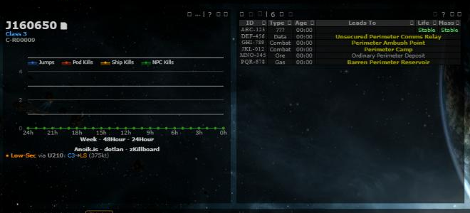
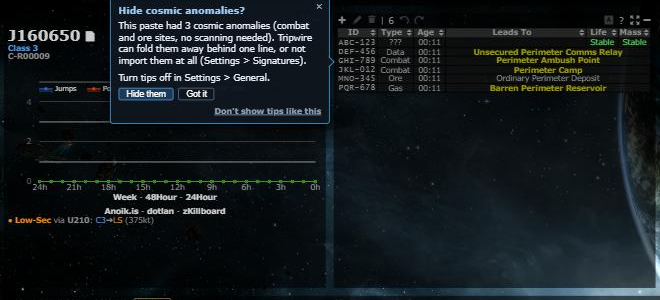

# Feature tips

**Date:** 2026-10-18

## Description

A tips engine (`forkHints`) that shows one short tip at a quiet moment, right where a feature helps, and never for a
feature the user already uses or turned off. It ships with two tips: "do it with Ctrl+K" after the 5th toolbar action done
with the mouse, and "Hide cosmic anomalies?" after a signature paste that had anomalies in it.

## Before / After

| Before | After |
| --- | --- |
|  |  |

## Settings

Toggle: Settings > General > Feature tips "Show feature tips" (on by default, `options.hints.enabled`, missing = on).
Each tip also has "Don't show tips like this", which turns off tips of that Settings section. Settings > Reset turns
tips back on and forgets every tip's history. Not a mask default (each user's own, like usage statistics).

## Tip

This is the tips engine itself. The two pilot tips are registered from their features' own files
(`command-palette.js`, `sig-anomalies.js`) as the pattern for later tips.

## Change

- `app/js/fork/hints.js` (`forkHints`): register / emit / show(id, {force}) / list / reset / debug. Caps: one pop-up tip
  a session, 30 minutes apart, 3 a week, one per Settings section a day, none in the first 2 minutes of a session or
  after What's New opened; beacons at most 3 on screen. Quiet moment: tab visible and focused, idle 5 s but active within
  2 minutes, no chain kill for 10 minutes, no paste for 30 s, no open dialog, focused field, drag, other pop-up or Fight
  here. Queued tips expire at their ttl. State in `options.hints` (7-day log), saved with `options.saveDelay`.
- `app/js/fork/hints-ui.js`, `app/css/fork/hints.css`: callout (follows its anchor, goes when it goes), toast, beacon;
  "Show me" / "Got it" / × / "Don't show tips like this"; Esc closes; never takes focus; polite live region; hides after
  20 s untouched ("ignored"); steps aside for other pop-ups and dialogs. No "idle" (empty-state line) kind yet.
- Core events: `session.start`, `idle`, `paste.sigs`, `system.viewed`, `dialog.close` (hints.js); `jump.done`
  (jump-return.js), `kill.chain` (kill-reporting.js and chain-killfeed.js, one kill counted once), `paste.dscan` (intel-scans.js), `panel.open` (panel-host.js),
  `maskAdmin.open` (mask-admin-tab.js), `mouse.action` (command-palette.js, Add/Edit signature, Follow).
- Usage statistics: `hints.tip_shown/acted/got_it/closed/ignored/section_off` (not `shown`, which is daily exposure), plus `<feature>.hint_shown` /
  `<feature>.hint_acted` for each tip's funnel (shown, then used, on the same feature). The catalog gets a `hints` entry,
  a top-level `generic` list (actions every feature may send, not use) and per-feature `events` (allowed, not use);
  `feature-usage.js` and `analytics/analytics.inc.php` read both.
- Docs: AGENTS.md section 2 "Does it need a tip?", the tripwire-feature skill and the PR template ask it.
- Upstream files touched: none.
