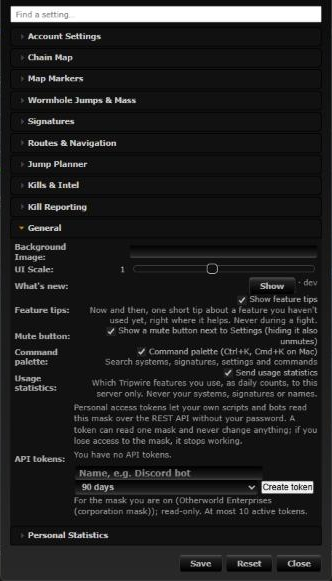
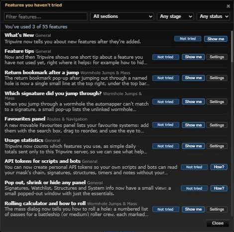

# Features you haven't tried

**Date:** 2026-10-18

## Description

A Features dialog lists every fork feature the user can use with a one-line description, whether they've used it
(Used / Not tried / Turned off), and "Show me" / "Settings" buttons. Features not tried yet come first, from the
sections the user already uses most. It is the place to find everything again, so tips and What's New don't have to
re-teach.

## Before / After

| Before | After |
| --- | --- |
|  |  |

Before: Settings > General with no Features row. After: the Features dialog.

## Settings

No toggle: the dialog only opens when the user asks for it (pull, never pushed), so there is nothing to turn off.

## Tip

No tip: the Getting started card ("See all features") and the What's New footer link to it, Ctrl+K finds it
("features", "help", "discover") and it sits next to What's new in Settings > General.

## Change

- `app/js/fork/features-hub.js`, `app/css/fork/features-hub.css` (new): the dialog. Rows come from
  `public/fork/feature-catalog.json`; mask admin features only when the Mask Admin link is shown, operator features
  only when the usage analytics command is registered. Description: first sentence of the feature's newest What's New
  entry (plain text, escaped). Sort: not tried, then used, then turned off; within each, sections with the most used
  features first, then stage (first, core, intermediate, admin), then catalog order. Filters: section, stage, status and
  text (status and text reset on each open). "Show me" closes the dialog (Settings stays open if it sits on it, so
  unsaved changes aren't lost) and runs `forkFeatureActions.tryIt` (tip, try command, panel, Settings row, or a short
  toast: the button says "How?" when only the toast is left); "Settings" opens the feature's Settings row.
- Entry points: Ctrl+K `features.open`, a Settings > General row (`forkSettings.register`), a link in the What's New
  dialog's footer (added on its `dialogopen` event; whats-new.js unchanged) and a "See all features" link in the
  Getting started card (`getting-started.js`, one line).
- Try it / Show me no longer counts as use of the feature it shows: `forkFeatureActions.tryIt` marks the feature as
  being tried while it runs (a command until its result is in, at most 3 s) and `forkUsage.track` skips that feature's
  use actions meanwhile (`feature-usage.js`); panel restores by Try it don't count as `panelModes.mode`. The user's own
  later use counts as before. This also fixes What's New's Try it.
- `app/js/fork/feature-actions.js`: `features.open` and `app.whatsNew` added to the Try it allow-list (`TRY_SAFE`);
  catalog `try` for `featuresHub` and `whatsNew`.
- Catalog: `featuresHub` (use: `opened`, `tried`; event: `settings`; command `features.open`, which counts as
  `featuresHub.command` from Ctrl+K instead of also `opened`).
- Tests: `app/js-test/fork/features-hub.test.js` (audience, description, sort, filter, summary, markup), plus Try it
  tests in `feature-actions.test.js` / `feature-usage.test.js` and the card link in `getting-started.test.js`.
- No upstream files touched.
