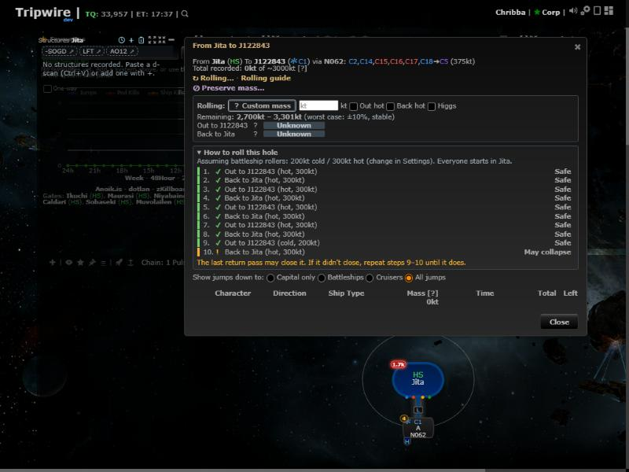
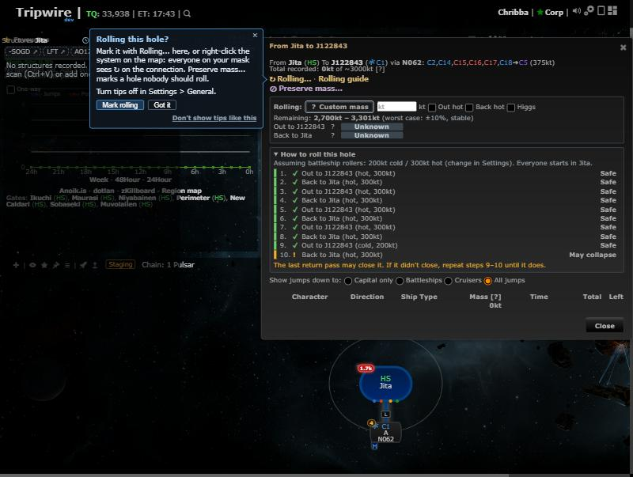

# More feature tips

**Date:** 2026-10-18

## Description

Twelve more tips for features that are easy to miss (right-click only, in Mask Admin, or only useful at a certain
moment), each registered from its feature's own file and shown by the feature tips engine at a quiet moment. The engine
gets tips inside dialogs, a `dialog.open` and a `chain.exit` event, and counts `minCount` on eligible triggers only.

## Before / After

| Before | After |
| --- | --- |
|  |  |

More: [Edit life and mass in place (toast)](tip-sig-inline.jpg), [Mass after a jump (callout on the chain node)](tip-mass-after-jump.jpg)

## Tips

| Tip id | Feature | Kind | Trigger, and when | Anchor | "Show me" |
| --- | --- | --- | --- | --- | --- |
| `sigInline.dialog` | Edit life and mass in place | toast | `dialog.close` of Edit signature after a life or mass change in it was saved (not after Cancel / Esc) | none | opens the Mass popover on that row |
| `intelScans.paste` | D-scan and local scans | toast | `paste.dscan` (paste anywhere); shows once the paste box is closed without Share (Share = use = no tip) | none | restores the Intel panel if minimized, scrolls to and outlines it |
| `rollingCalc.jump` | Rolling calculator | callout | `jump.done` through a mapped hole | the chain node the hole leads into | opens that hole's Mass dialog |
| `rolling.massDialog` | Rolling (also covers Preserve mass) | callout in the dialog | `dialog.open` of the Mass dialog, rolling and preserve mass never used | "Rolling..." link | opens the Mark rolling dialog |
| `regionMap.infoLink` | Region map | beacon | `system.viewed`, 3rd k-space system | system panel "Region map" link | opens the region map |
| `stagingScan.nullsec` | Staging scan | beacon | `system.viewed` of a null-sec system | the scan's header | (none: the panel is the feature) |
| `jumpPlanner.exit` | Jump planner | beacon | `chain.exit` (a low-sec / null-sec exit got its range ring; the exits at page load or a mask switch don't count) | that ring | opens the planner on that exit |
| `chainKillFeed.afterKill` | Chain kill feed | beacon | `kill.chain`, shown after 10 quiet minutes (ttl 1 h) | the panel's header, else the Panels menu icon | restores and outlines the panel |
| `panelModes.crowded` | Pop out, shrink or hide panels | beacon | `idle` tick, 5+ panels on screen, session 10+ minutes old | Signatures panel's Pop out button | opens the Panels menu |
| `discordNotifications.maskAdmin` | Discord notifications | callout in Mask Admin | `maskAdmin.open`, mask admin, the mask has no Discord channel at all (rally.php's new `discordChannels`; no tip before its first answer) | Discord menu entry | opens the Discord page |
| `watchlist.maskAdmin` | Watchlist | callout in Mask Admin | `maskAdmin.open`, can edit, mask has no filters (already polled) | Watchlist menu entry | opens the Watchlist page |
| `bookmarkTemplate.maskAdmin` | Bookmark names | callout in Mask Admin | `maskAdmin.open`, can edit, built-in names (already loaded) | Bookmarks menu entry | opens the Bookmarks page |

Priorities: core loop 55-60, intermediate 30-45, Mask Admin 20-22 (Discord, then Watchlist, then Bookmarks; one pop-up
tip a session, so at most one per Mask Admin open). Each retires when its feature is used or its Settings toggle is off.
Changed from the spec: the "Fitted jump mass" tip (`autoMass`) was replaced by `rollingCalc.jump` (the Mass dialog after a jump), because auto-mass logs every tracked jump through a
mapped hole by itself (that counts as use) and pops its own hot/cold prompt, so a tip on `jump.done` would only reach
users it can't work for; the d-scan tip is a toast because the Intel panel is often below the fold; the Panels tip is a
beacon (the button is the feature, a full layout has no empty corner for an "idle" line, so no new kind was built).

## Settings

No new toggle: covered by Settings > General > "Show feature tips" and each tip's "Don't show tips like this" (the
Mask Admin tips share the `maskAdmin` group). A tip also retires when its feature's own toggle is off.

## Tip

This entry is the tips themselves (one per feature; Rolling's covers Preserve mass too).

## Change

- Tips registered in `sig-inline.js`, `intel-scans.js`, `rolling-calculator.js`, `rolling.js`, `region-map-view.js`,
  `staging-scan.js`, `jump-planner.js`, `chain-killfeed.js`, `panel-modes.js`, `discord-notifications.js`,
  `watchlist.js`, `bookmark-template.js`, with small pure helpers (`sigInline.tipEligible`, `rollingCalc.jumpHole`,
  `jumpPlanner.newExits`, `panelModes.crowded`, `watchlist.tipNoFilters`, `bookmarkTemplate.isDefault`).
- Engine (`hints.js`, `hints-ui.js`, `hints.css`): `dialog` option (that dialog being open doesn't block or hide the
  tip), `dialog.open` core event, `chain.exit` event (from `jump-planner.js`), `minCount` counts eligible triggers only,
  beacons stay inside the window, `forkHintsUI.flash(el)` for "Show me" on something already on screen.
- Usage: opening a hole's Mass dialog with the rolling guidance on tracks `rollingCalc.opened` (the catalog entry becomes
  `active` with `use: ["opened"]`), so `rollingCalc.jump` retires once someone uses the Mass dialog.
- `public/rally.php` / `rally_discord.inc.php` (fork-owned): the answer also says `discordChannels` (one indexed
  `discord_webhooks` lookup); `rally.js` keeps it in `rally.discordChannels`. The tips wait for the auto-mass hot/cold
  prompt (`.automass-notice`), not a Settings checkbox id as before.
- Tests: `app/js-test/fork/feature-tips-content.test.js` (every registered tip names a catalog feature, a known kind /
  audience / placement / trigger, a unique id and says how to turn tips off; the pure predicates) and engine cases in
  `hints.test.js`. AGENTS.md: `dialog` and new trigger events in "does it need a tip?".
- Upstream files touched: none.
