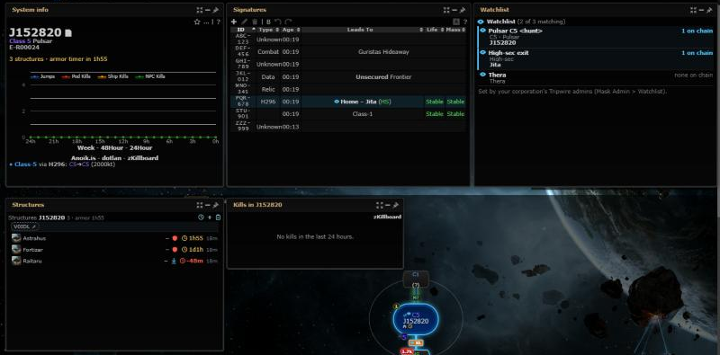
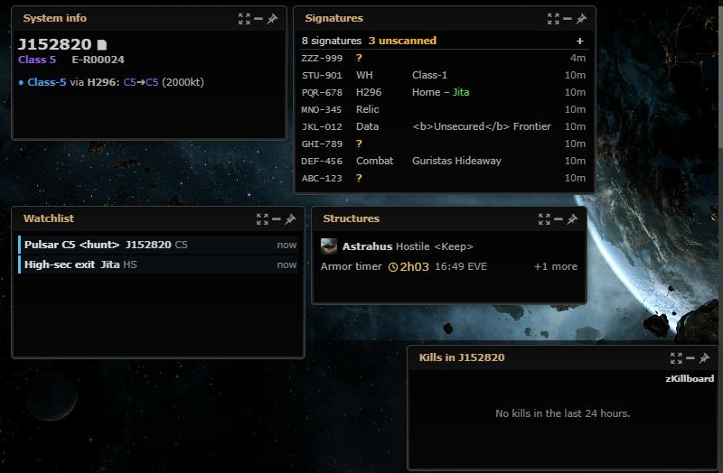

# Small views for Signatures, Watchlist, Structures and System info

**Date:** 2026-10-18

## Description

The small view (a small popped-out window, until now only for the kill panels) now also exists for Signatures
(unscanned count and the newest signatures), Watchlist (only the current hits), Structures (the next timer) and
System info (name, class and statics), so these panels can stay on screen without taking much room.

## Before / After

| Before | After |
| --- | --- |
|  |  |

Before: the four panels popped out at their normal size, System kills in its small view. After: the four new small views
(System kills' unchanged).

## Settings

No toggle: part of the panel display modes, which have none (the user's choice for #117); nobody sees a small view unless
they pick it.

## Change

- **Signatures**: "8 signatures  3 unscanned" (amber when there are unscanned ones) with the add (+) button, then the
  newest signatures first (by creation time, ties: the later added), one row each: ID, type, name / where a wormhole
  leads, age. Only the signatures the table draws (a wormhole needs its wormhole and its other end, as upstream). A
  click on a row opens its edit dialog (as a double-click on the table row does).
  **Unscanned** = a signature whose group nobody has identified yet: type `unknown` or no type (what a scanner still has
  to scan down). Wormholes and sites count as scanned, whatever else is missing. Anomalies hidden by Settings >
  Signatures > Anomalies are left out (as in the list); "Colour signatures by age" tints the age.
- **Watchlist**: one row per current **hit** = a watchlist filter that matches a system on the chain map now (the same
  matches that mark the map and give the pop-up): filter, system and class, and how long it has been on the map (since
  it was first seen in this browser session; kept while its system is off the map for up to 30 minutes, as for the
  pop-ups), newest first, scrolling when there are more than fit. "No hits" when nothing matches.
- **Structures**: the soonest timer still to come in the viewed system (structure, owner, timer kind, countdown that ticks
  every second while shown and the tab is visible, redrawn only when it changes; end in EVE time, with the date when
  it is another EVE day) and "+N more"; ended timers are ignored. "No timers" otherwise.
- **System info**: CSS only: name (with its copy link), class / security, region and the statics; the activity graph,
  links, effect, favourites, gates and the other lines are hidden. The graph is moved out of sight (not `display: none`),
  so it still draws its labels when the panel goes back to normal or docked.
- Panel modes: a panel def can carry `smallHint` (the small view button tooltip, the Panels menu and the command palette
  say what it shows; the kill panels keep their wording) and `smallSize` (each small window opens at a size that fits).
- Every block is redrawn from the panel's own refresh points (signature table redraw, watchlist matching, structures
  poll and renders) and when the panel moves; no new requests or endpoints.
- Fork files: `app/js/fork/panel-small-views.js` + `app/css/fork/panel-small-views.css` (new), `panel-modes.js`,
  `panel-host.js` (doc), `watchlist.js` / `.css`, `structures.js` / `.css`, tests. No upstream files touched.
