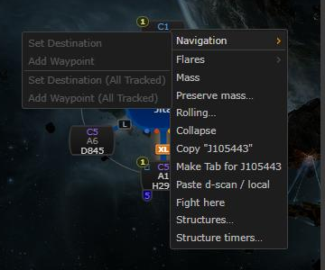
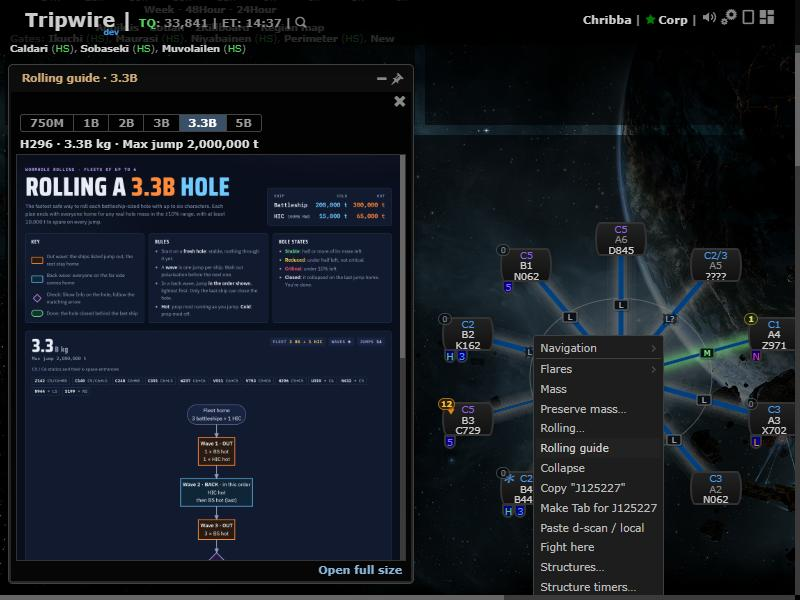

# Hole rolling guide

**Date:** 2026-10-18

## Description

Right-click a wormhole on the chain map and pick **Rolling guide** to see the fleet rolling flowchart for that hole's
size (750M, 1B, 2B, 3B, 3.3B, 5B): which battleships and HICs jump out and back in each wave, and what to do for each
hole state, so the hole closes with everyone home. It opens as a popped-out panel; like every panel it can be docked or
minimized.

## Before / After

| Before | After |
| --- | --- |
|  |  |

`rolling-guide.png`: What's New image candidate (the popped-out guide for an H296).

## Settings

No toggle: the guide only appears when you ask for it (the menu entry, the mass dialog link, the palette command) and
does nothing on its own; docking, popping out and minimizing come from the panel modes every panel has.

## Change

- New panel `rollingGuideWidget` (`app/js/fork/rolling-guide.js`, `app/css/fork/rolling-guide.css`), registered with
  the panel host and `defaultMode: "floating"`: size buttons, a caption naming the hole ("H296 · 3.3B kg · Max jump
  2,000,000 t"), the flowchart scaled to the panel's width (scrolls down; click it or "Open full size" for the PNG in a
  new tab). Its close icon or Escape closes it.
- The size comes from the hole's type (`appData.wormholes[type]`: total mass, and max jump at least 300,000 t so a hot
  battleship fits). K162 / unknown type: "Pick the hole's size". Too small for battleships: says so, with the buttons.
- Opened from: chain map context menu (after "Rolling…"), a "Rolling guide" link next to "Rolling…" in the mass dialog,
  and the palette command "Rolling guide" (last size). Opening it from another hole switches the image and brings the
  window to the front.
- `options.rollingGuide = {open, size}`: an open guide opens again after a reload, on the last size.
- Images: `public/images/rolling-guide/{750m,1b,2b,3b,3-3b,5b}.png` (one per size, with key, rules and ship masses)
  and `poster.png` (all sizes). They were made once, offline, by the scripts in `tools/rolling-guide/` (solver,
  checker, Mermaid flowcharts rendered in headless Chrome; see its README). Mermaid's CDN and Google Fonts are only
  used by those offline build scripts; Tripwire itself loads nothing from third-party hosts for this feature.
- Fork file touched: `app/js/fork/rolling.js` (the mass dialog's rolling line also renders the guide link, 3 lines).
  No upstream files touched.
- Tests: `app/js-test/fork/rolling-guide.test.js` (size per hole type, K162 / unknown / too small, captions,
  formatting, settings, panel HTML and escaping).
