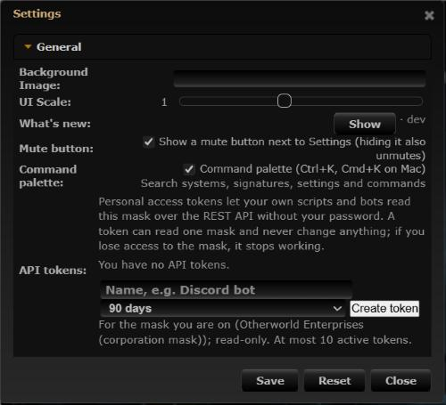
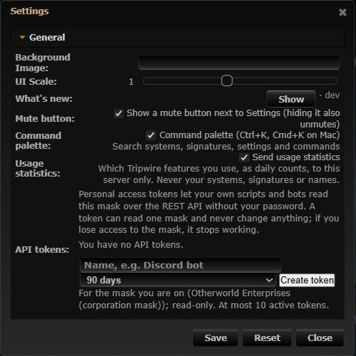

# Usage statistics (first-party feature analytics)

**Date:** 2026-10-18

## Description

Tripwire now counts which fork features are used, so we can see what people use, what they never find and what they
turn off. It is **first-party analytics**: counters go from the browser to this server's own `fork_events.php` and into
MySQL; **no third-party host, script or pixel** is involved. Users can turn it off in Settings > General. A feature
catalog (`public/fork/feature-catalog.json`, 51 features) lists every fork feature once and is the backbone of the
coming feature tips and features hub.

## Before / After

| Before | After |
| --- | --- |
|  |  |

## Settings

Toggle: Settings > General > Usage statistics, "Send usage statistics" (on by default, `options.usageStats.enabled`,
missing = on). Not in the mask-defaults allow-list: sending statistics is each user's own privacy choice, not a mask
setting. The local "used" state (`options.usage`, for not re-teaching features later) is kept either way and never sent.

## Change

- **What is collected.** Per UTC day: an 8-byte pseudonymous user id (HMAC-SHA256 of the account id with a random salt),
  a feature id from the catalog, an action from a fixed list (`command`, `opened`, `shown`, `disabled`, `setting_on`,
  `setting_off`, `setting_changed`, the feature's own `use` words, `app.active`) and a count; first/last time per user
  and feature; and a pseudonymous mask hash per day and used feature, only to count masks using it.
- **What is not collected.** Account, character, corporation or mask ids and names, systems, signatures, wormholes,
  IP addresses, user agents, URLs or any typed text.
- **Retention.** `ANALYTICS_DAYS` (default 90); the salt is replaced every `ANALYTICS_DAYS` and the old one deleted, so
  older rows can't be tied to anyone. Hourly prune `analytics_prune.cron.php` (`DELETE ... LIMIT 5000`). Single events
  (`fork_analytics_raw`) only when `ANALYTICS_RAW_DAYS` > 0 (default 0). About 60 MB at 200 users.
- **Client** `app/js/fork/feature-usage.js` (`forkUsage.track/used/on/debug`): counts palette commands, panels opened by
  the user or switched to another mode, Settings Save changes, `data-track` clicks, on-screen exposure once a day, a daily
  snapshot of features turned off and real activity (polling never counts). Sent every 60 s with `fetch(keepalive)` and
  with `sendBeacon` when the tab is hidden, at most 50 counters / 8 KB, with a per-session token. Hooks wrap fork globals
  (`forkCommands.execute`, `panelHost.addGridWidget`, `panelModes.setMode`, `forkSettings.saveAll`,
  `commandPalette.open`, `whatsNew.open`) at start-up; no other file changes.
- **Server** `public/fork_events.php` + `analytics/analytics.inc.php`: login, session token, Origin / Sec-Fetch-Site
  check, catalog whitelist, server UTC day, clamped counts, always 204, never throws. Tables `fork_analytics_daily`,
  `_user`, `_mask`, `_meta` (`_raw` optional) created on first use; reference DDL `docker/sql/analytics.sql`.
- **Config** `ANALYTICS_ENABLED` (true), `ANALYTICS_DAYS` (90), `ANALYTICS_RAW_DAYS` (0), `ANALYTICS_ADMINS` (empty, for the
  dashboard in a later PR) in `docker/config.php`, `.env.example`, both compose files and `docker/README.md`
  (new "Product analytics" section).
- **Workflow.** AGENTS.md section 2, the `tripwire-feature` skill (new section 6 "Analytics check"; later sections
  renumbered) and the PR template: every user-facing feature adds its catalog entry and a success signal, and checks its
  events with `forkUsage.debug(true)`.
- Tests: `app/js-test/fork/feature-catalog.test.js`, `app/js-test/fork/feature-usage.test.js`, `tests/analytics_test.php`;
  `mask-defaults-allow.test.js` leaves `usageStats` out of the allow-list on purpose.
- Upstream files touched: none.
