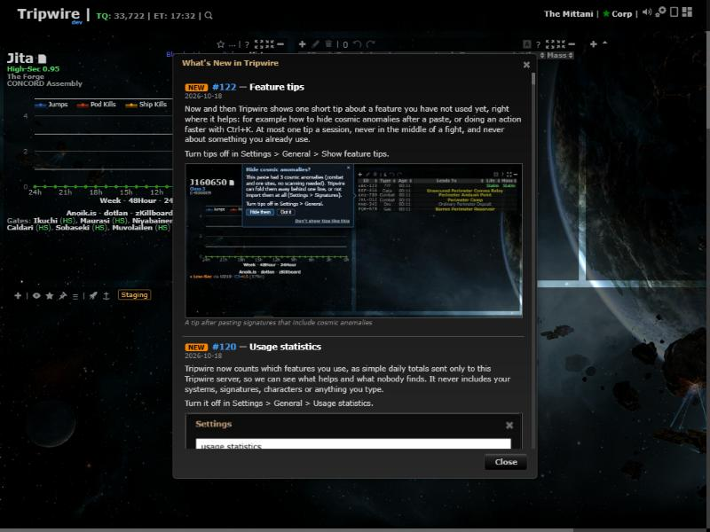
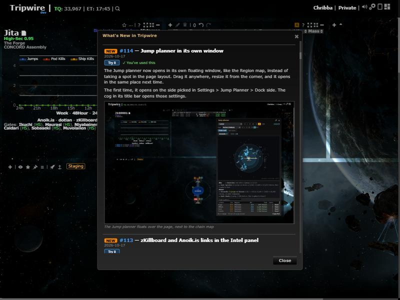
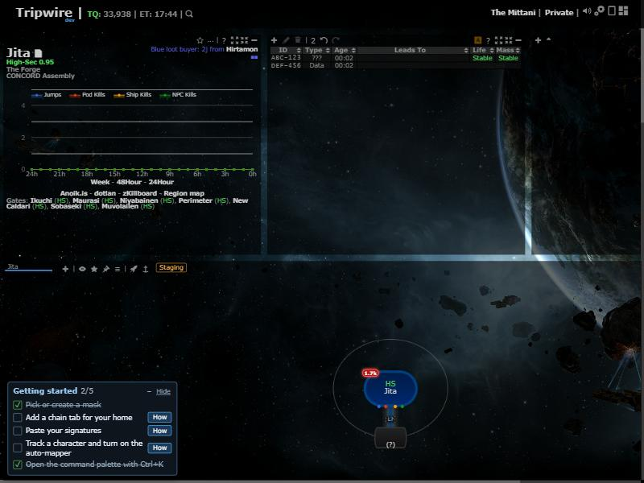

# What's New first run + Getting started

**Date:** 2026-10-18

## Description

A brand-new account no longer opens on What's New with ~90 entries all flagged NEW: it marks them seen silently and
shows a small Getting started card with five first steps that tick themselves off. Every What's New entry gets a
"Try it" button (shows the feature: its tip, its window or panel, or its Settings row), a "You've used this" tick, or
"Turned off" with a "Turn it on" button.

## Before / After

| Before (new account) | After (Try it / used tick) |
| --- | --- |
|  |  |

Getting started card (new accounts only):

## Settings

- What's New first run: no toggle, it is a fix (a new account was shown every feature ever announced).
- Try it / used tick: no toggle, a pure improvement of the What's New list.
- Getting started: no Settings toggle. It has its own "Hide" (for good, `options.gettingStarted.hidden`), folds to one
  line, and never shows to accounts 14 days or older.
- Tip: none needed. Getting started is on screen by itself for exactly the users it is for; while it shows the Ctrl+K
  step, the Ctrl+K tip is held back (`forkHints.hold`) so the two don't teach the same thing twice.

## Change

- `app/js/fork/feature-actions.js` (new, `forkFeatureActions`): catalog lookups (`byId`, `byPR`), `status(id)`
  (used / off / new) and `tryIt(id)`: a registered tip (forced) -> the feature's catalog `try` command (a command with
  arguments opens in the palette so the user picks) -> its panel -> its Settings row -> a toast with the first paragraph
  of its newest What's New entry. Only `try` commands ever run, and `try` is an allow-list (`TRY_SAFE`: panel toggles and
  commands that open a window or map; the catalog test checks it), so Try it can never lead to a write for the whole
  mask (Fight here, Mark rolling, Preserve mass, targets...). For What's New now and the features hub later.
- `app/js/whats-new.js` (fork file): first-run decision (`firstRun`: new account = no What's New state, or state the
  server didn't send, and `accountAgeDays` < 14; server failure or older account = today's behaviour), Try it / ✓ /
  Turned off per entry, opening What's New counts `wn_listed` (catalog `generic`, once a day, not use and not the
  on-screen `shown`) for the features of its NEW entries, `whatsNew.tried` on Try it.
- `app/js/fork/getting-started.js` + `app/css/fork/getting-started.css` (new): the card, bottom left. Steps: a mask
  other than the corp mask (or a choice saved in Masks), a chain tab with a home system, a signature paste (feature
  tips' `paste.sigs`), a tracked character with the auto-mapper on, Ctrl+K used. Each has a "How" button.
- `public/fork_events.php`, `analytics/analytics.inc.php`: `mode=get` also returns `accountAgeDays` (whole days since
  `accounts.created`, capped at 14; nothing stored). `app/js/fork/feature-usage.js`: `forkUsage.serverInfo` (promise of
  that answer). `app/js/fork/hints.js`: `forkHints.hold(feature, by)` and `forkHints.listen(fn)`.
- Catalog: new feature `gettingStarted` (use `how`; events `done_<step>`, `all_done`, `collapsed`, `expanded`,
  `hidden`; exposed `#gettingStarted`), `whatsNew` event `tried`, generic action `wn_listed`, optional per-feature
  `try` (12 features).
- Tests: `app/js-test/fork/feature-actions.test.js`, `getting-started.test.js`, more in `whatsNew.test.js` and
  `hints.test.js`; `tests/analytics_test.php` checks the account age.
- No upstream files touched. No new third-party hosts.
- Shared browsers: Tripwire (upstream) keeps a copy of the options in the browser (`localStorage.tripwire_options`) and
  uses it when the server has none. A new account whose server options are empty ignores the What's New and Getting
  started state in that copy. Remaining limit: it still inherits the other keys (chain tabs, mask, `usage`...), so some
  Getting started steps can start ticked.
