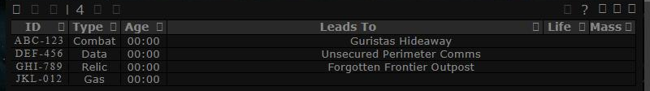
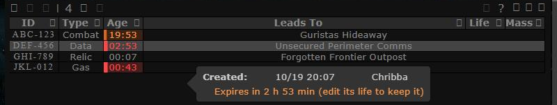
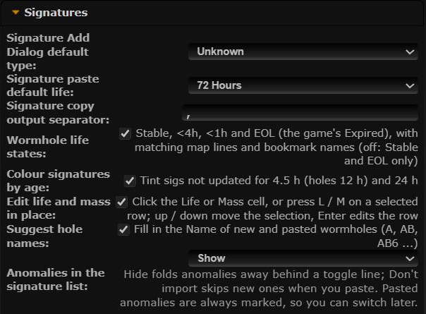
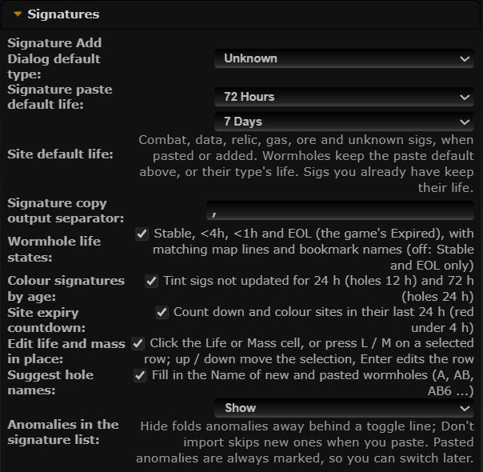

# Site expiry

**Date:** 2026-10-19

## Description

Sites (combat, data, relic, gas, ore and unknown sigs) last days in the game, but Tripwire gave them the 72 h paste
life and then deleted them without warning. New sites now get a 7-day life by default, and a site in its last 24 h
counts down in its Age cell (orange), turning red in its last 4 h, like an EOL hole.

## Before / After

| Before | After |
| --- | --- |
|  |  |
|  |  |

Same four sites (lives of 20 h, 3 h, 72 h and 50 min) before and after: the combat site counts down in orange, the data
and gas sites in red, the relic site still counts its age up. The tooltip shows the new "Expires in ..." line.

## Settings

- **Site default life** (Settings > Signatures, right below "Signature paste default life"): 72 h / 7 days (default) /
  14 days / 28 days, stored as `options.sigExpiry.siteLife` (hours). Applies to sigs pasted or added afterwards;
  existing sigs keep their life.
- **Site expiry countdown** (Settings > Signatures, after "Colour signatures by age"), toggle: yes, on by default,
  stored as `options.sigExpiry.enabled` (missing = on). Applied on Save.
- Both rows share `options.sigExpiry`; each keeps the other's field. Reset deletes the key (= the defaults). Mask
  admins can set `sigExpiry` as a mask default like the other Settings keys.

Tip: no tip, because it is visible: the countdown shows in the signature list and both rows are in Settings.

## Change

- **Life defaults.** `sigExpiry.defaultLifeSeconds(type, options)`: the site life for any non-wormhole type, unknown
  included; the paste default (`options.signatures.pasteLife`) for wormholes. Used by paste (new and updated
  non-wormhole sigs) and by the Add dialog when it opens (for the "Add Dialog default type"). In the Add dialog,
  switching the type between a site and Wormhole swaps the life to the new kind's default, but only while it still
  holds the other kind's default (a typed life, or a wormhole type's life, stays). Edit mode never touches the life.
- **Site turned hole.** When a paste turns a site/unknown sig into a wormhole, it now sends a lifeLength so the hole
  gets the paste default counted from now (`sigExpiry.holeLifeSeconds`). Without it the hole would keep the site's
  7-day life; with plain `pasteLife` a sig first seen days ago would come out already expired (life runs from
  `lifeTime`, when the sig was first seen) and be deleted by the server within a minute.
- **Countdown and colour.** A site with a life (lifeLength > 0) and 24 h or less left switches its Age span from
  upstream's count-up to a countdown to `lifeLeft` (jQuery countdown with the server clock, as upstream does for EOL
  holes), orange tint and left bar; 4 h or less (or past its end): red (#FF4747) tint and bar. The Age tooltip gets
  "Expires in 3 h 20 min (edit its life to keep it)". Re-applied every minute and whenever the table's rows change;
  rows rebuilt by an edit are re-decorated, and a site whose life is extended or with the feature off gets its
  count-up back.
- **sig-age.** A site counting down is not also tinted for age (expiry wins). Its thresholds for sites change from
  aging 4.5 h / stale 24 h to **aging 24 h / stale 72 h**, as sites now last days (holes unchanged: 12 h / 24 h). The
  Age tooltip lines of both features are composed by `sigAge.setNote` so neither erases the other's line.
- New files: `app/js/fork/sig-expiry.js` (pure logic in `sigExpiry`, tested in `app/js-test/fork/sig-expiry.test.js`),
  `app/css/fork/sig-expiry.css`. Fork files changed: `app/js/fork/sig-age.js` (+ its test),
  `app/js/fork/mask-defaults.js` and `maskadmin/maskadmin.inc.php` (allow `sigExpiry` as a mask default),
  `docs/eve-wormhole-primer.md`.
- Upstream files touched (guarded `typeof sigExpiry !== "undefined"`, falling back to upstream's value):
  - `app/js/tripwire/paste.js`: the lifeLength of the non-wormhole add and update payloads, and a lifeLength on both
    signatures of the "site becomes a wormhole" update (4 lines).
  - `app/js/dialogs/signature-dialog.js`: the default life when the dialog opens (1 line).
