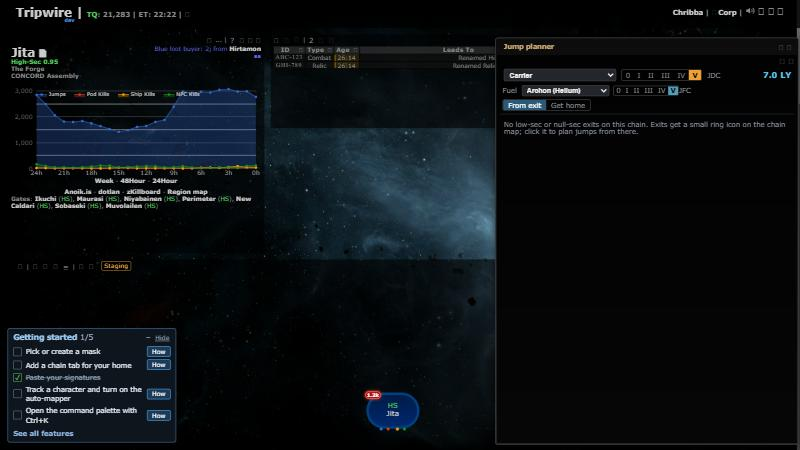

# App security fixes

**Date:** 2026-10-21

## Description

Fixes from the 2026-10-20 security review: account and mask changes can no longer be triggered from another
site (CSRF), the `system` URL parameter and tracked pilot/ship names can no longer inject script (XSS), corp admin
rights only go to the character that is logged in, and the PHP session cookie and login are hardened.

## Settings

No toggle, because these are security fixes with no visible change for users.

No tip, because nothing new for users to find.

## Change

- **CSRF** (new `csrf.inc.php`, `app/js/fork/csrf.js`): one token per logged-in session, printed by `tripwire.php`
  in `<meta name="csrf-token">` and sent by a jQuery prefilter as `X-CSRF-Token` on same-origin non-GET requests.
  `public/options.php` (options, password, username) and `public/masks.php` (create, save, delete, join, leave)
  answer 403 without a POST carrying it (password change over GET used to work, so a link could take over an account).
  A tab opened before the deploy needs one reload.
- **Reflected XSS**: `tripwire.php` escapes `?system=` before printing it; `landing.php` URL-encodes it in the SSO
  link; `public/login.php` URL-encodes it in the post-SSO redirect.
- **Stored XSS**: `public/refresh.php` only stores tracking for the account's own ESI characters, under their ESI
  name, and drops `< > "` from system, station and ship names; the occupants tooltip (`app/js/global-hooks.js`)
  the Mass dialog (`app/js/dialogs/mass-dialog.js`) and the admin dialog's tables (`app/js/dialogs/admin-dialog.js`) escape pilot and ship names.
- **Corp admin**: `public/register.php` only sets the session's admin flag when the director character that
  signed in through SSO is the logged-in character (the DB flag for that character is set as before).
- **Session**: `public/login.php` regenerates the session ID on login; new `docker/php-security.ini` (copied by
  `docker/Dockerfile`) sets `HttpOnly`, `Secure` (`SESSION_COOKIE_SECURE=0` turns it off; the dev stack does in
  `docker/php-dev.ini`), `SameSite=Lax`, strict mode and `expose_php=0`.
- **Note sanitiser**: `note-html.inc.php` and `app/js/fork/sanitise-html.js` check `href`/`src` without control
  characters and spaces, so a tab or newline inside `.php` or `javascript:` no longer slips past.
- Tests: `tests/csrf_test.php`, `app/js-test/fork/csrf.test.js`, new cases in
  `app/js-test/testdata/note-html-cases.json` (run by both sanitiser tests).

Upstream files touched (small, marked `// fork`): `tripwire.php`, `landing.php`, `public/options.php`,
`public/masks.php`, `public/login.php`, `public/register.php`, `public/refresh.php`, `app/js/global-hooks.js`,
`app/js/dialogs/mass-dialog.js`, `app/js/dialogs/admin-dialog.js`.

Dev stack after the change (logged in, map loads; forged GET/POSTs to options.php and masks.php get 403):

