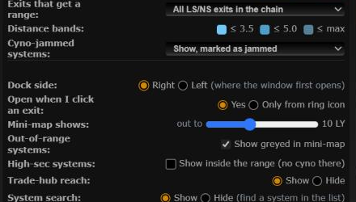
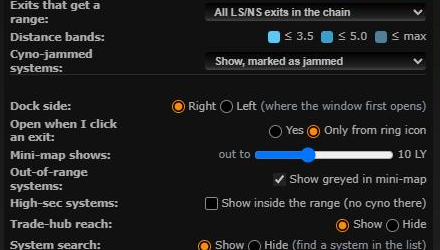
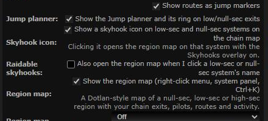

# Name click opens nothing by default

**Date:** 2026-10-23

## Description

Clicking a low-sec or null-sec system's name on the chain map used to open the Jump planner (on by default) and, for
users who had turned it on, the region map with Skyhooks. That got in the way of just viewing the system. Both are now
off by default for everyone, so a name click only views the system; the panels open from their own buttons.

## Before / After

| Before | After |
| --- | --- |
|  |  |

Settings > Routes & Navigation after (unchecked by default):

## Settings

Kept as opt-in toggles, now off by default: Settings > Jump Planner > "Open when I click an exit" and Settings > Routes &
Navigation > "Raidable skyhooks: also open the region map when I click a low-sec or null-sec system's name". The Jump
planner still opens from the exit's ring icon (or Ctrl+K), the region map from the skyhook icon, right-click > Region map,
the system panel's "Region map" link or Ctrl+K.

## Tip

No new tip: the ring and skyhook icons are visible buttons, and the existing ring and region map tips already point at them.

## Change

- The setting is stored under a new key, `nameClick`, in `options.jumpRange` and `options.skyhooksPanel` (missing = off).
  The old `clickOpen` key is ignored: the Jump planner's Settings Save wrote `clickOpen: true` for anyone who saved
  Settings with the old default, so keeping the old key would have left it on for most users.
- `app/js/fork/jump-planner.js`, `app/js/fork/skyhooks-panel.js`, tests. No upstream files touched.
