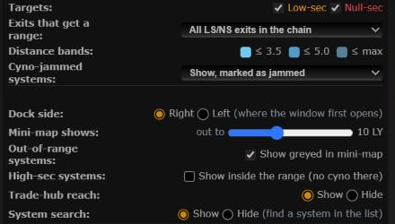

# Jump planner and region map open only from their buttons

**Date:** 2026-10-23

## Description

Clicking a low-sec or null-sec system's name on the chain map used to open the Jump planner (on by default) and, for
users who had turned it on, the region map with Skyhooks. That got in the way of just viewing the system, so a name
click now only views it; the panels open from their own buttons.

## Before / After

| Before | After |
| --- | --- |
|  |  |

Settings > Jump Planner loses "Open when I click an exit"; Settings > Routes & Navigation loses "Raidable skyhooks: also
open the region map when I click a low-sec or null-sec system's name".

## Settings

No toggle: this removes two opt-out toggles. The Jump planner opens from the exit's ring icon (or Ctrl+K), the region map
from the skyhook icon, right-click > Region map, the system panel's "Region map" link or Ctrl+K.

## Tip

No new tip: the ring and skyhook icons are visible buttons, and the existing ring and region map tips already point at them.

## Change

- `app/js/fork/jump-planner.js`: the name-click handler and the `clickOpen` setting (and its Settings row) are gone.
- `app/js/fork/skyhooks-panel.js`: the name-click handler and the `clickOpen` setting (and its Settings row) are gone.
  A `clickOpen` key already saved in `options.jumpRange` / `options.skyhooksPanel` is ignored.
- Tests updated. No upstream files touched.
