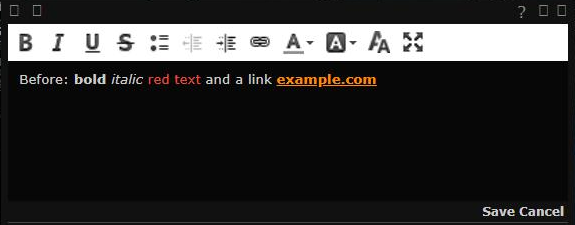
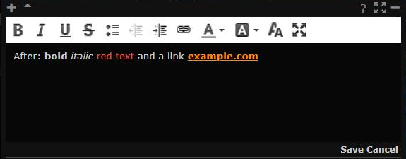

# CKEditor 4.22.1

**Date:** 2026-10-24

## Description

The comment editor's vendored CKEditor goes from 4.4.6 (2014) to 4.22.1, the last open-source CKEditor 4, to get rid of
its known XSS and ReDoS advisories (retire.js: 12 before, 0 after). The editor looks and behaves as before.

## Before / After

| Before | After |
| --- | --- |
|  |  |

## Settings

No toggle, because this is a security upgrade with no new behaviour. No feature tip either.

## Change

- `public/ckeditor/` is now the official 4.22.1 release (npm `ckeditor4@4.22.1`), trimmed to the old build's plugin set
  (listed in `public/ckeditor/config.js`) and English only. The builder (`build-config.js`) and the skin's `dev/` folder
  are gone.
- `tools/ckeditor/update.sh` (with `port-skin.js`) rebuilds the folder from a release: it copies the files, keeps the
  plugin folders we load, rebuilds `skins/custom` from the release's moono skin with our edits (white toolbar, dark
  translucent editing area, font/size drop-downs as icons), restyles `contents.css` and re-applies the autogrow patch
  (don't grow when opening maximized). It checks the GitHub source tarball against a pinned sha256 and stops if a
  plugin in `config.js` (or one it requires) is neither in `ckeditor.js` nor shipped in `plugins/`.
- `config.js` keeps 4.4.6's behaviour where 4.22 changed defaults: the old 40-colour palette (8 per row, no "used
  colours" rows), pasted formatting kept in Chrome/Safari (`pasteFilter: null`; notes are still sanitised on save), and
  no pasting of image files (they'd become `data:` images that the sanitiser drops on save).
- `config.js` sets `versionCheck: false`: 4.22 would otherwise call cdn.ckeditor.com and show an "insecure version"
  notice. It also fixes the language to English, since only `en` is shipped.
- `autolink` and `toolbarswitch` stay the third-party plugins we had. The old autolink also links bare `www.` addresses,
  which the core 4.22 autolink doesn't.
- Advisories fixed only in the commercial 4.24/4.25 LTS releases:
  - CVE-2024-24815 (CDATA detection, ACF bypass) applies, because our `allowedContent: true` lets `<script>`/`<style>`
    into the editor. It can only be triggered by content put into your own editor (for example by pasting): saved notes
    go through `note-html.inc.php`, which drops `script`/`style`.
  - CVE-2024-43411 (version notifications) doesn't apply: `versionCheck` is off.
  - CVE-2024-24816 and CVE-2023-4771 (samples) and CVE-2024-43407 (Code Snippet GeSHi) don't apply: we don't ship
    samples or that plugin.
- No upstream files touched outside the vendored `public/ckeditor/` folder.
