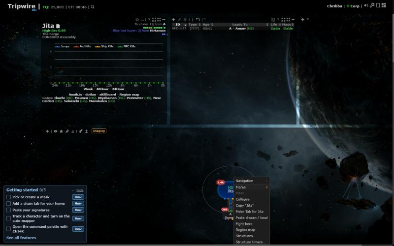
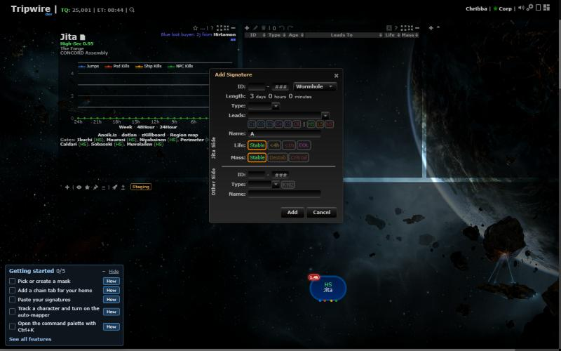

# Dependency security update

**Date:** 2026-10-24

## Description

Full dependency review. Fixes every known vulnerability in the build tooling (npm audit: 52 → 0), the Docker image
(Trivy: 3 HIGH in nginx → 0) and the browser libraries the app page loads (jQuery, jQuery UI, lodash, moment).
CKEditor 4.4.6 (comments) and the landing page's jQuery 1.7.1 are still vulnerable; they need UI work and get their own PRs.

## Before / After

No visual change. The app running on the new libraries (context menu, Add Signature dialog):

| Map context menu | Add Signature (wormhole) |
| --- | --- |
|  |  |

## Settings

No toggle: security fix, nothing for a user to choose.

## Change

- **npm (build only, never shipped):** gulp 4 → 5, gulp-uglify-es 3 (terser 5), gulp-clean-css 4, gulp-rename 2. Removed
  unused gulp-util and gulp-watch (gulp has `watch`) and gulp-sourcemaps (gulp 5's built-in `sourcemaps` option replaces it;
  its postcss/css chain had no fixed version). `overrides` lift cross-spawn, node-notifier 11 (drops vulnerable uuid) and
  gulp-mocha's mocha to patched versions. `mocha`, `glob` and `glob-parent` are now explicit devDependencies: CI's
  `npx mocha` and `docker/gulpfile.dev.js` (sorted script order) relied on them arriving transitively. Bundles keep the
  same 138 JS / 72 CSS sources in the same order; the minified output differs only by newer terser / clean-css.
- **Browser libraries** (`public/js`): jQuery 3.3.1 → 3.7.1 (XSS in `htmlPrefilter`, prototype pollution), jQuery UI
  1.12.1 → 1.13.3 (Datepicker/position/checkboxradio XSS; 1.14 would switch off the back-compat layer
  `widget-inlinecomplete.js` uses), lodash 4.17.15 → 4.18.1 (prototype pollution, `_.template` code injection),
  moment 2.17.1 → 2.31.0 (ReDoS; published with npm provenance from moment/moment). Files taken from the npm tarballs.
  The jQuery UI theme stays `css/jquery-ui-1.12.1.min.css` (custom ThemeRoller theme, no advisories; 1.13 renders the
  same markup).
- **Docker image:** `apk upgrade` in the runtime stage, so Alpine fixes released after the PHP base image (here nginx
  1.30.4 → 1.30.6, CVE-2026-15176) are in every build; install-php-extensions 2.7.24 → 2.12.3. PHP 8.5.12 is current.
- **Compose:** dev and prod example MySQL 8.0.40 → 8.4.13 LTS (8.0 is end-of-life; production already runs 8.4).
  The upgrade of an existing dev `mysql-data` volume is one-way: an 8.0 container can't start on it afterwards.
- Composer (`firebase/php-jwt` 7.1.1): no advisories.
- Upstream files touched: `package.json`, `package-lock.json`, `gulpfile.js` (sourcemaps option instead of
  gulp-sourcemaps), `tripwire.php` (two script file names), `public/js` library files.
- Tested: npm audit 0, 3430 mocha tests, `gulp test` and the bundle build on Linux, image build + Trivy (0 at any severity),
  PHP tests on MySQL 8.4 (one known race: `zkill_kill_endpoint_test` "overall cap" fails when the zKill worker drains the
  queue mid-test), and the app clicked through in the dev stack with no console errors.
