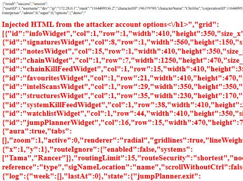
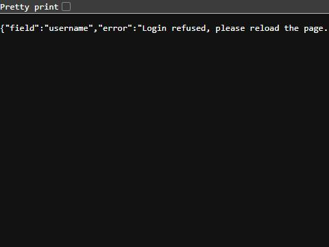

# PHP security fixes

**Date:** 2026-10-28

## Description

Fixes from the 2026-10-28 PHP security review: a link from another site can no longer log a visitor into an attacker's
account and run the attacker's HTML on Tripwire, delete their ESI characters, fake their location, set flares, send Discord
pings or log them out; ESI refresh tokens no longer reach the browser; EVE SSO checks a per-session `state`; password
login is limited per account and no longer says which usernames exist; new signatures can't claim another pilot as creator.

## Before / After

| Before | After |
| --- | --- |
|  |  |

Before: opening `login.php?mode=login&username=…&password=…` (a plain link) logged in and rendered the account's options
as HTML on the Tripwire origin (demo payload in red). After: refused with a JSON 403.

## Settings

No toggle, because these are security fixes. No tip, because nothing new for users to find.

## Change

- **Login CSRF → XSS** (`public/login.php`): password login only by a POST that isn't cross-site (`Sec-Fetch-Site` /
  `Origin`, new `fork_request_cross_site()` in `csrf.inc.php`); the response is `application/json` with `<`/`>`/`&`
  escaped (it used to be served as HTML with the user's free-form options in it); the SSO error text is escaped.
- **EVE SSO state** (new `sso-state.inc.php`): `esi::login()` sends `<purpose>.<nonce>`, `public/index.php` routes on
  the purpose, `login.php` and `register.php` only act on a callback carrying this session's nonce (single use). A
  callback with the old fixed state, another browser's nonce or none goes back to the sign-in error. A login started
  before the deploy has to be started again.
- **Refresh tokens** (`public/refresh.php`): the account's and the ESI characters' `refreshToken` are no longer sent to
  the browser (the client only uses access tokens).
- **GET / cross-site actions**: `refresh.php` only applies `tracking` and `esiDelete` with the session's CSRF token;
  `flares.php` and `ping.php` require it (`fork_csrf_require()`); `logout.php` ignores cross-site requests (our own
  Logout link and button still work; browsers without `Sec-Fetch-Site`, such as Safari before 16.4, can still be logged
  out by a link). The app's jQuery POSTs already send the token (`app/js/fork/csrf.js`).
- **Discord pings** (`public/ping.php`): `allowed_mentions` set; @here/@everyone only ping through the dialog's buttons,
  not from text typed into the message; `pingType` limited to `here`/`everyone`.
- **Password login** (new `login-guard.inc.php`): 10 failed logins for one username in 15 minutes lock password login
  for that account (EVE SSO still works), on top of upstream's per-IP limit; "Username doesn't exist." and "Password
  incorrect." are now both "Username or password incorrect.". Anyone can lock a username's password login
  this way by failing on purpose; SSO is unaffected, so that is accepted. Production already passes the real client IP to nginx
  (`TRUSTED_PROXIES`), so the per-IP limit is per visitor, not global.
- **Signature creator** (`signatures.php`): a new signature's created/modified-by is always the logged-in character
  (it was taken from the request); the automap jump record only uses the user's own tracked characters.
- Tests: `tests/csrf_test.php` (cross-site check), new `tests/sso_state_test.php` and `tests/login_guard_test.php`.

Upstream files touched (small, marked `// fork`): `public/login.php`, `public/register.php`, `public/index.php`,
`public/refresh.php`, `public/flares.php`, `public/ping.php`, `public/logout.php`, `esi.class.php`, `signatures.php`.

Not changed (from the same review, low): no CSP/HSTS header, `cached_third_party.php` error output, `refresh.php`'s ESI
update/delete without `userID`, upstream `docker-compose.yml` exposing Adminer and the Traefik API.
