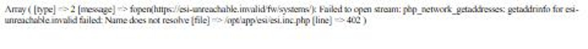
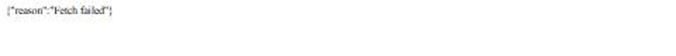

# PHP security hardening

**Date:** 2026-10-28

## Description

The rest of the 2026-10-28 PHP security review (item 7): basic Content-Security-Policy and HSTS headers, no PHP error
details in `cached_third_party.php` responses, ESI token refresh/delete limited to the user's own row, and Adminer in
upstream's `docker-compose.yml` only reachable from the host.

## Before / After

| Before | After |
| --- | --- |
|  |  |

`cached_third_party.php?key=fw` when the upstream fetch fails (production PHP settings). Before: the PHP error, with
server paths, sent to the browser. After: `{"reason":"Fetch failed"}`, details in the server log.

## Settings

No toggle, because these are security fixes. No tip, because nothing new for users to find.

## Change

- **Headers** (`docker/nginx-security-headers.conf`, `docker/nginx.conf`): `Content-Security-Policy: base-uri 'self';
  object-src 'none'; frame-ancestors 'none'` on every response. No `script-src`/`style-src` yet: the app still needs
  inline scripts and styles and several CDNs. `Strict-Transport-Security: max-age=31536000` (this host only) when the
  proxy says the request was HTTPS (`X-Forwarded-Proto`); none on plain http, so the dev stack is unaffected.
- **`public/cached_third_party.php`** (upstream): a failed fetch logs the PHP error and answers
  `{"reason":"Fetch failed"}` instead of printing it; a missing or unknown `key` answers 400 `Unknown cache key` (it
  hit a PHP warning, then a fatal "undefined constant reason").
- **`public/refresh.php`** (upstream): refreshing or dropping an ESI character's token touches only this account's row
  (`AND userID`). Before, a character tracked by two accounts had both rows overwritten, and a refused token on one
  account deleted it from the other too.
- **`docker-compose.yml`** (upstream; not used by our image or production): Adminer published on `127.0.0.1:9000`
  instead of all interfaces. Traefik's insecure API was already unreachable (port 8080 isn't published).
