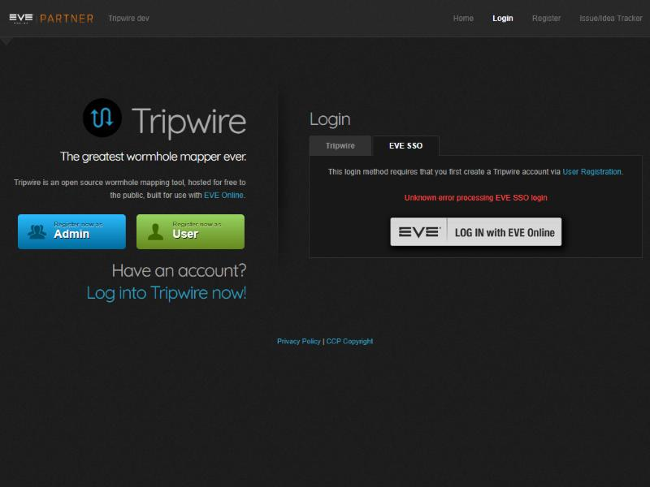
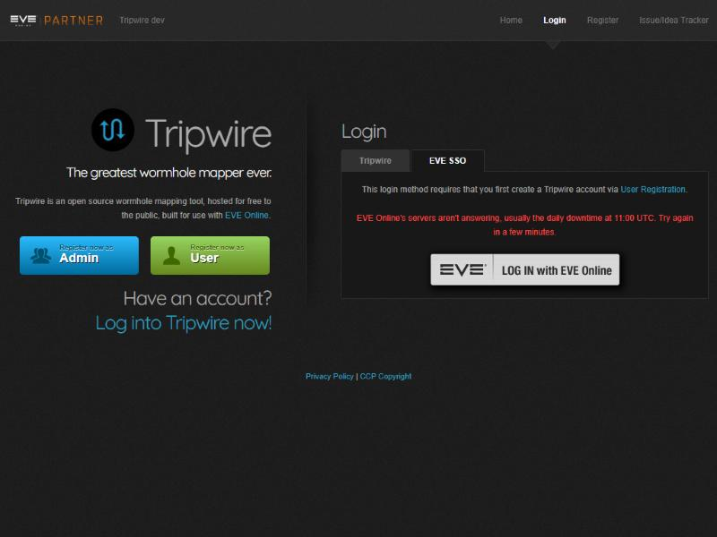

# EVE SSO downtime message

**Date:** 2026-10-28

## Description

Logging in or registering with EVE SSO during EVE's daily downtime (11:00 UTC) showed "Unknown error processing EVE
SSO login", which looked like a Tripwire bug. When ESI isn't answering, the page now says EVE's servers are down and
to try again in a few minutes.

## Before / After

| Before | After |
| --- | --- |
|  |  |

## Settings

No toggle, because it only replaces an error message with a more accurate one. No tip: it shows itself when needed.

## Change

New `sso-downtime.inc.php`: when a login/registration would redirect to `?error=<login|register|registeradmin>-unknown`,
it asks ESI's `/status/` endpoint (through the fork's ESI rate-limit layer, 4 s timeout, answer cached 30 s, only
after a valid SSO state) and, if that doesn't answer 200, redirects to `...-downtime` instead. Other failures keep the
old message. Tests: `tests/sso_downtime_test.php` (includes an end-to-end SSO callback through php-fpm).

Upstream files touched: `public/login.php`, `public/register.php` (appended to the existing fork line),
`landing.php` (one new message line per SSO pane). Calls `esi.evetech.net`, which Tripwire already uses.
