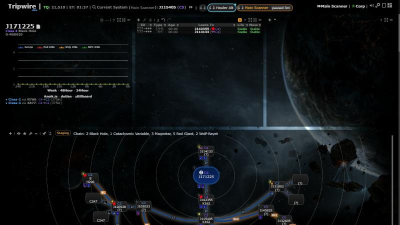

# Map jumps of all my tracked characters (up to 5) (multi-character jump tracking)

**Date:** 2026-10-30

## Description

Opt-in: when another of your tracked characters jumps through a wormhole, Tripwire makes it the active character and
maps its jump (automapper, return-bookmark pop-up, signature prompt, Follow), so multiboxers no longer lose track of which
character is jumping. A strip of character chips next to "Current System" shows who is active and who jumped last.
For everyone with 2+ tracked characters, every question about a jump names the character it is about. And ESI location
and ship polling is skipped for logged-off alts.

## Before / After

| Before | After |
| --- | --- |
|  |  |

After: "Current System (Hauler Alt)", the chip strip (active chip outlined orange; every character that jumped a
wormhole has a cyan ring and dot for a minute, pulsing for the first seconds; offline characters dimmed with a hollow
dot), and the per-character A (auto-map) switch next to the eye and ship icons in the tracking list, here off for the
hauler.

| Automatic switch notice (one click back) | Paused after a manual pick | Fleet jump: the active character stays |
| --- | --- | --- |
|  |  |  |

Paused on Main Scanner (Current System J115405); Hauler Alt jumped twice meanwhile and both holes (J115405 → J142355 →
J171225, viewed) were mapped onto the chain without switching:

Mapped without switching: dashed rings, the last jumper bright: 

| Which Signature? names the jumper (never cut) | Signature prompt | Return bookmark |
| --- | --- | --- |
|  |  |  |

| Settings row | Tip (feature off, another character jumped) |
| --- | --- |
|  |  |

## Settings

Toggle: Settings > Wormhole Jumps & Mass > "My characters: Map jumps of all my tracked characters (up to 5)" (`options.multiTrack =
{enabled, exclude: {characterID: true}}`). **Off by default** (missing key = off), a deliberate exception to "on by
default": it changes which character is active, and the user asked for strict opt-in. Up to 5 characters (sorted by name)
are used; linking stays unlimited. Each character's A icon in the tracking list ("Switch to this character when it jumps") chooses whether Tripwire picks up its jumps. Settings > Reset
deletes `multiTrack`. Left out of Mask Admin defaults (it holds the user's own character IDs).

No toggle for the rest, both pure improvements: naming the character in jump questions (only with 2+ tracked
characters; one character sees no change) and the offline polling skip (no visible change, fewer requests).

## Tip

Yes: the feature is invisible until switched on. `multiTrack.otherJump` (toast) fires on the new `tracking.otherJump` event
when a non-active linked character makes a mappable wormhole jump while the feature is off; "Open Settings" goes to the row.

## Change

- **When it switches, and when it maps without switching** (pure `planMoves`, `releaseDecision`, `replayPlan`,
  `runReplay`, `switchBack`, mocha-tested):
  - A tracked character's wormhole jump (its A switch on) makes it active after 7 s (the active character's own jump can
    come a 5 s poll later); all its waiting jumps are replayed in order, so no false hole from the first stop to the
    last. If it moved on meanwhile, its jumps are mapped without switching and it only becomes active. If a replayed
    jump opens "Which Signature?", the rest are mapped after it closes and the character lands on its last system.
  - Never switches to a character that is in the active character's system when the switch is due; the fleet window is
    measured from the alt's own jump, however long the switch was held.
  - Fleet jumps: an alt through the same hole (from → to) as the active character within 10 s doesn't switch (nothing
    to switch to; its jump is mapped one sync later too, which finds the active character's connection and does
    nothing). If the active character's "Which Signature?" for that hole is cancelled, the followers' jumps through it
    (either way), queued or made within the next 10 s, are dropped instead of asking again. Several alts through one hole without the active character: one switch,
    the others follow it. If the character a switch just left takes the same hole within 10 s (it was leading, a poll
    late), Tripwire switches back to it without a notice (after any open question closes).
  - **Mapping without switching:** after a manual pick (chip, tracking list, "Back to", Ctrl+K) switching pauses for 3
    minutes, but the other characters' jumps are still mapped: the automapper runs with the jumper's context (its
    tripwire.client.EVE for the one synchronous call: station and pod checks, `automap.character`, the "Which
    Signature?" dialog naming it) and the active character's straight after. Current System, Follow and the jump
    pop-ups don't move. The active chip says "paused 3m"; a click resumes. A character mapped this way gets a dashed
    ring and the tooltip "mapped J1 → J2 12 s ago (stayed on Main)" (a chain: "J1 → J2 → J3 (2 jumps)"); only the last
    jumper's ring is bright.
  - Never two questions at once: nothing is mapped without switching while "Which Signature?" or the signature prompt
    is on screen, nor until the next sync after one closed.
  - While a question about the last jump is on screen or still coming ("Which Signature?", the signature prompt and its
    retries) the switch waits, so the question isn't wiped; its jumps go to the queue of jumps mapped without switching
    (which waits for the question and one sync after it). The chip gets a queued ring; a notice only when a question is
    actually visible ("It is mapped; Tripwire switches to it when you close this question."). The return-bookmark
    panel is passive and holds nothing.
  - No switching with no active character (the user untracked on purpose), when turned off or after Reset.
  - Each automatic switch shows one notice "Now on X (jumped A → B) · Back to Y" (replaced by the next; it stays while a
    question about that jump is open, else 20 s).
- New `app/js/fork/multi-track.js` (+ css, mocha tests). A 1 s in-memory tick diffs every linked character's system
  (filled by upstream's existing 5 s location poll). A wormhole jump of an opted-in, non-active character (same rules as
  the automapper: no gate, dock, pod, Jita/Amarr, abyssal) makes it active and replays the jump through `tripwire.EVE`
  (old system as a character change, then the new one). One switch per tick, so in a fleet jump the next character finds
  the hole the first one mapped (verified: two characters through one new hole = one connection).
  - The switch is not saved: `tracking.active` is this session's state, carried by the next save the user makes; a
    reload goes back to the last saved active character. (Saving let a background tab overwrite settings.)
  - No switching when the user untracked on purpose (no active character), and queued switches are dropped when the
    feature is turned off or Reset.
- Jump questions name the jumper (taken when the jump happens, so a later switch can't change it): the automapper's
  "Which Signature?" dialog gets the title "Which signature did Alt Two jump through?" and a portrait line (wrapped from
  the fork, no upstream edit; its answer was already built at the jump, so it always acts for that character); the
  signature prompt asks "Which signature did Alt Two jump through?"; the return bookmark reads "Alt Two · Return
  bookmark". Only with 2+ tracked characters, whether or not the feature is on.
- Jumps while "Which Signature?" is open: before, another character's jump was dropped. Now, with the feature on, it
  waits (see above) and is mapped and switched to once the dialog closes. An active character's own second jump while the dialog is
  open is still dropped by upstream's automapper.
- The strip always shows the active character (marked "not switched to automatically" when its A switch is off or it is
  over the 5; its own jumps are mapped by upstream as always),
  stays visible with nothing tracked (a chip click resumes), and the tracking list says when more than 5 are switched
  on. If the active character stops being tracked, nothing is active and a notice says so. Chip tooltips say when a
  location isn't updating (token expired, ESI paused). Tooltips are escaped (jBox shows HTML).
- The header stays on one line: if it would wrap, a long tracked name top right is capped, then chip names go, then only
  the active chip and "+N", then no strip, then no name in "Current System" (checked with a 37-character name at
  1920/1366/1100/1024/900/800 px). Character names are always inserted as text.
- **Load:** no new endpoints, no new server polling, no new ESI requests. Per mapped jump, the same requests an active
  character's jump already makes; switching itself saves nothing.
- Ctrl+K "Switch to character" (previously active character first) has its own catalog entry (`switchCharacter`).
- **Offline skip** (`app/js/fork/esi-offline-skip.js`, every user): upstream's `/online/` answer (still every 60 s)
  decides. An offline alt that is neither the active character nor opted in to the feature gets no `/location/` or
  `/ship/` requests (24 requests/min saved per such alt). The active and opted-in characters are always polled (a fresh
  login can take up to 2 minutes to show as online). Online or unknown (first load, failed request, missing scope) =
  polled as before; offline → online polls that character at once. A character whose token is about to expire stays in
  the loop so the server still refreshes it. The server's tracking row only changes when something changes, so
  occupants look exactly as before.
- Upstream file touched: `signatures.php` (automap "Connection already mapped" branch): logs this character's jump mass
  when its location already reached the server and the tracking trigger didn't log it (no row for it through this hole
  in the same direction in the last 30 s); an error there is logged and never fails the dedupe. Tested in
  `tests/automap_dedupe_test.php`.
