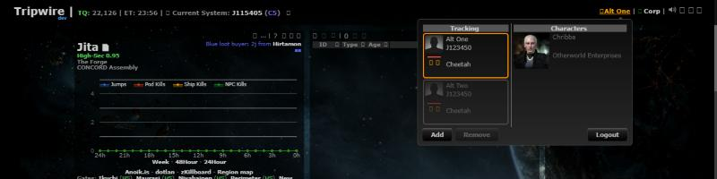
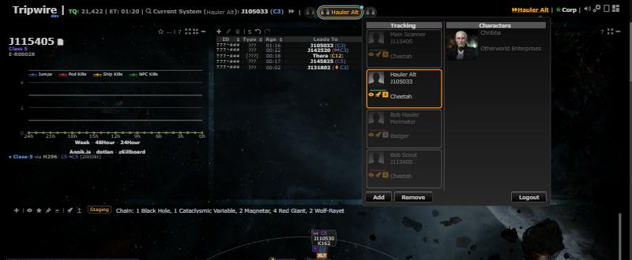
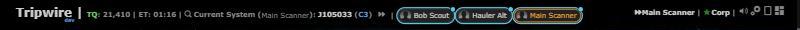
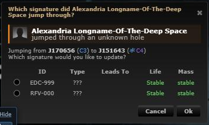
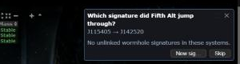
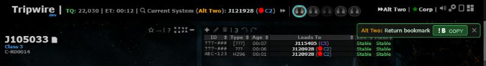
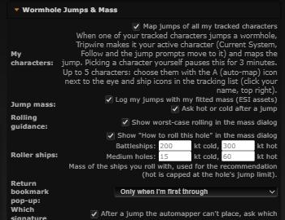
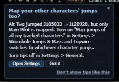

# Map jumps of all my tracked characters (multi-character jump tracking)

**Date:** 2026-10-30

## Description

Opt-in: when another of your tracked characters jumps through a wormhole, Tripwire makes it the active character and
maps its jump (automapper, return-bookmark pop-up, signature prompt, Follow), so multiboxers no longer lose track of which
character is jumping. A strip of character chips next to "Current System" shows who is active and who jumped last.
For everyone with 2+ tracked characters, every question about a jump names the character it is about. And ESI location
and ship polling is skipped for logged-off alts.

## Before / After

| Before | After |
| --- | --- |
|  |  |

After: "Current System (Hauler Alt)", the chip strip (active chip outlined orange; every character that jumped a
wormhole has a cyan ring and dot for a minute, pulsing for the first seconds; offline characters dimmed with a hollow
dot), and the per-character A (auto-map) switch next to the eye and ship icons in the tracking list, here off for the
hauler.

| Automatic switch notice (one click back) | Paused after a manual pick | Fleet jump: the active character stays |
| --- | --- | --- |
|  |  |  |

| Which Signature? names the jumper (never cut) | Signature prompt | Return bookmark |
| --- | --- | --- |
|  |  |  |

| Settings row | Tip (feature off, another character jumped) |
| --- | --- |
|  |  |

## Settings

Toggle: Settings > Wormhole Jumps & Mass > "My characters: Map jumps of all my tracked characters" (`options.multiTrack =
{enabled, exclude: {characterID: true}}`). **Off by default** (missing key = off), a deliberate exception to "on by
default": it changes which character is active, and the user asked for strict opt-in. Up to 5 characters (sorted by name)
are used; linking stays unlimited. Each character can be left out with its A icon in the tracking list. Settings > Reset
deletes `multiTrack`. Left out of Mask Admin defaults (it holds the user's own character IDs).

No toggle for the rest, both pure improvements: naming the character in jump questions (only with 2+ tracked
characters; one character sees no change) and the offline polling skip (no visible change, fewer requests).

## Tip

Yes: the feature is invisible until switched on. `multiTrack.otherJump` (toast) fires on the new `tracking.otherJump` event
when a non-active linked character makes a mappable wormhole jump while the feature is off; "Open Settings" goes to the row.

## Change

- **When it switches** (pure `multiTrack.planMoves`, mocha-tested):
  - An alt's jump does not switch when it takes the same hole (from → to) as the active character within 10 s, or lands
    where the active character is. Several alts through one hole without the active character: one switch (the first),
    the others follow it. A switch waits 1.5 s (the active character's own jump may come with the next poll) and is
    checked again then.
  - After a manual pick (chip, tracking list, "Back to", Ctrl+K "Switch to character") automatic switching pauses for
    3 minutes; the active chip says "paused 2:41" and a click on it resumes.
  - While a question or pop-up about the last jump is open (automapper "Which Signature?", signature prompt, return
    bookmark, including their retries), switching waits so it isn't wiped: a yellow notice says so, the chip gets a
    queued mark, and the jump is mapped once it is closed or auto-hides (60 s / 90 s at most).
  - No switching with no active character (the user untracked on purpose), when turned off or after Reset.
  - Each automatic switch shows one notice "Now on X (jumped A → B) · Back to Y" (replaced by the next).
- New `app/js/fork/multi-track.js` (+ css, mocha tests). A 1 s in-memory tick diffs every linked character's system
  (filled by upstream's existing 5 s location poll). A wormhole jump of an opted-in, non-active character (same rules as
  the automapper: no gate, dock, pod, Jita/Amarr, abyssal) makes it active and replays the jump through `tripwire.EVE`
  (old system as a character change, then the new one). One switch per tick, so in a fleet jump the next character finds
  the hole the first one mapped (verified: two characters through one new hole = one connection).
  - The switch is not saved: `tracking.active` is this session's state, carried by the next save the user makes; a
    reload goes back to the last saved active character. (Saving let a background tab overwrite settings.)
  - No switching when the user untracked on purpose (no active character), and queued switches are dropped when the
    feature is turned off or Reset.
- Jump questions name the jumper (taken when the jump happens, so a later switch can't change it): the automapper's
  "Which Signature?" dialog gets the title "Which signature did Alt Two jump through?" and a portrait line (wrapped from
  the fork, no upstream edit; its answer was already built at the jump, so it always acts for that character); the
  signature prompt asks "Which signature did Alt Two jump through?"; the return bookmark reads "Alt Two · Return
  bookmark". Only with 2+ tracked characters, whether or not the feature is on.
- Jumps while "Which Signature?" is open: before, another character's jump was dropped. Now, with the feature on, it
  waits (see above) and is mapped once the dialog closes. An active character's own second jump while the dialog is
  open is still dropped by upstream's automapper.
- The strip always shows the active character (marked "not auto-mapped" when its A switch is off or it is over the 5),
  stays visible with nothing tracked (a chip click resumes), and the tracking list says when more than 5 are switched
  on. If the active character stops being tracked, nothing is active and a notice says so. Chip tooltips say when a
  location isn't updating (token expired, ESI paused). Tooltips are escaped (jBox shows HTML).
- The header stays on one line: if it would wrap, a long tracked name top right is capped, then chip names go, then only
  the active chip and "+N", then no strip, then no name in "Current System" (checked with a 37-character name at
  1920/1366/1100/1024/900/800 px). Character names are always inserted as text.
- **Load:** no new endpoints, no new server polling, no new ESI requests. Per switched jump, the same requests an active
  character's jump already makes; switching itself saves nothing.
- **Offline skip** (`app/js/fork/esi-offline-skip.js`, every user): upstream's `/online/` answer (still every 60 s)
  decides. An offline alt that is neither the active character nor opted in to the feature gets no `/location/` or
  `/ship/` requests (24 requests/min saved per such alt). The active and opted-in characters are always polled (a fresh
  login can take up to 2 minutes to show as online). Online or unknown (first load, failed request, missing scope) =
  polled as before; offline → online polls that character at once. A character whose token is about to expire stays in
  the loop so the server still refreshes it. The server's tracking row only changes when something changes, so
  occupants look exactly as before.
- Upstream file touched: `signatures.php` (automap "Connection already mapped" branch): logs this character's jump mass
  when its location already reached the server and the tracking trigger didn't log it (no row for it through this hole
  in the same direction in the last 30 s); an error there is logged and never fails the dedupe. Tested in
  `tests/automap_dedupe_test.php`.
