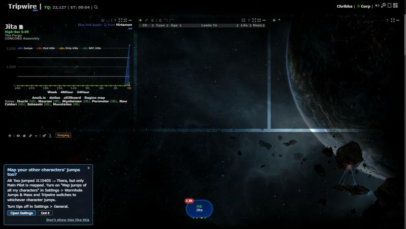

# Map jumps of all my characters (multi-character jump tracking)

**Date:** 2026-10-30

## Description

Opt-in: when another of your tracked characters jumps through a wormhole, Tripwire makes it the active character and
maps its jump (automapper, return-bookmark pop-up, signature prompt, Follow), so multiboxers no longer lose track of which
character is jumping. A strip of character chips next to "Current System" shows who is active and who jumped last.
Also, for everyone: ESI location and ship polling is skipped for characters that are logged off.

## Before / After

| Before | After |
| --- | --- |
|  |  |

After: "Current System (Fifth Alt)", the chip strip (active chip outlined orange, the last jumper pulses cyan for 10 s and
keeps a cyan ring for a minute, offline characters dimmed), and the per-character "map this character's jumps" switch
(A icon) in the tracking list, here switched off for the hauler.

| Return bookmark names the jumper | Settings row | Tip (feature off, another character jumped) |
| --- | --- | --- |
|  |  |  |

## Settings

Toggle: Settings > Wormhole Jumps & Mass > "My characters: Map jumps of all my tracked characters" (`options.multiTrack =
{enabled, exclude: {characterID: true}}`). **Off by default** (missing key = off), a deliberate exception to "on by
default": it changes which character is active, and the user asked for strict opt-in. Up to 5 characters (sorted by name)
are used; linking stays unlimited. Each character can be left out with its A icon in the tracking list. Settings > Reset
deletes `multiTrack`. Left out of Mask Admin defaults (it holds the user's own character IDs).

The offline polling skip has no toggle: it is a pure improvement (no visible change, fewer requests).

## Tip

Yes: the feature is invisible until switched on. `multiTrack.otherJump` (toast) fires on the new `tracking.otherJump` event
when a non-active linked character makes a mappable wormhole jump while the feature is off; "Open Settings" goes to the row.

## Change

- New `app/js/fork/multi-track.js` (+ css, mocha tests). A 1 s in-memory tick diffs every linked character's system
  (filled by upstream's existing 5 s location poll). A wormhole jump of an opted-in, non-active character (same rules as
  the automapper: no gate, dock, pod, Jita/Amarr, abyssal) makes it active and replays the jump through `tripwire.EVE`
  (old system as a character change, then the new one). One switch per tick, so in a fleet jump the next character finds
  the hole the first one mapped (verified: two characters through one new hole = one connection).
- The jump pop-ups name the character (fork-owned `jump-return.js`, `jump-sig-prompt.js`) when 2+ characters are opted in.
- The strip fits the header: names only on the active / last-jumper chips, and if the header would wrap, names off, then
  only the active chip and "+N", then no strip. Character names are always inserted as text.
- **Load:** no new endpoints, no new server polling, no new ESI requests. Per switched jump, the same requests an active
  character's jump already makes, plus one debounced options save.
- **Offline skip** (`app/js/fork/esi-offline-skip.js`, every user): upstream's `/online/` answer (still every 60 s) decides;
  offline = no `/location/` and `/ship/` requests (saves 24 requests/min per logged-off character); online or unknown
  (first load, failed request, missing scope) = polled as before; offline → online polls that character at once. A
  character whose token is about to expire stays in the loop so the server still refreshes it. The server's tracking row
  only changes when something changes, so occupants look exactly as before.
- Upstream file touched: `signatures.php` (automap "Connection already mapped" branch): logs this character's jump mass
  when its location already reached the server and the tracking trigger didn't log it (no row for it through this hole in
  the last 30 s). Tested in `tests/automap_dedupe_test.php`.
- Known limit (v1): a jump made while the automapper's "Which Signature?" dialog is open is not mapped, as today.
