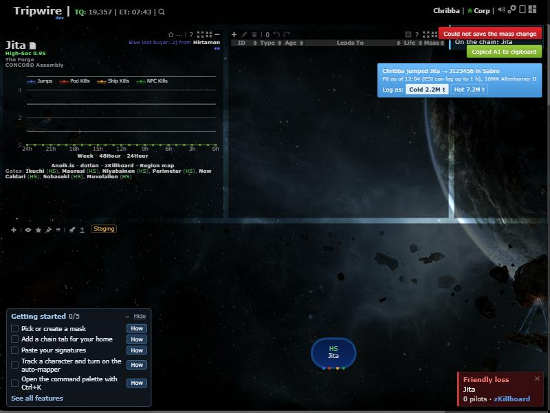
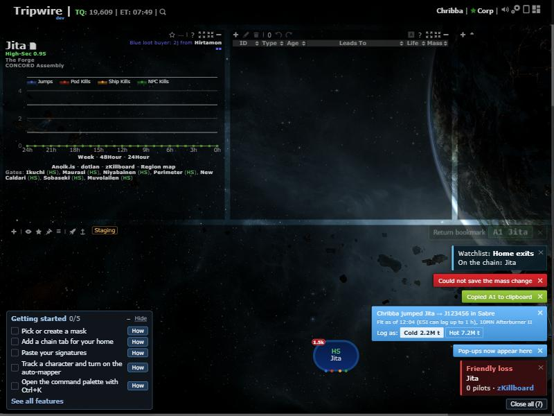
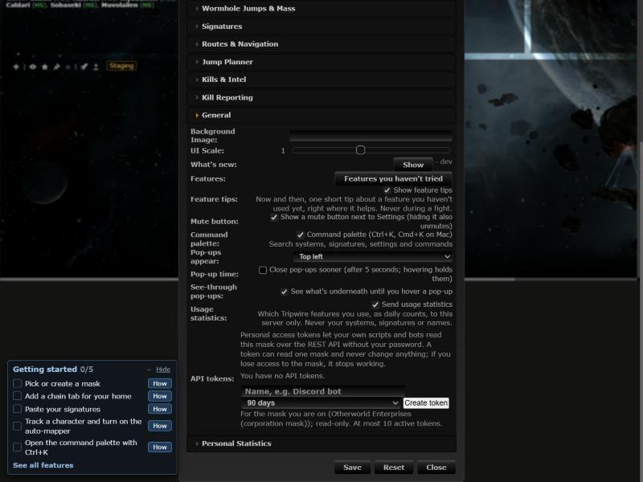

# Pop-up corner and closing

**Date:** 2026-10-30

## Description

Pop-ups came from five separate places with fixed positions, so they overlapped the UI and each other, and the jump mass prompt couldn't be closed. They now share one dock in a corner the user chooses, and every pop-up can be closed.

## Before / After

| Before | After |
| --- | --- |
|  |  |

## Settings

Settings > General: Pop-ups appear (corner, default top right), Close pop-ups sooner (off), See-through pop-ups (off). No on/off toggle for the dock or close buttons: they are a pure improvement. Stored in `options.notifications`, per user (left out of mask defaults: the right corner depends on your own screen). No tip: Close all and the close buttons are visible.

## Change

New `app/js/fork/notifications.js` and `app/css/fork/notifications.css`. jBox notices are routed through the dock by wrapping the `jBox` global, so no upstream file changes. Kill, structure timer and Watchlist pop-ups and the two jump panels are created in the dock (one line each in their fork files). Close buttons on every notice, Close all from two pop-ups up, Esc closes all (not while typing or in a dialog), hovering a notice holds its timer. Kill pop-ups move from bottom right to the chosen corner.
