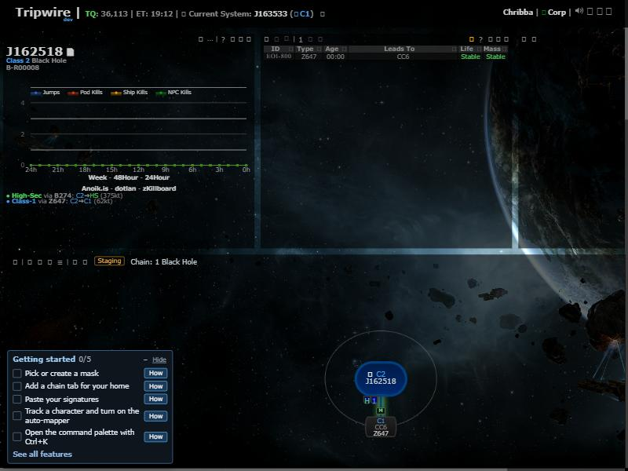
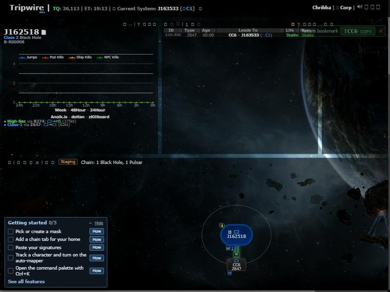

# Jump right after a view change

**Date:** 2026-10-31

## Description

A jump first seen on the location poll right after you changed the viewed system was lost: the automapper, Follow and
the jump pop-ups never saw it, so the hole stayed unmapped. Found from a production report: a pilot's jump into J163533
wasn't mapped until they linked it by hand a minute later.

## Before / After

Same jump in the dev stack, viewing J162518, with Current System J163533: before, the hole's Leads To stays unset;
after, it says J163533 and the return bookmark pop-up shows.

| Before | After |
| --- | --- |
|  |  |

## Settings

No toggle, because this is a bug fix. No tip, for the same reason. No What's New entry: nothing new to find.

## Change

The view-change and first-load path of `tripwire.parse` replaced `tripwire.client` without keeping `client.EVE`, unlike
the refresh path. `tripwire.EVE` then had no previous system to compare with until the next poll stored the new one.
Both paths now keep it.

Upstream files touched: `app/js/tripwire/parse.js` (3 lines). New test: `app/js-test/parse-keeps-location.test.js`.
