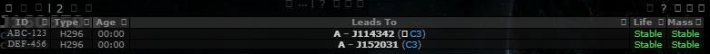
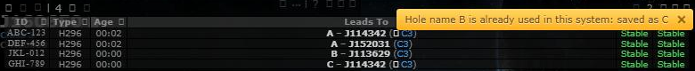

# Hole names: no two holes with the same name

**Date:** 2026-11-03

## Description

When two people named holes in the same system at the same time, both got the same suggested name (`B`) and the
second save went through, leaving two `B` holes. Saving now picks the next free name when the one in the dialog is
already taken, and two saves that cross inside one refresh are settled on the next sync: the later one is renamed.

## Before / After

Before: two holes named `A` out of J160650. After: the dialog suggested `B`, another pilot saved a `B` while it was
open, and the save came out as `C` with a pop-up saying so.

| Before | After |
| --- | --- |
|  |  |

## Settings

No new toggle: this is part of Settings > Signatures > Suggest hole names, and turning that off turns this off too.
No tip: it happens on its own and says so in a pop-up.

## Change

`app/js/fork/hole-naming.js`:

- On Add/Save in the signature dialog, a new or changed name whose token (prefix + 1 character, e.g. `B` or `AB`)
  another hole in the system already has is replaced by the lowest free one of the same kind (letter, small digit,
  medium digit); text after the token is kept (`B - frig` -> `C - frig`). Names outside the scheme, and names that
  didn't change (editing an old hole's mass), are left alone.
- For two minutes after such a save, each sync checks the name again. If the same token was saved twice, the first
  save (oldest modified time, then lowest id) keeps it and every later one gets the next free name. Each client
  renames only its own hole and all of them work it out the same way, so two clients never both rename or pick the
  same name.
- New pure helpers `holeNaming.charSize`, `resolveConflict`, `raceRenames`, tested in
  `app/js-test/fork/hole-naming.test.js`.

No upstream files touched.
