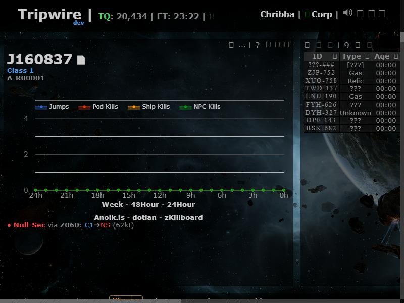
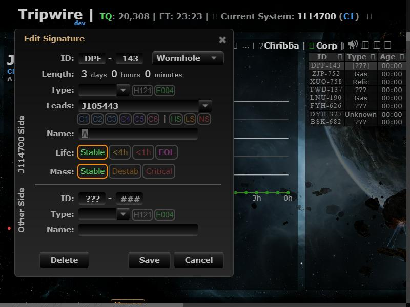
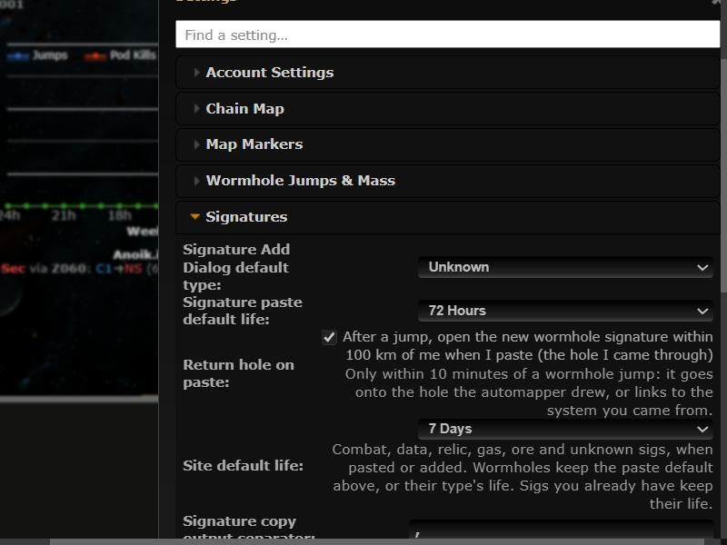
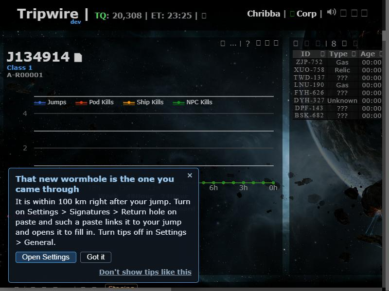

# Return hole on paste

**Date:** 2026-11-05

## Description

Right after a wormhole jump you land within about 100 km of the hole you came through. When you paste the probe scanner
within 10 minutes of a jump and exactly one new wormhole signature is within 100 km, Tripwire now links it to the jump
(onto the hole the automapper drew, or with its far side set to the system you came from) and opens its Edit Signature
dialog so you can fill in the type. Opt-in, as the user asked.

## Before / After

| Before (feature off: DPF-143 is a loose hole next to the automapper's `???` hole) | After (DPF-143 put on the automapper's hole, leads to the system you came from, dialog open) |
| --- | --- |
|  |  |

Settings row and the tip:  

## Settings

Toggle: Settings > Signatures > Return hole on paste, **off by default** (the user asked for opt-in;
`options.returnSigPaste.enabled === true` means on, a missing key means off; Reset turns it off). Allowed as a mask default.

## Tip

Yes, one toast tip (`returnSigPaste.paste`, on `paste.sigs`): the feature is off by default and only does something right
after a jump plus a paste, so it is easy to miss. It shows only when the feature is off and the paste would have found the
return hole; its button opens the Settings row.

## Change

- New `app/js/fork/return-sig-paste.js`: distance parsing (m / km / AU in all six client languages and their separators),
  the candidate check, jump detection (wraps `tripwire.EVE` like jump-sig-prompt.js), and the paste hook: it wraps
  `tripwire.pasteSignatures.parsePaste` and, for that one synchronous call only, `tripwire.refresh`, so the paste's payload
  is adjusted before it is sent (the add is swapped for an update of the automapper hole's signature, or its far side is
  set). Undo works for both (one update step on top of the paste's own). The jump-sig prompt closes on a merge.
- Usage events `returnSigPaste.merged` / `returnSigPaste.linked`; catalog entry in `public/fork/feature-catalog.json`.
- `returnSigPaste` added to the mask-default allow-lists (`app/js/fork/mask-defaults.js`, `maskadmin/maskadmin.inc.php`,
  both fork-owned). No upstream files touched (`app/js/tripwire/paste.js` unchanged).
- Tests: `app/js-test/fork/return-sig-paste.test.js`.
