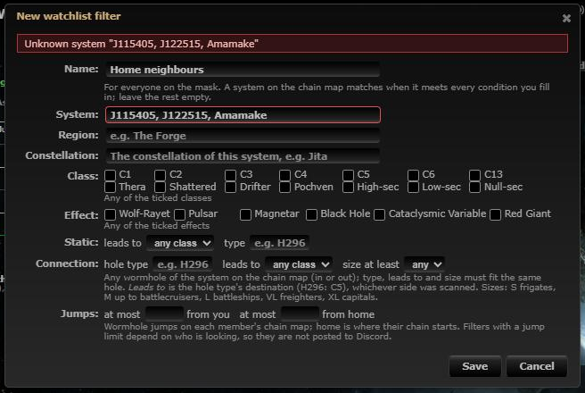
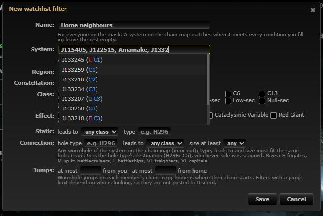
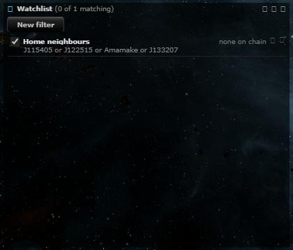

# Watchlist: several systems per filter

**Date:** 2026-11-08

## Description

A Watchlist filter's System field took one system, so watching 15 systems meant 15 filters. It now takes a
comma-separated list ("J115405, J122515, Amamake", up to 50); a system on the chain map matches when it is any of them.

## Before / After

| Before | After |
| --- | --- |
|  |  |

Before: a list is one unknown system. After: the field autocompletes the name after the last comma, and the filter
lists its systems in the panel:

## Settings

No toggle: it is an improvement to an existing field (one system still works as before). No tip: the field's
placeholder and hint say it.

## Change

- Conditions store `systemIDs` (a list, at most 50, duplicates dropped) instead of `systemID`. Filters saved with one
  `systemID` are read as a one-item list by both matchers, so existing filters keep working without a migration; they
  are written as `systemIDs` when next saved.
- `app/js/fork/watchlist.js`: `normaliseConditions`, `matchSystem`, `fromForm` (splits on commas, names every unknown
  system, at most 50), `toForm` (joins with ", "), `describe` ("J115405 or Amamake"), and the System field's
  autocomplete completes the part after the last comma and adds ", " after a pick.
- `watchlist/watchlist.inc.php`: the same normalisation and matching for the server and the Discord type "Watchlist
  match"; saving checks every system against the game data.
- Tests: shared cases in `watchlist/tests/cases.json` (legacy + list merge, invalid entries, the 50 cap, a match on
  any of several systems; run by mocha and PHP), mocha editor tests in `app/js-test/fork/watchlist.test.js`.
- `docker/README.md` (#watchlist). Upstream files touched: none.
