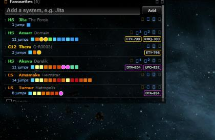
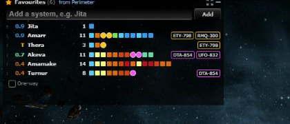

# Favourites: one-line rows with every route

**Date:** 2026-11-13

## Description

The Favourites panel now shows each favourite on one line, Wanderer style: security or class, name, jump count and
the jump markers, with the buttons on hover. Every favourite gets its route without switching it on, so the routes
to Thera and Turnur through EVE-Scout's connections (with the signature to warp to) show straight away.

## Before / After

| Before | After |
| --- | --- |
|  |  |

## Settings

Toggle: Settings > Routes & Navigation > "One-line rows with every favourite's route" (`options.favouritesCompact.enabled`,
on by default). Off brings back the two-line rows where only favourites with Route on get a route.

Tip: none, the panel and its routes are on screen.

## Change

- Every favourite is routed (shortest, or the row's Route mode); the Route button now only decides whether the route
  is highlighted on the chain map (blue left edge on the row) and shortest vs safe.
- Routes start at the tracked character, or the system you are viewing when no character is tracked; the header
  says which ("from Perimeter", "from Jita (viewing)").
- Labels: security `0.9`, class `C5`, `T` Thera, `P` Pochven, `Z` Zarzakh; region in the name's tooltip.
- EVE-Scout's Thera/Turnur list is fetched whenever any favourite needs a route (`theraRoute`), not only those with
  Route on.
- "Set destination in game" is on every compact row (it follows the row's route); with no tracked character a
  gate-only route says so instead.
- Files: `app/js/fork/favourites-panel.js`, `favourites-route-strip.js`, `thera-route.js`, `autopilot-route.js`, `mask-defaults.js`, new
  `app/css/fork/favourites-compact.css`, tests, and the new key in the mask-defaults allow list
  (`maskadmin/maskadmin.inc.php`, fork-owned). No upstream files touched.
