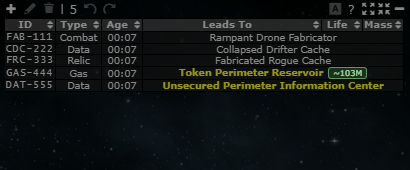
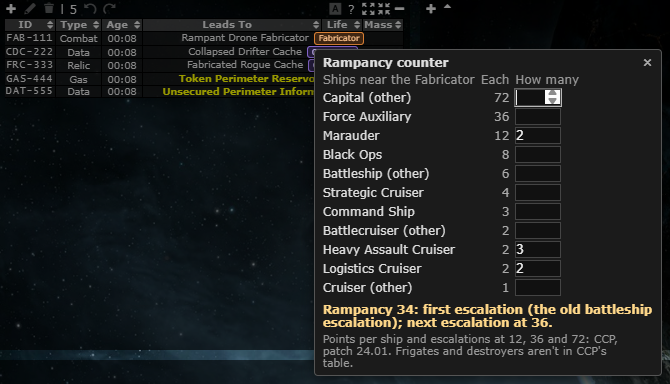
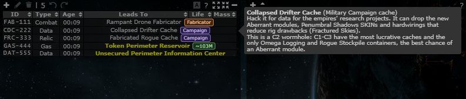

# Campaign and Fabricator tags

**Date:** 2026-11-15

## Description

Military Campaign caches and the Rampant Drone Fabricator get a small tag in the signature list, with a tooltip on what
the site is and why it is worth running. Clicking the Fabricator tag opens a Rampancy counter, which adds up a fleet's
Rampancy and shows which escalation it triggers.

## Before / After

| Before | After |
| --- | --- |
|  |  |

The cache tooltip in a C2 wormhole: 

## Settings

Toggle: Settings > Signatures > Campaign and Fabricator tags (on by default), `options.campaignTags.enabled`. Also allowed
as a mask default.

Tip: none. The tags are visible on the row, and the Fabricator tag's tooltip says that clicking it opens the counter.

## Change

- Site names come from CCP's own posts only:
  - [Fractured Skies expansion notes](https://www.eveonline.com/news/view/fractured-skies-expansion-notes) (2026-11-10):
    "Collapsed Drifter Cache" and "Fabricated Rogue Cache" are the Military Campaign caches. The most lucrative ones,
    and the Omega Logging and Rogue Stockpile containers, are in C1-C3 wormholes. Omega Logging and Rogue Stockpile are
    containers, not sites, so they are not tagged.
  - [Patch notes 24.01](https://www.eveonline.com/news/view/patch-notes-version-24-01) (2026-07-23.1) and
    [Rampant Drone Fabricator sites are back](https://www.eveonline.com/news/view/rampant-drone-fabricator-sites-are-back):
    the "Rampant Drone Fabricator" is back in C1-C6 for good, with up to 100 waves. One later patch note calls it "the
    Rogue Drone Fabricator site", so that name matches too.
- Tags match by name whatever the sig type, because CCP's posts don't say whether these sites are signatures or
  anomalies. Rows hidden by the "Anomalies: Hide" option stay hidden, tag included.
- The cache tooltip says when the system is C1-C3 (the system class comes from the static data).
- **Rampancy counter:** CCP confirms both the thresholds and the per-ship points in patch 2026-07-23.1. Escalations
  happen at 12, 36 and 72 Rampancy (these match the fan-site numbers). Points per ship near the Fabricator: Capital 72,
  Force Auxiliary 36, Marauder 12, Black Ops 8, Battleship 6, Strategic Cruiser 4, Command Ship 3, Battlecruiser,
  HAC and Logistics Cruiser 2, other cruisers 1. Frigates and destroyers aren't in CCP's table, so the counter has no
  row for them and says so. CCP doesn't say how near counts as "in proximity", so the counter only adds up the fleet
  the user types in.
- No chain node tag: these are per-signature facts, and the sig list is where people look for them.
- Code: `app/js/fork/campaign-tags.js` (pure logic in `campaignTags`, mocha tests in
  `app/js-test/fork/campaign-tags.test.js`), `app/css/fork/campaign-tags.css`. Catalog entry `campaignTags` (opening
  the counter counts as a use). The mask-default allow-lists (`app/js/fork/mask-defaults.js`,
  `maskadmin/maskadmin.inc.php`) gain `campaignTags`.
- Upstream files touched: none.
