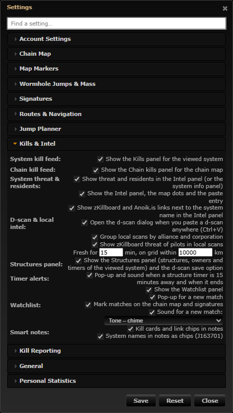
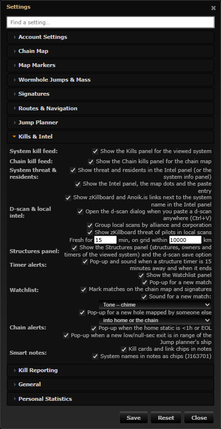
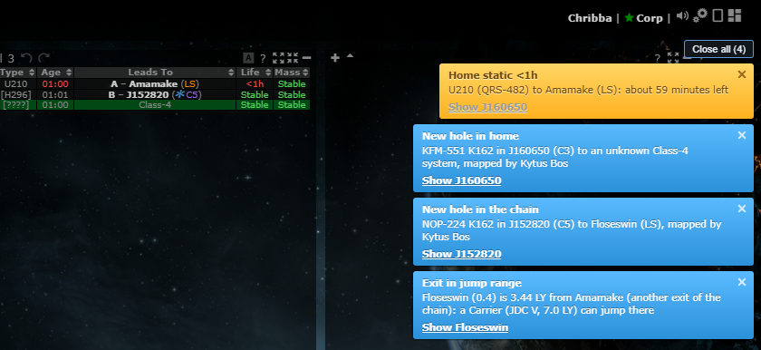
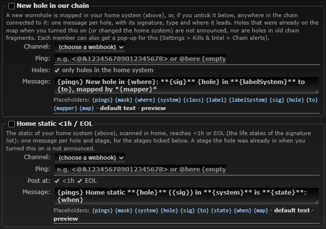
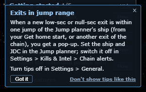

# Chain alerts: new holes, home static <1h / EOL, exits in jump range

**Date:** 2026-11-15

## Description

Pop-ups when the chain changes in a way that matters: someone else maps a new hole (or K162) into home or the chain,
the home static goes <1h or EOL, or a newly mapped low/null-sec exit is within one jump of the Jump planner's ship.
Mask admins can post the first two to Discord as two new types, each off until they turn it on for a channel.

## Before / After

| Before | After |
| --- | --- |
|  |  |

The pop-ups (in the pop-up dock):

Mask Admin > Discord, the two new types (off by default):

## Settings

Toggle: Settings > Kills & Intel > Chain alerts (on by default), one row with three switches: new hole (with "into home
or the chain" / "into home only"), home static <1h / EOL, exits in jump range. `options.chainAlerts` = {enabled, newHole,
scope, homeStatic, capRange}; a missing key means all on; Reset deletes it; mask admins can make it a mask default.
Kills & Intel because these are pop-ups about what is happening on the chain, next to the Watchlist's and the structure
timers' pop-ups (a pop-up goes with its topic); a new section would hold one row.
Discord: Mask Admin > Discord > "New hole in our chain" (type 10, key `chainHole`, "only holes in the home system" ticked
by default) and "Home static <1h / EOL" (type 11, key `homeStatic`, both stages ticked), both off until an admin turns
them on and picks a channel. The capital range alert is in-app only (it depends on each member's own jump ship and JDC).

## Tip

Yes, one, for the capital range alert: it only matters in some situations (a low/null-sec exit appears), so it is easy
to miss. Toast `chainAlerts.capRange` on `chain.exit` when the new exit is low/null-sec and the alert is on. The new-hole
and static pop-ups show themselves when they matter, so they need no tip.

## Change

- `app/js/fork/chain-alerts.js` (new): pure logic in `chainAlerts` (mocha: `app/js-test/fork/chain-alerts.test.js`) and a
  `chain.nodes` hook. Home is the active chain tab's system (as the Watchlist reads it), the chain is what the map draws.
  Holes on the map when the page loads or the mask changes are known (primed per mask of the data; a mask seen loaded
  and empty for 10 s gets an empty baseline, so its first hole alerts too); a new hole is shown once; a hole whose
  scanned side isn't known (no parent) is not called a K162; holes whose signatures were last changed by your own character are skipped. The static is checked on every
  chain change and every 30 s; each (hole, stage) is shown once (remembered in localStorage, last 100). The range check
  reuses the Jump planner's engine and data read-only (`jumpRange`, `jumpPlanner.settings/range`, `public/jumprange/*.json`
  fetched on the first candidate): from your Get home start when set, else from the other k-space exits of the chain
  (never from high-sec: no jump drive can be activated there), honouring the planner's
  low/null-sec ticks. Off (alert and tip) while the Jump planner itself is turned off. Pop-ups are jBox notices, so they go to the pop-up dock.
- `discord/chain_alerts.php` (new): types 10-11, polled by `discord_notify.worker.php` with the watchlist (same leader,
  15 s). New holes: baseline on turn-on / home change, then each hole once (`discord_sent` kinds `chole` / `choleBase`,
  kept past the 7-day prune and forgotten when the hole is gone, `discord/outbox.php`). Static: one message per (hole,
  stage), not for stages reached before turn-on. Tests: `discord/tests/chain_alerts_test.php` (pure + poll on the dev
  database) and `tests/chain_alerts_discord_flow_test.php` (worker + Discord mock).
- Fork files edited: `discord/settings.php`, `discord/template.php`, `discord/discord.inc.php`, `discord/outbox.php`,
  `discord_notify.worker.php`, `public/discord.php` (preview samples), `app/js/fork/discord-notifications.js` (Mask Admin
  rows), `app/js/fork/mask-defaults.js` + `maskadmin/maskadmin.inc.php` (allow-list), position checks in
  `discord/tests/rolling_test.php` and `app/js-test/fork/discord-notifications.test.js`, `docker/README.md`.
- No upstream files touched. No new third-party calls (the range data is this app's own `public/jumprange/`).
