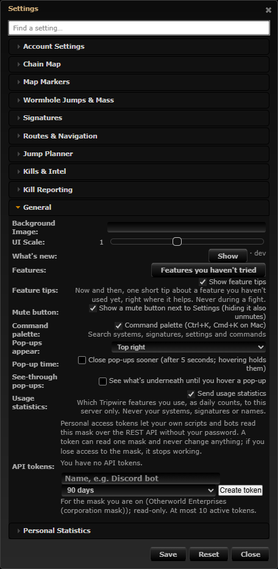
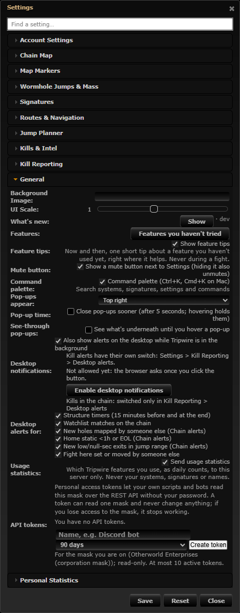
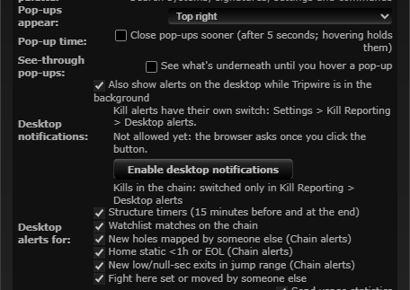
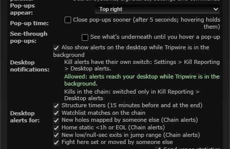
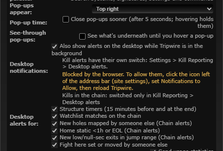
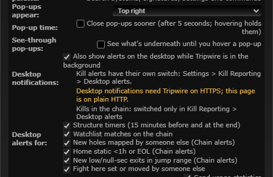
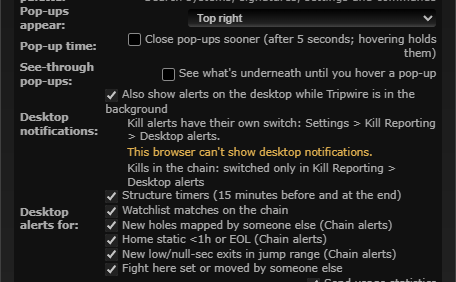
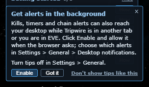

# Desktop notifications

**Date:** 2026-11-15

## Description

The fork's alerts (kills in the chain, structure timers, Watchlist matches, chain alerts, Fight here) were in-app
pop-ups only, so they were missed while Tripwire sat in a background tab or you were in the EVE client. They now also
show as desktop notifications through the browser's Notification API while the tab is hidden. Nexum and Wayfinder offer
this; only the idea is taken.

## Before / After

| Before | After |
| --- | --- |
|  |  |

The status line in each permission state:

| Not asked yet | Allowed | Blocked | Not on HTTPS | No API |
| --- | --- | --- | --- | --- |
|  |  |  |  |  |

("Not on HTTPS" and "No API" were captured by overriding `isSecureContext` / removing `Notification` in the page;
the others with Chrome's `Browser.setPermission`.) Tip: 

## Settings

Toggle: Settings > General > Desktop notifications (on by default), right under the pop-up dock's rows, plus
"Desktop alerts for:" with one switch per alert. General because it is how pop-ups from several sections reach you,
next to the other pop-up settings. Nothing shows until the user allows notifications, so the browser permission is the
real opt-in: the master switch being on does nothing on its own. Kills keep their existing switch (Settings > Kill
Reporting > Desktop alerts) and only that one: the new master switch, or a mask default for it, never turns off kill
alerts users already had (the General row says so). `desktopNotify` is in the mask-defaults allow-list.

Tip: yes, the browser never asks by itself, so the feature is easy to miss. One toast tip (`desktopNotify.enable`)
after an in-app alert while the browser hasn't been asked yet; its Enable button asks for permission.

## Change

- New `app/js/fork/desktop-notify.js` (`forkDesktopNotify`) and `app/css/fork/desktop-notify.css`. Sources call
  `forkDesktopNotify.notify({type, title, body, tag}, onClick)` with one guarded line next to their own pop-up; nothing
  is detected anew. Covered types: `kill` (Kill Reporting), `timer` (structure timers, 15 minutes before and at the
  end), `watchlist`, `newHole`, `homeStatic`, `capRange` (chain alerts) and `rally` (Fight here set or moved by
  someone else). Not covered: notices that answer your own action (saved, copied, errors) and the jump prompts.
- Shown only while `document.hidden`; the in-app pop-up still shows as before. A tag per event (hole, timer, filter,
  kill) so a repeat replaces the earlier one. Clicking focuses Tripwire, closes the notification and runs the pop-up's
  action (show the system, open the Timers board, flash the kill's node). Icon: `images/favicon.png` (kills keep the
  victim's ship image from image.eveonline.com, as before). The text is the in-app pop-up's own text, nothing more.
- Permission is only ever requested from a click: the Settings button, the tip's button, or Kill Reporting's existing
  "Also alert me" link and Save (now through `forkDesktopNotify.request`).
- Kill Reporting's own desktop code now goes through `forkDesktopNotify` (permission, hidden check, tags, analytics);
  its `killReporting.desktop` switch alone decides. The home static check of chain alerts also runs while the tab is
  hidden when a desktop notification could show.
- Chain alerts in a background tab: the desktop notification goes out at once, and the in-app pop-up now waits until the
  tab is visible again (`chainAlerts.whenVisible`) instead of closing itself after 20 s unseen.
- Analytics: `desktopNotify.granted` / `clicked` (use), `denied` / `shown` (events); catalog entry `desktopNotify`.
  New tip trigger `alert.shown` in `hints.js`.
- Fork files touched: `kill-reporting.js`, `structure-timers.js`, `watchlist.js`, `chain-alerts.js`, `rally.js`,
  `hints.js`, `mask-defaults.js`, `maskadmin/maskadmin.inc.php`, `public/fork/feature-catalog.json`. No upstream files.
- Tests: `app/js-test/fork/desktop-notify.test.js` (gating on hidden / permission / switches, tags, source mapping,
  stubbed Notification API for show, click and permission requests).
