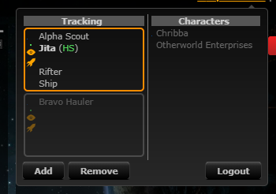
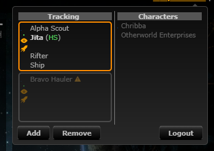
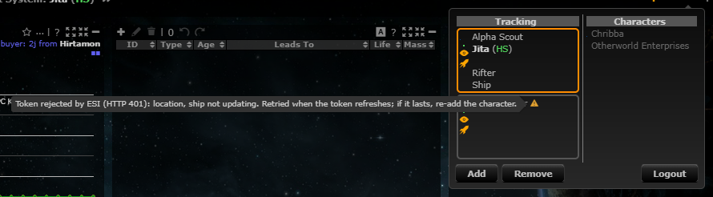

# ESI polling backoff, cache lifetimes and spreading

**Date:** 2026-11-15

## Description

The browser polls ESI location, ship and online for every linked character, and since 2025-11-03 those routes share a
rate-limited bucket per character (1200 tokens per 15 min; a 2xx costs 2, a 4xx costs 5). A rejected token kept being
polled every 5 s, and a 403 even looped as fast as the network allowed. Now failing routes back off, a token ESI keeps
rejecting stops being polled until it changes, answers are not re-asked while ESI's cache says they are current, and one
poll's requests are spread over up to 2 s. A character whose token keeps failing gets a small alert on its tracking card.

## Before / After

| Before | After |
| --- | --- |
|  |  |

Tooltip of the new alert: 

Measured in the dev stack with every ESI request stubbed (headless Chrome, two fake characters, "Bravo" answering
401/403 on location and ship, "Alpha" answering 200 with `Cache-Control: max-age=5`):

| | Before | After |
| --- | --- | --- |
| 401, 60 s: Bravo location + ship | 24 requests (120 tokens) | 4 (at 0 s and ~30 s), then 120 s, then stopped after the 3rd |
| 401, 175 s: Bravo location + ship | ~70 | 5, ship stopped after its 3rd |
| 403, 20 s: all routes of **both** characters | 112 requests per route (the hot loop) | Alpha 4 per route (5 s cadence), Bravo 1 |
| Alpha, healthy | every 5 s | every 5 s (unchanged) |

## Settings

No toggle: internal reliability work. Nothing changes while ESI answers normally, and the alert only appears for a
character whose tracking is already broken.

## Tip

No tip: there is nothing to discover; the alert explains itself on hover.

## Change

**Audit (browser, `app/js/tripwire/esi.js` and fork files):**

| Path | Before | Now |
| --- | --- | --- |
| location / ship (5 s), online (60 s), per character | 429 / 420 / error budget: paused (`esi-limits.js`). 401: polled every 5 s forever. 403: `tripwire.refresh` asked the server for the characters, whose answer (`esi.parse`) re-ran every poller at once, so it looped back-to-back, for every character. 5xx / network: every 5 s. No cache check, all requests in the same millisecond. | `esi-backoff.js` (new): 401/403 wait 30 s, then 120 s, then that route stops until the character's access token changes (one try per new token; the server refreshes tokens ~every 20 min, and drops a character whose refresh is refused). 5xx, network errors and other 4xx: 5 s doubling to 5 min, ±25 % jitter; a `Retry-After` on them is a minimum. A route is not asked while `Cache-Control: max-age` (or `Expires` without max-age) says the last answer is current, nor while a request is still out (this also stops `esi.parse` from re-asking everyone at once). One poll's requests go out 250 ms apart, over at most 2 s, with a little jitter. |
| Low budget | Not checked in the browser (only on the server) | `esi-limits.js`: a character (or `/status`) under 5 % of its `X-Ratelimit-Limit` pauses 60 s, as `esi/esi.inc.php` already did. |
| TQ status (15 s), chain map system jumps/kills | 429/420 handled (`esi-limits.js`) | unchanged |
| Assets (`auto-mass.js`) | own backoff: 401/403 = no scope, recheck later; errors back off; uses `Expires` | unchanged (asked on a ship change, not polled) |
| Incursions (`jump-planner.js`), type/station/name lookups, search, autopilot, open window | user-triggered or one-off; 420/429 recorded centrally | unchanged |

**Audit (server):** `esi/esi.inc.php` already paused on 429 (`Retry-After`), 420, a low error budget and a group under 5 %;
callers serve their stale cache when paused or failing, and GETs use ETags. Gap fixed: a 5xx carrying `Retry-After` (a
503 in downtime, say) now pauses that route or group for that long. Token refresh (SSO) only happens when a token is
within 5 minutes of expiry, so it can't hammer. `zkill/` has its own client (unchanged).

**Indicator:** the character's card in the Tracking panel (click your name) gets a small amber alert after its name while
a route is stopped, with a tooltip saying which routes and the HTTP status; it goes away once an answer is ok. Fork-owned
element: upstream's own "missing permissions" alert is untouched. Multi-character chips also say "token rejected".

**Files:** `app/js/fork/esi-backoff.js`, `app/css/fork/esi-backoff.css`, `app/js-test/fork/esi-backoff.test.js` (new);
`app/js/fork/esi-limits.js` (+ test), `app/js/fork/multi-track.js` (one line), `esi/esi.inc.php` (+ 4 checks in
`esi/tests/esi_test.php`). All fork-owned: **no upstream files touched.**

Known limit: two open tabs for the same character still each poll; the low-budget pause slows them down, but they don't
share answers.
