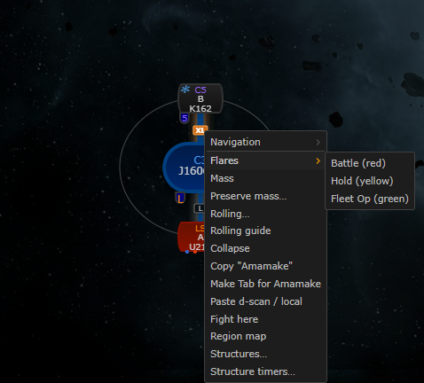
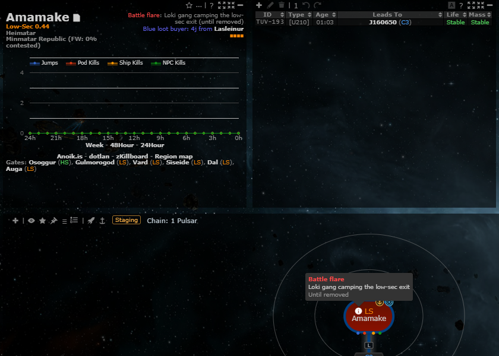
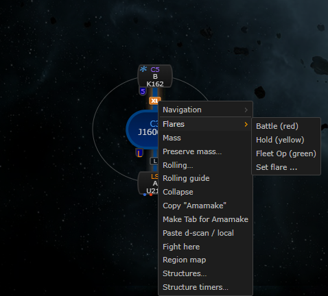
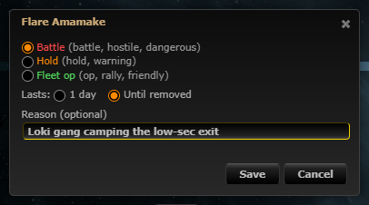

# Flare reason and lifetime

**Date:** 2026-11-15

## Description

A flare can now say why it was set and how long it lasts: right-click a system > Flares > Set flare ... picks the colour,
1 day or until removed, and an optional reason. The reason shows in the system panel and in a tooltip on the flared
node's (i) icon. Ported from upstream Tripwire 2.0's flare rework (upstream `production` a9c49177: `app/js/dialogs/flare-dialog.js`,
`public/flares.php`, `app/js/systemPanel.js`, and the `db-update.php` diffs "flare reason", "flares - fix clean event"
and "flares - remove default lifetime").

## Before / After

| Before | After |
| --- | --- |
|  |  |

The new menu item and the dialog:

| Flares menu | Set flare dialog |
| --- | --- |
|  |  |

## Settings

No toggle, because it extends an existing feature without adding anything automatic: nothing changes on the map until
someone writes a reason (the (i) icon and the panel line then carry information the whole mask needs), and flares
without one look and expire as before.

Tip: yes, one (`flareDetails.reason`, a callout on a flared node without a reason when a system is viewed), because the
dialog is reached only by right-click. The palette also gets "Flare: set colour, reason and lifetime...".

## Change

- `flares/flares.inc.php` (new): validation (colour red/yellow/green, lifetime `86400` or `forever`, a missing lifetime
  is 1 day, reason cleaned to one line and at most 200 characters, else 400), set/remove/list per mask, and
  `flares_ensure_schema()`: adds `lifeLength` (seconds, `NULL` = until removed, default 86400) and `reason` to an older
  `flares` table and rewrites the `flaresClean` event to delete each flare when its own lifetime is over. Runs from
  `public/flares.php` on every set/remove and from `public/refresh.php` when the list query finds a column missing, so
  existing databases need no migration; refresh falls back to the old list if the columns cannot be added. Not ported:
  upstream's `db-update.php` mechanism (state file, `update_history` table, update DB connection).
- Expired flares are left out of the list at once, not only when the hourly event runs.
- Setting a flare again (any colour) restarts its lifetime. The quick Battle / Hold / Fleet Op items and the palette's
  flare commands keep the flare's lifetime and reason; a missing reason is sent as no field. Fixes the old quick items
  adding a second entry when re-colouring.
- `app/js/fork/flare-details.js` / `app/css/fork/flare-details.css` (new): the dialog, the (i) icon and its tooltip, the
  panel line, the palette command, the tip, and an empty flare list before the first refresh (upstream 2.0 crashed on
  the first map draw without it). Everything the user typed is escaped where shown.
- Map key: the Flares entry mentions the (i) icon.
- Upstream files touched: `public/flares.php`, `public/refresh.php`, `app/js/global-hooks.js` (setFlare/removeFlare
  delegate, "flare" menu command), `app/js/systemPanel.js` (flare line), `tripwire.php` (Set flare ... menu item),
  `.docker/mysql/tripwire.sql` (the two columns and the new event body for fresh installs). Fork files touched:
  `app/js/fork/command-palette.js`, `app/js/fork/map-legend-entries.js`, `public/fork/feature-catalog.json`,
  `docker/README.md` (Flares: schema, event, what an admin runs if the app user lacks `ALTER`/`EVENT`).
- Tests: `app/js-test/fork/flare-details.test.js` (mocha), `flares/tests/flares_test.php` (PHP: cleaning, length cap,
  lifetimes, old-table upgrade and event, expiry, per-mask storage, `public/flares.php` over HTTP with CSRF).
