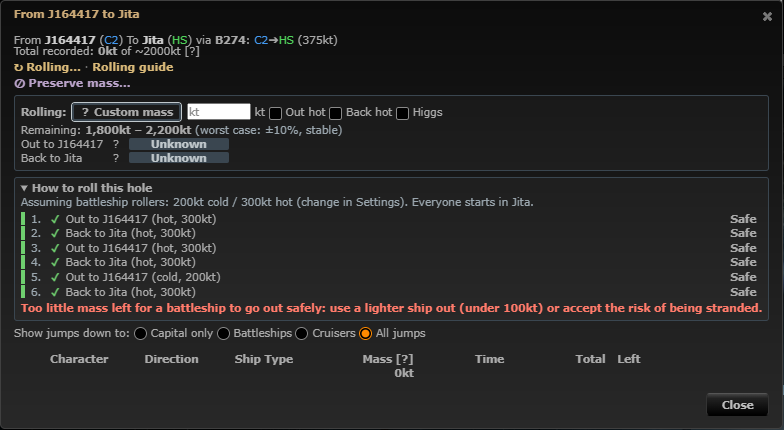
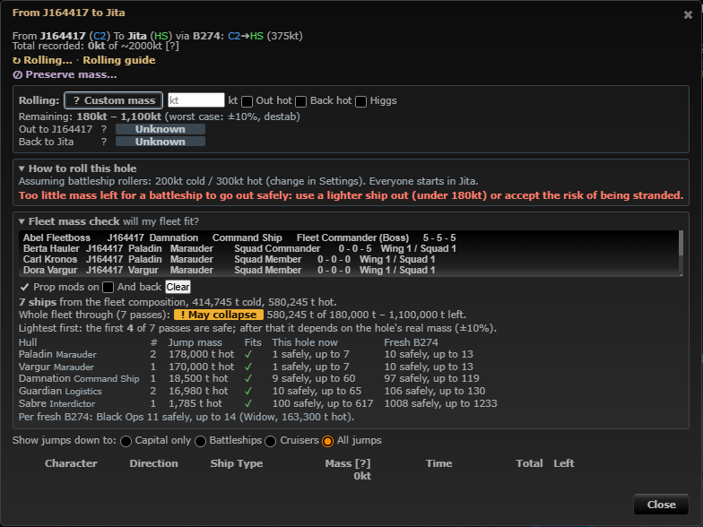

# Fleet mass check: "will my fleet fit through this hole?"

**Date:** 2026-11-15

## Description

Paste the in-game fleet composition (or a d-scan, or a list of ship names) into a hole's Mass dialog to see the fleet's
hull counts and total mass, which hulls fit the hole's jump limit, how many passes the hole takes before it may collapse
(given its logged mass and mass state), and how many of each hull a fresh hole of that type takes, e.g. Marauders and
Black Ops after their mass cut in patch 24.01. Also available from the command palette (Ctrl+K) as "Fleet mass check".

## Before / After

| Before | After |
| --- | --- |
|  |  |

## Settings

Toggle: Settings > Wormhole Jumps & Mass > Fleet mass check (on by default, `options.fleetMass.enabled`; a mask admin
can set a mask default for it, so `fleetMass` was added to the Mask Admin defaults allow-list).

Tip: yes. It is paste-only and easy to miss, so one callout (`fleetMass.dialog`) points at the section when a hole's
Mass dialog opens (retires once a fleet is checked).

## Change

- New `app/js/fork/fleet-mass.js` (pure global `fleetMass`, mocha-tested in `app/js-test/fork/fleet-mass.test.js` with
  fixtures in `app/js-test/testdata/fleet-mass/`) and `app/css/fork/fleet-mass.css`.
- Parsing: the fleet composition copy is tab-separated `Pilot, System, Ship type, Ship group, Position, Skills
  "n - n - n" [, Wing / Squad]` (the format aa-intel-tool's fleetcomp parser reads; the fixture follows it). D-scans are
  read by type ID (rows that aren't ships are left out), plain lists as "Paladin", "3x Paladin", "Kronos x3",
  "Guardian 4", "Marshal<TAB>2" or an EFT header. Unknown names are listed, not guessed.
- Mass: hull masses from `appData.mass` (`tools/mass.json`, which already has the 24.01 Marauder/Black Ops masses).
  "Prop mods on" (default) adds the usual prop module for the hull's size, using the module masses of the fitted jump
  mass feature (`fit-mass-data.js`): 500 t up to 5,000 t hulls, 5,000 t below 20,000 t, 50,000 t up to 500,000 t,
  500,000 t for capitals; capsules none. A ship whose hot mass would be over the jump limit goes cold.
- Maths: the rolling calculator's `rollingCalc.remaining` (logged mass + mass state + the hole's +-10%),
  `classify` and `passMass`. Passes are counted lightest first ("the first N of M passes are safe"), with an
  "And back" option. The preserve mass flag is shown as a warning.
- The section sits in the Mass dialog above the jump log. The paste stays for the session (not stored), so the same
  fleet can be checked against several holes. Command `fleetMass.check` (Holes) opens a hole's Mass dialog with the
  section open and the paste box focused.
- Usage: `fleetMass.checked` when a paste with ships is checked in an opened dialog; catalog entry `fleetMass`.
- Edited fork-owned allow-lists: `app/js/fork/mask-defaults.js`, `maskadmin/maskadmin.inc.php` (`fleetMass` added).
- No upstream files touched. No new ESI scope or external calls.
