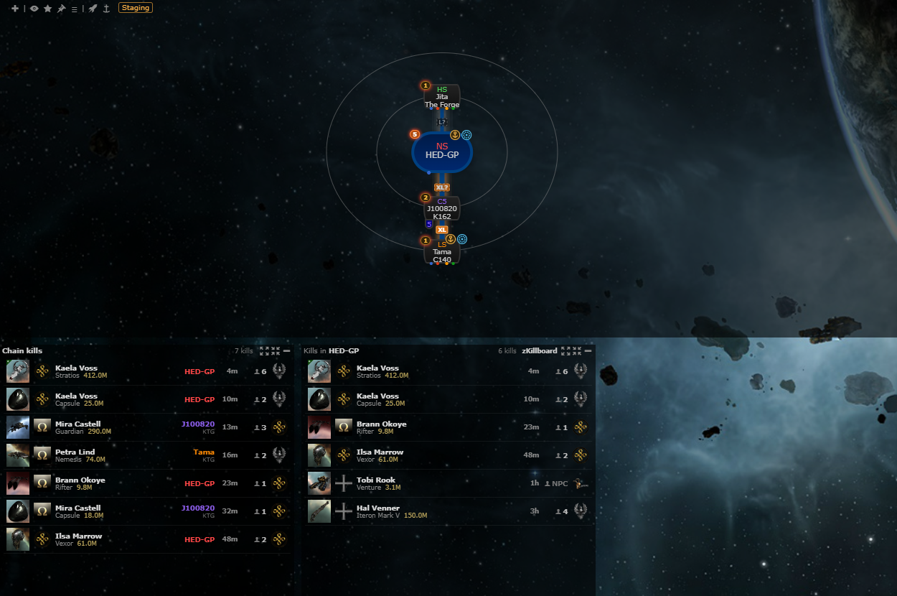
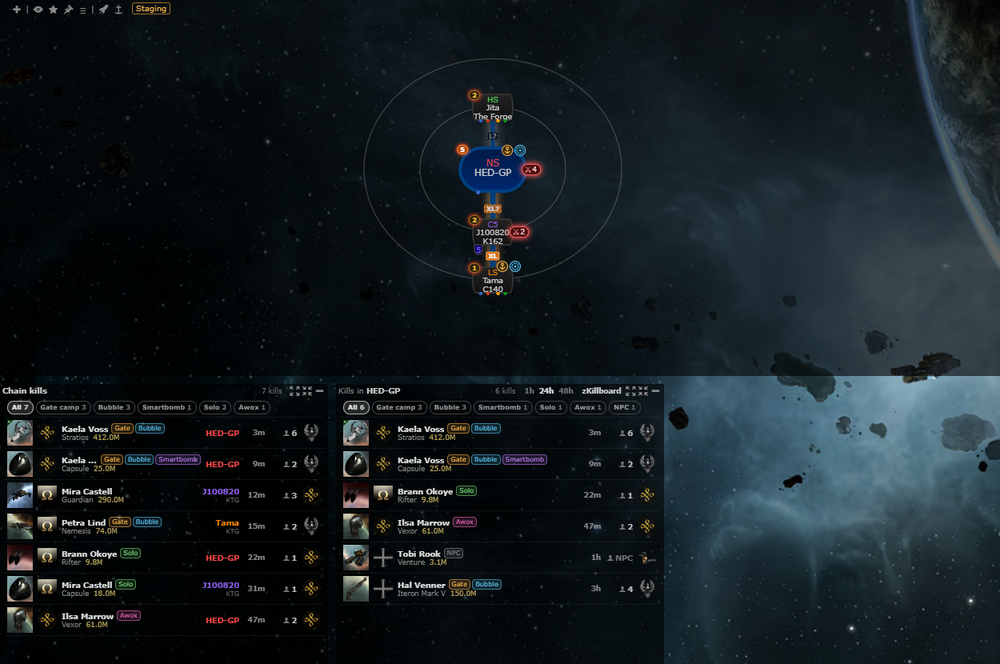

# Kill tags, tag filter and Fight now markers

**Date:** 2026-11-15

## Description

Kills in the System and Chain kill feeds get small tags (Gate camp, Bubble, Smartbomb, Gank, Solo, Awox, NPC) with a
filter by tag, the System kill feed gets a 1h / 24h / 7d window, and chain map systems with 2 or more player kills in the
last hour get a red "Fight now" marker that links to zKillboard's related kills (battle report) for that system and hour.
Idea from Nexum's kill labels (v5.12-5.13); no code taken.

## Before / After

| Before | After |
| --- | --- |
|  |  |

## Settings

- Kill tags and the tag filter: Settings > Kills & Intel > Kill tags (on by default, `options.killTags.enabled`).
- Fight now markers: Settings > Map Markers > Fight now (on by default, `options.fightNow.enabled`).
- Both keys are on the mask-defaults allow-list, so a mask admin can set a mask default.
- The window buttons belong to the System kill feed and stay when the tags are off.

Tip: none. The tags, the filter bar, the window buttons and the marker are all visible where they apply; there is nothing
hidden behind a right-click, a key or a dialog.

## Change

- **Storage** (`zkill/killmails.php`, `zkill/schema.php`, `docker/sql/zkill.sql`): the pooled worker already receives the
  whole killmail; it now also stores per kill zKillboard's `locationID` (nearest celestial), the distinct attacker hull and
  weapon type IDs (`attackerShips` / `attackerWeapons`, comma lists up to 400 characters), whether CONCORD is on the mail
  and zKillboard's `ganked` label. An existing `zkill_killmails` gets the columns from `zk_ensure_schema` (worker start, or
  the first read that hits a missing column); kills stored before have no tag facts and get only the Solo / Awox / NPC tags.
  No new third-party calls: nothing new is fetched, and the browser only links to zKillboard.
- **Read side** (`zkill/query.php`): `system_kills.php` returns the new fields; `zk_fight_now()` counts player kills per
  system in the last hour. New endpoint `public/fight_now.php?systems=...` (read only, queues nothing).
- **Tags** (`app/js/fork/kill-tags.js`, pure `killTags.classify`, mocha fixtures in
  `app/js-test/testdata/kill-tags-killmails.json`), defined conservatively:
  - Gate camp: the nearest celestial is a stargate (item IDs 50000000-59999999).
  - Bubble: an Interdictor or Heavy Interdiction Cruiser among the attackers.
  - Smartbomb: a smartbomb (group 72) among the attackers' weapons.
  - Gank: zKillboard's ganked label, or in high-sec (security 0.45+) CONCORD on the mail. Only kills stored before the tag
    facts (no attacker hulls, no location) fall back to 3+ pilots on an unarmed hull (haulers, freighters, barges, exhumers,
    Orca, expedition frigates, shuttles), since that rule can't tell a gank from a war-dec, limited engagement or suspect kill.
  - Solo: exactly one pilot among the attackers. Awox: zKillboard's awox flag. NPC: zKillboard's npc flag or no pilot
    (an NPC kill gets no other tag).
- **Feeds** (`app/js/fork/system-killfeed.js`, `chain-killfeed.js`): tag chips after the victim's name, a filter bar
  (All plus each tag that occurs, with counts) over the list, remembered per panel in the browser. The System kill feed
  asks for up to 50 kills (was 20) so the filter has something to pick from, and its window is 1h / 24h / 7d (default 24h).
  Windows longer than the server keeps kills (`retentionSeconds`, `ZKILL_RETENTION_HOURS`) collapse into one button labelled
  with the retention, e.g. 1h / 24h / 48h at the default 48 hours.
- **Map** (`app/js/fork/fight-now.js`, `app/css/fork/kill-tags.css`): high-sec systems are never marked (same rule as the
  Chain kill feed; trade hubs and gank systems would always be lit). The marker sits just outside the node's right edge,
  polls once a minute for the systems on the chain map, and its click opens the link without selecting the system.
- Mask defaults allow-list (`app/js/fork/mask-defaults.js`, `maskadmin/maskadmin.inc.php`): `killTags`, `fightNow`.
- Usage: two catalog entries, `killTags` (`filtered`, `window`; shown via `.kill-tag`) and `fightNow` (`opened`; shown via
  `.fight-now`), so each toggle's on/off is counted.
- Upstream files touched: none.
