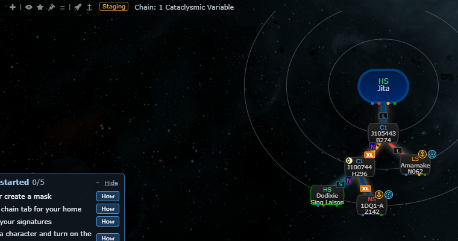
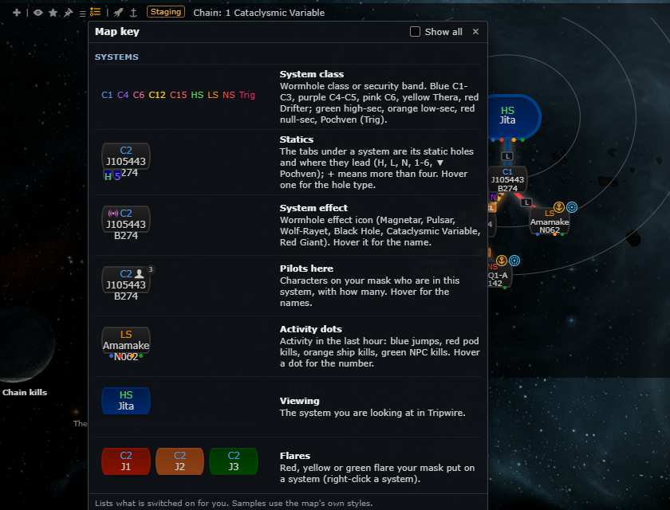

# Map key

**Date:** 2026-11-15

## Description

A Map key button in the chain map header opens a panel that explains every colour, line and marker the map can show
(upstream's and the fork's), each with a live sample, one plain line and where in Settings it is switched off. Many
fork markers had nothing explaining them.

## Before / After

| Before | After |
| --- | --- |
|  |  |

## Settings

Toggle: Settings > Chain Map > Map key button (on by default). The button is small, but the header is crowded and
someone who knows the map may prefer it gone; it sits with the other chain map header/drawing options. Mask admins can
make it a mask default (added to the mask-defaults allow-list).

Tip: none. The button is visible in the chain map header (and the command palette has "Map key").

## Change

- `app/js/fork/map-legend.js`: `forkLegend` registry (`forkLegend.register({...})`, fields at the top of the file),
  the panel (groups Systems / Connections / Marks on systems / Marks on connections), "Show all", the Settings row,
  the `mapKey.open` command, usage events `mapLegend.opened` / `mapLegend.show_all`.
- `app/js/fork/map-legend-entries.js`: 37 entries for what the map draws today (upstream classes, statics, effects,
  pilots, activity, flares, loops, gate routes, EVE-Scout, mass/life/size lines; fork size tags, high-sec region, home
  region, threat badges, preserve mass, rolling, life states, A0/storm tags, structures, STG, targets, Fight here, kill
  markers, watchlist, d-scan/local dot, jump ring, skyhook icon, destinations, favourite routes).
- Samples never drift: nodes and marks use the map's classes and the features' own markup functions; the map's
  `#chainMap` CSS rules are copied at runtime for the panel's sample root; connections are drawn on a canvas with the
  radial map's own drawing rules (`propertyFromCssClass`), 1.5x size.
- Only entries whose feature is on for the user are listed (a checkbox Settings row's value, or the entry's
  `enabled(options)`); "Show all" lists the rest dimmed with where to turn them on.
- `app/js-test/fork/map-legend.test.js`: every Map Markers Settings row must have a legend entry (`settingId`) or a
  line in `forkLegend.WAIVERS`; plus registry, on/off, "where" text and CSS re-targeting tests.
- tripwire-feature skill: one checklist line for adding a Map key entry.
- Catalog entry `mapLegend`; `mapLegend` added to the mask-defaults allow-list (`app/js/fork/mask-defaults.js`,
  `maskadmin/maskadmin.inc.php`).
- No upstream files touched (upstream's hover legend, the ≡ icon, is unchanged; the new button goes right after it).
