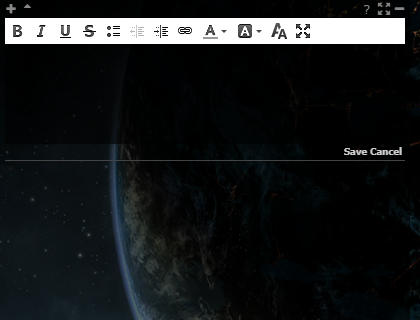
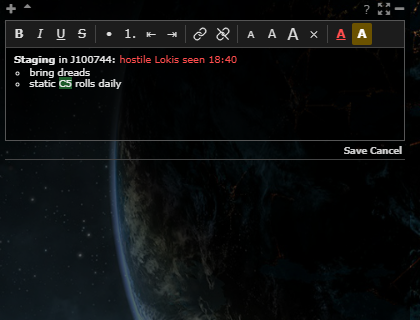
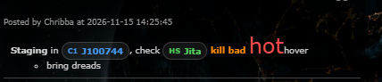

# Note security: new note editor, sanitised everywhere, php-jwt 7.2

**Date:** 2026-11-15

## Description

Ports the security parts of upstream Tripwire 2.0 (bitbucket daimian/tripwire `production` a9c49177, credit to its
authors) as a stand-alone fix, without the rest of the sync (PR #172 was closed). CKEditor 4 is replaced by a small
note editor based on upstream's `app/js/editor.js`, every path that hands out a system note now goes through the fork's
sanitiser, and php-jwt is updated to 7.2.1 (CVE-2021-46743 affected the old 5.x; the fork was already on 7.1.1).

## Before / After

| Before (CKEditor 4.22.1) | After (note editor) |
| --- | --- |
|  |  |

A saved note with pasted ``, `javascript:` and `onmouseover` payloads: shown and stored clean, smart notes
still decorate it: 

## Decisions

- **(a) Editor: replaced CKEditor.** CKEditor 4's open-source line ended in June 2023; 4.22.1 is its last free release
  and later security fixes (e.g. CVE-2024-24815, fixed in 4.24.0-lts) are commercial only. The fork ran it with its
  content filter off (`allowedContent: true`) and a Source button. Locking it down would still leave ~1.3 MB of
  unmaintained code in the page. The new editor (`app/js/fork/note-editor.js`, ~200 lines, contenteditable) sanitises
  the note it opens with, sanitises paste and drop *before* inserting (upstream inserted the raw clipboard and cleaned
  up afterwards, so an `` in copied HTML could run), returns sanitised HTML from `getData()` and
  `destroy(id, false)` (upstream put the raw editor HTML back into the page after a save), and only accepts http(s),
  mailto and Tripwire-relative links in its Link prompt. After a save the note shown is the one the server stored.
  User-visible loss: Source, Font family, Subscript / Superscript and Maximize buttons. Existing notes that use them
  still show as before (the sanitiser keeps those tags).
- **(b) Every render path sanitised.** Server: `refresh.php` (both lists), `comments.php` (on save, and now returns the
  stored note), `api/v1` notes, the token API and the password API all sanitise. **Gap fixed:** the password-auth
  `/api.php?q=/comments` (`api/comments/get.php`) printed stored HTML as is, so a row saved before the sanitiser existed
  reached API clients raw; `get.php` now sanitises every row (the token path's own extra pass is gone). Client: notes are
  rendered through `sanitiseHtml` (`tripwire/comments.js`), the editor as above, smart notes builds its chips with DOM
  calls and gets the stored note when editing. An error message in the notes list was inserted as HTML; now as text.
  Discord never carries system notes (only plain-text rolling / structure notes, escaped for Discord markdown).
- **Server parser:** the PHP sanitiser now parses with PHP 8.4+'s HTML5 parser (`Dom\HTMLDocument`, as the browsers do)
  when it is there, and falls back to libxml's HTML 4 parser otherwise, so a note can't be read one way by the server
  and another way by the browser (mutation XSS for API clients).
- **(c) php-jwt 7.1.1 -> 7.2.1** (`composer require firebase/php-jwt:^7.2.1`, optimized autoloader, no dev). The fork's
  caller already used the Key API (`JWT::decode($token, JWK::parseKeySet($jwks))`). `esi::validateJWT` now also returns
  false instead of throwing on a bad token (a failed login, not an HTTP 500), compares the issuer strictly, and checks
  what EVE's SSO docs ask for: `aud` contains our client ID and `sub` is `CHARACTER:EVE:<id>`.

## Settings

No toggle: this is a security fix, and going back to CKEditor would undo it. No tip: the editor opens from the
existing Edit link and + button.

## Change

- New: `app/js/fork/note-editor.js` (also `tripwire.editor`), `app/css/fork/note-editor.css`.
- Removed: `public/ckeditor/` (CKEditor 4.22.1), `app/js/ckeditor.js`, `tools/ckeditor/` (our updater).
- Fork files: `smart-notes.js` (editor hooks instead of CKEditor events), `panel-modes.js` (the CKEditor
  suspend / restart around a panel move is gone: the new editor moves with the panel), `hints.js`, `hints-ui.js`,
  `command-palette.js` (no CKEditor iframe to special-case), `sanitise-html.js` (comment only), `note-html.inc.php`
  (HTML5 parser), `esi.class.php`.
- Upstream files touched: `app/js/comments.js`, `app/js/tripwire/comments.js`, `app/js/tripwire/active.js`,
  `app/js/tripwire/tutorials.js`, `app/css/comments.css`, `tripwire.php` (CKEditor script tag), `public/comments.php`,
  `api/comments/get.php`, `api/token-auth.php`, `composer.json`, `composer.lock`, `vendor/`.
- Tests: XSS payload corpus `app/js-test/testdata/note-xss-corpus.json` (59 payloads: onerror, mixed case, entities,
  `javascript:` / `vbscript:` / `data:` URLs, svg, math / noscript mutation XSS, style, CSS escapes, iframe, form,
  meta, base, CDATA, ...) run by `app/js-test/fork/note-xss.test.js` (browser sanitiser) and `tests/note_xss_test.php`
  (server sanitiser, both parsers; also checks every server read path calls it). Each output is re-parsed and must hold
  only allowlisted tags, attributes and URLs, and must not change when sanitised again. `app/js-test/fork/note-editor.test.js`
  (open / save / paste / drop / link prompt), `tests/esi_jwt_test.php` (stubbed JWKS and tokens: valid, wrong key,
  unknown kid, expired, future, wrong issuer, other app, not a character, alg none, HS256 key confusion, tampered
  payload, malformed, short RSA key).
- Not used from upstream: its sanitiser (the fork's is stricter, see the closed sync PR #172) and its
  `tests/php/note-html.test.php` parity test (compares against upstream's JS sanitiser).
