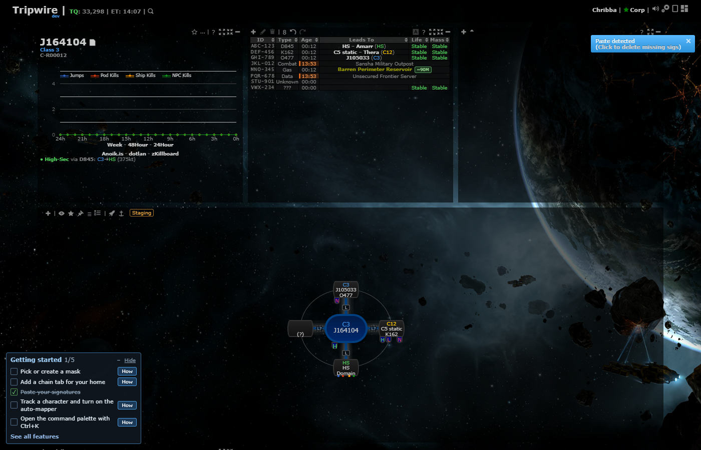
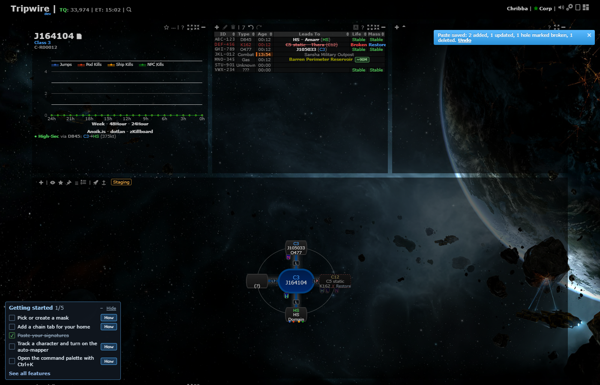
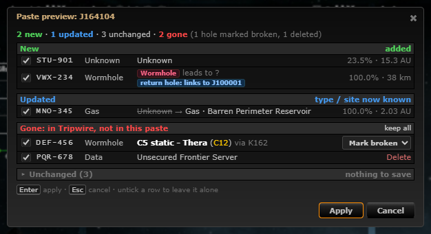
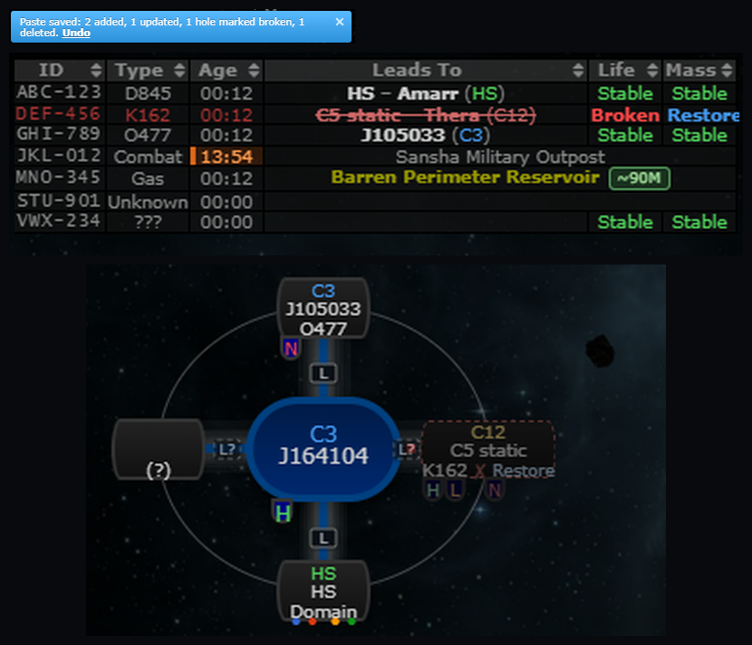
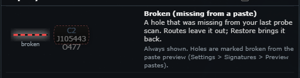

# Paste preview, with gone holes marked broken

**Date:** 2026-11-15

## Description

A probe scanner paste used to add and update straight away and then offer "Click to delete missing sigs", which
deleted every missing sig at once, wormholes included, with no list of what goes. Now a paste that would remove
something opens a preview first (New, Updated, Unchanged, Gone; untick a row to leave it alone), and a gone wormhole is
marked broken by default instead of deleted: it stays on the map red and dashed, routes leave it out, and Restore brings
it back. Ideas from Nexum (broken holes) and WormholeSystems (paste preview); the user approved the clickable mockup.

## Before / After

| Before | After |
| --- | --- |
|  |  |

The preview (the mockup's sample, right after a jump with Return hole on paste on): 

After Apply, zoomed (sig list and chain map): 

Map key entry: 

## Settings

Toggle: Settings > Signatures > **Preview pastes** (on by default; off gives exactly the old behaviour, with the
"Click to delete missing sigs" link) and **Always preview** (off by default: show the preview for every paste). Both
are stored in `options.pastePreview = {enabled, always}` and can have a mask default (Mask Admin).

Tip: none. The preview opens by itself on exactly the paste where it matters (something would be removed), and a broken
hole carries its own Restore link on the map and in the signature list, so nothing is hidden behind a right-click, a
key or Mask Admin.

## Change

- **Preview** (`app/js/fork/paste-preview.js`, new): wraps `tripwire.pasteSignatures.parsePaste`. Upstream's parser
  still builds the add / update payload, but its `tripwire.refresh` call is caught (nothing sent); the paste is sorted
  into New / Updated (type or site name now known, or a broken hole that is back in the scan: restore) / Unchanged /
  Gone against the viewed system. Gone uses upstream's rule: never gates, `???` sigs or anomalies kept by "Anomalies:
  Don't import". Only with something Gone (or Always preview) the dialog opens; otherwise the paste saves straight away
  with a notice "3 added, 1 updated" and an Undo link. Apply (Enter) sends adds, updates, deletes and broken marks in
  **one** `refresh.php` request and pushes one Undo step; Esc / Cancel saves nothing. Scan % and distance are shown in
  the preview only. Upstream's "Paste detected (Click to delete missing sigs)" notice is not shown while previews are on.
  A d-scan paste still opens the D-scan dialog (intel-scans.js takes it before the sig parser).
- **Return hole on paste** runs inside the preview: its row is tagged "return hole: links to <system>"; unticking it
  leaves that hole out of the paste (no hole, no link). Its Edit Signature dialog opens after Apply.
  `return-sig-paste.js` (fork) exposes its hit for the call as `returnSigPaste.current` (2 lines).
- **Broken holes** (`app/js/fork/broken-holes.js`, new): the far side of a broken hole stays on the map with a red dashed
  connection, a dimmed, dashed node and a "✗ Restore" link; its sig row shows "Broken" with the Leads To struck through
  and a Restore link. Only routes leave it out; the chain keeps every row and line, so chain alerts, the automapper,
  kill feeds, kill reporting, the palette, life states and size tags still see those systems. `chain.nodes` is wrapped
  when the file loads (innermost; a mocha test pins that no fork file before it wraps at load) and marks its result:
  the broken line gets the `broken-hole` modifier, rows whose system can only be reached through a broken hole get
  `row.brokenHole`, rows whose own way home crosses a broken hole get `row.brokenPath`, and `exits` leaves the cut-off
  systems out (a loop through another hole keeps them; `systemsInChainMap` then points at the row with a clean way home, or at
  a copy whose way home is just the system, so the system panel's "To chain:" text never runs through the broken hole). The route features
  honour the marks with one guarded line each (fork files): `rally.systemConnections` skips broken lines (the hole
  graph of Favourites, Destinations, Fight here and the route filters), `routeDestinations.chainExits` skips
  cut-off rows and prefers a clean row (an exit reached only through a loop stays, flagged `brokenPath`, without the
  broken hole's name; Destinations judges it by the route from where you are, else from the chain's root over the
  hole graph, else it is unreachable and ranks last there and in Loot buyers via `routeHoleFilters.pickRoutes`), `routeDestinations.chainSystems`,
  `favouritesPanel.chainSystems` and `jumpPlanner.isExtraRow` skip `row.brokenHole`, `jumpPlanner.homePaths` (Get
  home) skips a way home through a broken line so the fewest-holes choice takes another, and the system panel's routes and the region map read the filtered `exits`.
- **Storage** (`broken_wormholes.inc.php`, new): fork-owned table `fork_broken_wormholes (maskID, wormholeID, markedBy,
  markedAt)`, created on first use; no change to upstream's `wormholes` schema, so syncs never conflict, and a restore is
  just deleting our row. No foreign key (as `preserve_mass.inc.php`); rows of holes that are gone are never listed and are
  cleaned on the next change, so a broken hole lasts until the hole itself expires or is deleted. Mask-scoped (the
  session's mask; a hole of another mask is skipped), and changes need the session's CSRF token (`fork_csrf_valid()`).
  Marks and restores are written to the audit log as wormhole updates (`broken: '' -> yes`). No Discord messages.
- **No endpoint of its own**: `public/refresh.php` (upstream) calls `broken_wormholes_refresh()` after the signatures
  part (2 lines): it applies a `brokenHoles: {mark, restore}` part of the request and always answers the mask's list
  (`brokenHoles`), so the paste is one request and everyone on the mask sees a change with their next refresh.
- **Undo** (`undo-history.js`, fork, PR #166): a step may carry extra parts (`meta.extra`, `undoHistory.registerExtra`);
  broken marks and restores ride in the same step and request as the paste's sig changes, and undo / redo swap mark and
  restore. A step is done only when its signatures and its extra parts were all saved; otherwise it is partial and
  only what was saved goes on the other stack (`ui.settlePart`, mocha-tested). Restore from the map or the list is its
  own undoable step.
- `life-states.js` (fork): its 15 s Life refresh skips a broken hole's cell (1 line).
- Map key: entry "Broken (missing from a paste)" under Connections, always shown (mask-mates' broken holes draw
  whatever this user's Preview pastes setting is).
- `rally.js`, `route-destinations.js`, `favourites-panel.js`, `jump-planner.js`, `route-hole-filters.js` (fork): small
  guarded changes (above).
- Mask defaults: `pastePreview` added to the allow-lists (`mask-defaults.js`, `maskadmin/maskadmin.inc.php`).
- Tests: `app/js-test/fork/paste-preview.test.js`, `app/js-test/fork/broken-holes.test.js` (classify, Apply plan, routing
  split / restore, undo parts); `tests/broken_wormholes_test.php` (ids, CSRF, mask isolation, mark / restore / list, gone
  holes, audit).
- Upstream files touched: `public/refresh.php` (2 lines). `tripwire/paste.js` is unchanged.
