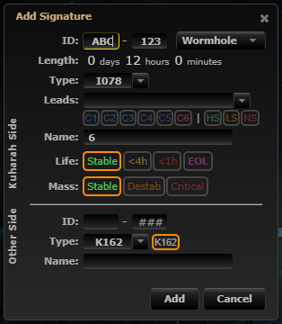

# Pochven holes and hull masses pinned to patch 24.01

**Date:** 2026-11-15

## Description

Rechecked the Pochven wormhole types against the
[Patch Notes - Version 24.01](https://www.eveonline.com/news/view/patch-notes-version-24-01) (2026-09-22.1, 2026-10-06.1,
2026-10-07.1) and public ESI, along with the Marauder and Black Ops hull masses. The data was already right (fixed in
[2026-10-10-game-data](../2026-10-10-game-data/README.md)), so this adds a mocha test that pins it. Upstream Tripwire
2.0 has older Pochven values, and the next upstream sync must not bring them back.

## Screenshot

No visual change: the app already shows these values. The Add Signature dialog in Kuharah (Pochven) with type I078
pre-fills a 12 h life:

## Settings

No toggle, because this is game data with nothing to prefer. No tip either, because nothing new is shown.

## Change

New test `app/js-test/fork/game-data-24-01.test.js`. No upstream file touched.

**Pochven.** Checked against ESI dogma (1382 life in minutes, 1383 total mass, 1385 jump mass):

| Types | Life | Total / jump mass (kg) | From -> to |
| --- | --- | --- | --- |
| I078, L687, O546 (intra-Pochven) | 12 h | 750,000,000 / 62,000,000 | Pochven -> Pochven |
| C729 | 12 h | 1,000,000,000 / 410,000,000 | k-space and Pochven -> Pochven |
| F216, U372 | 12 h | 1,000,000,000 / 375,000,000 | C2-C6 or null-sec -> Pochven |
| R081, X450 | 12 h | 1,000,000,000 / 375,000,000 | Pochven -> C4 or null-sec |
| O753, R327 (new Blood Raider / Tetrimon holes) | 12 h | 1,000,000,000 / 375,000,000 | low/null-sec -> Pochven |

The test pins these values in `tools/wormholes.json`, `public/js/combine.js` (`appData.wormholes`) and the REST API copy
`api/wormhole-types.json`. It also checks:

- the signature timer pre-fills 12 h
- the mapper offers I078/L687/O546 between two Pochven systems
- the rolling calculator gives 675,000,000-825,000,000 kg for an untouched intra-Pochven hole
- the rolling guide has no battleship plan for the 62,000,000 kg intra-Pochven holes and the "1b" plan for the others
- no type is listed twice in any of the three files

Life-state timers (<4h / <1h / EOL) and mass states work from the signature timer and the type's total mass, so they
need no Pochven-specific data.

**Upcoming upstream sync.** Upstream 2.0 (`a9c49177`) adds I078/L687/O546 with `"life": "5 Hours"` after J492 at the
end of `tools/wormholes.json` (and in `combine.js`), and has F216 at 300,000,000 jump mass. Our entries sit after X450,
so a 3-way merge could keep both copies, and upstream's later "5 Hours" copy would win when the file is parsed. When
syncing, keep our lines and drop upstream's copies. The duplicate-key and value checks in the new test fail until
that's done.

**Hull masses.** Every published Marauder (group 900) and Black Ops (group 898) hull in `tools/mass.json` and
`appData.mass` matches ESI `mass` and the 2026-09-22.1 notes: Paladin 128,000,000, Kronos 118,400,000, Vargur
120,000,000, Golem 125,600,000, Babaroga 114,400,000, Redeemer 112,700,000, Sin 106,300,000, Widow 113,300,000,
Panther 111,600,000, Marshal 112,500,000 and Python 106,300,000 kg. A sweep of all 570 hulls in `tools/mass.json`
against ESI found no other difference. `public/jumprange/ships.json`, `public/intel/types.json` and `fit-mass-data.js`
hold no hull masses. The test pins the 11 hulls in both files, checks each is 20-25 % lighter than before, and fails on
duplicate type IDs.

Not stored by Tripwire, so nothing to change: the 30-minute phases and 75 km warp-in of Extra-Pochven holes, and
where the new Blood Raider / Tetrimon holes spawn.
