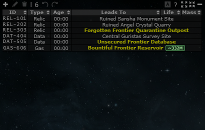
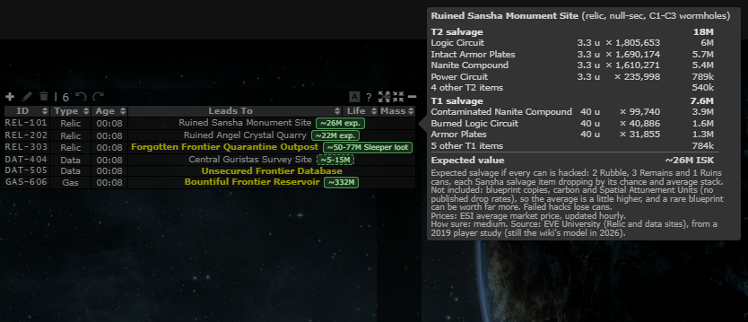

# Relic and data site value

**Date:** 2026-11-15

## Description

The site value chip (PR #165, gas and ore) now also covers relic and data sites in k-space and wormholes, except the
wormhole "Unsecured ..." data sites. Each chip says what kind of figure it is: an expected-loot model for Ruined relic
sites ("~26M exp."), Sleeper rat loot for Forgotten sites ("~115M Sleeper loot"), a rough dated range for other
pirate sites (dashed chip), or "?" with the reason. The tooltip says where each figure comes from and how far to trust it.

## Before / After

| Before | After |
| --- | --- |
|  |  |

## Settings

Toggle: the existing Settings > Signatures row (`options.siteValues.enabled`, on by default), relabelled "Site value:
Show the estimated ISK value of gas, ore, relic and data sites". No new toggle.

Tip: none. The chip is visible on the row and its tooltip explains it.

## Change

- Data: `public/site-values/sites.json` gains `families` (scanner names `<prefix> <faction> <layout>` for Angel, Blood
  Raider, Guristas, Sansha and Serpentis), `relicModel`, `exclude`, 38 salvage `types` with stored prices of
  2026-11-15, and named sites (12 Forgotten, 3 Sleeper caches, Silent Battleground). Every figure names its source and
  date in the file. Research: EVE University (Relic and data sites, List of data and relic sites, Template:Whisk),
  Signal Cartel's "Making ISK as an Explorer" (2024-01), EVE Online forums.
- **Ruined** (null-sec, C1-C3): expected salvage = for each item of the faction's list, Rubble/Remains/Ruins count x
  drop chance x mean uniform stack (EVE University, from MacrophageNT's 2019 study), times the live ESI average price.
  Reproduces the research's units per item (Monument 39.5 T1 / 3.345 T2, Temple 36.625 / 5.235, Science Outpost
  45 / 5.5, Crystal Quarry 36.625 / 7.235). Tooltip: T2 and T1 subtotals with their main items, and what is left out
  (BPCs, carbon, Spatial Attunement Units, failed hacks).
- **Dominant item:** not capped (there is no sourced ceiling to cap at). When one item is half or more of an estimate
  (`relicModel.dominantShare` 0.5, today Logic Circuit in Angel and Blood Raider sites, 50-59%), the tooltip names it,
  gives the value without it, and quotes Signal Cartel's 830k Jita buy price for Logic Circuit (Aug 2023).
- **Forgotten** (wormhole Sleeper relic): static Sleeper blue-loot figure from EVE University's Template:Whisk
  (2021-03-18); blue loot sells to fixed NPC buy orders. The C3 sites show both figures where the template and the site
  page disagree ("~50-77M", "~66-93M"). The cans are marked unverified.
- **Central / Local data, Decayed / Crumbling relic:** static ranges (dashed chip, "How sure: low"): Central 5-15M
  (typically 8M), Local 2-4M, Decayed 1-10M, Crumbling under 2M.
- **"?" with the reason:** Rogue Drone Ruined sites (drop chances unknown), Regional data (no figure), ghost sites
  (Covert Research Facility, rebalanced 2025-07-17 with no figures since), Sleeper caches (only old or anecdotal
  figures, loot changed 2025-07-17) and Silent Battleground (very rare, only "more than 200M"). These are well-known
  sites that explorers look for, so "?" tells them the value is unknown on purpose.
- **No chip:** wormhole Unsecured data sites (excluded by `exclude.prefixes`, even if a name were added), and rare or
  unclearly named sites (drone data, Detected sov sites, combat relic ruins, faction warfare and event sites): no
  reliable names or figures, and a "?" on them would only add noise.
- Prices: the server's hourly ESI copy now also fetches the 38 salvage types (it reads every type in `sites.json`, so
  `market_prices.inc.php` is unchanged); the PHP test checks they are in the list.
- Code: `app/js/fork/site-values.js` (`familySites`, `excluded`, `expectedUnits`, `modelEstimate`, `staticEstimate`,
  `relicTooltip`), `app/css/fork/site-values.css`; tests `app/js-test/fork/site-values.test.js`,
  `tests/market_prices_test.php`. Catalog title of `siteValues` updated.
- Upstream files touched: none.
