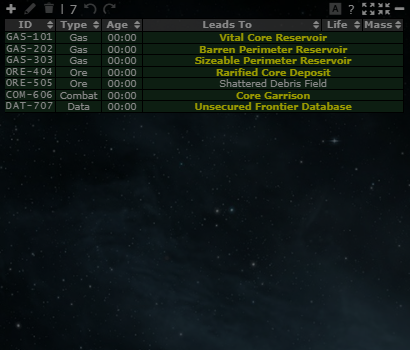
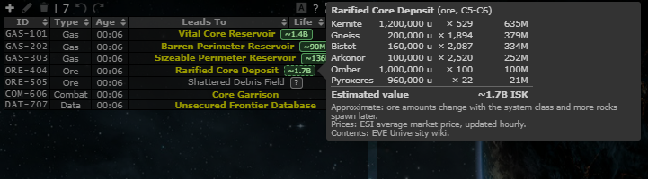

# Gas and ore site value

**Date:** 2026-11-15

## Description

Wormhole gas and ore sites in the signature list get a chip with their estimated ISK value (e.g. "~1.4B"); its
tooltip lists each resource with units, unit price and value. It shows at a glance which gas or ore site is worth
sending a harvester or a mining fleet to.

## Before / After

| Before | After |
| --- | --- |
|  |  |

## Settings

Toggle: Settings > Signatures > Gas and ore site value (on by default), `options.siteValues.enabled`. Also allowed as a
mask default.

Tip: none. The chip is visible on the row itself, and its tooltip explains it.

## Change

- Site contents: `public/site-values/sites.json`, by the site name the scanner shows. Gas sites (9) come from each
  site's EVE University page; unit volumes match Fuzzworks' gas table and the SDE, and All-Out's gas guide confirms two
  clouds per site (status `verified`). Ore sites come from EVE University only, which says the amounts are approximate
  and change with the system class (status `approximate`, dashed chip, said in the tooltip). Two sites are
  `unverified` and get a grey "?" chip with the reason instead of a value: Infrequent Core Deposit (its page says its
  quantities predate the 19.11 mining changes) and Shattered Debris Field (ore variants listed by pre-2024 names).
- Prices: ESI's public `/markets/prices/` average price (no key, no new host), fetched by the server at most hourly
  for everyone and cut to the 15 items we need (`market_prices.inc.php`, `public/market_prices.php`, cache file
  `cache/market-prices.json`). Until it answers, or if ESI is down, the prices stored in `sites.json` (2026-11-15) are
  used and the tooltip says so.
- Code: `app/js/fork/site-values.js` (pure logic in `siteValues`, mocha tests in `app/js-test/fork/site-values.test.js`,
  which also checks the data file), `app/css/fork/site-values.css`; PHP test `tests/market_prices_test.php`.
- Catalog: `siteValues` (passive, exposed `.site-value-chip`); mask-default allow-lists (`app/js/fork/mask-defaults.js`,
  `maskadmin/maskadmin.inc.php`) gain `siteValues`.
- Upstream files touched: none.
