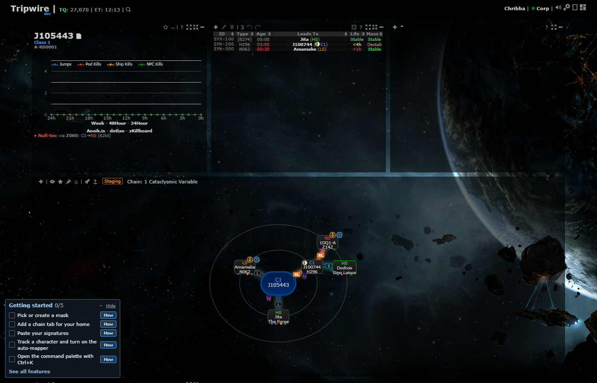
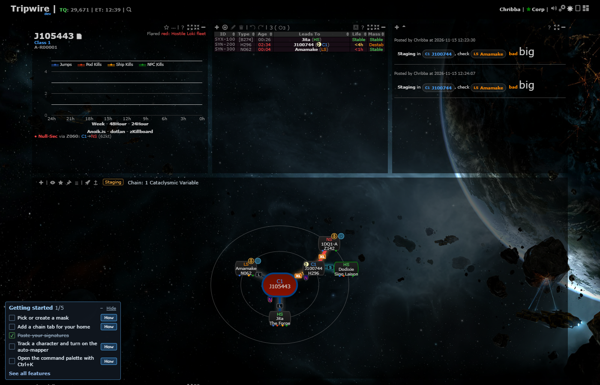
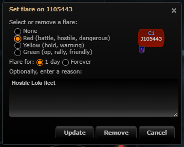
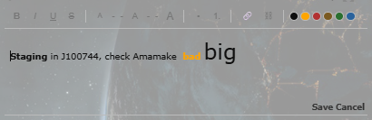
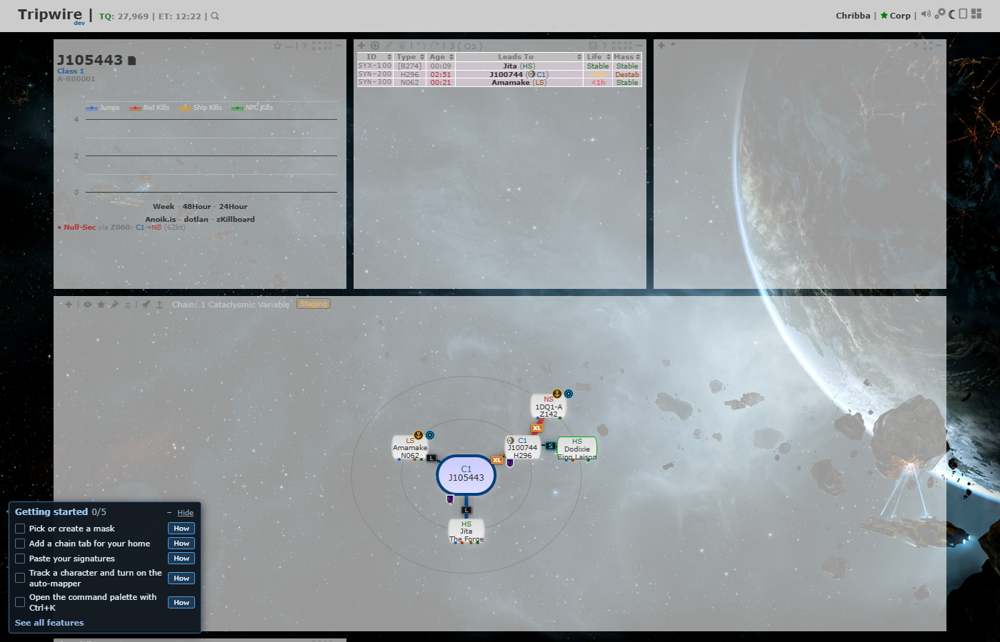
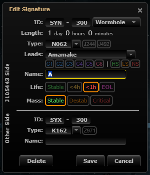
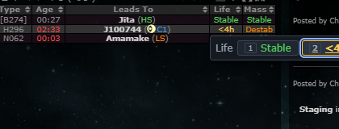
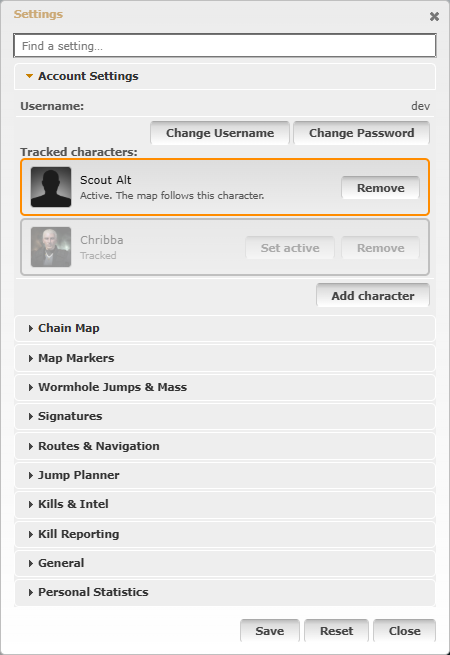

# Sync upstream Tripwire 2.0

**Date:** 2026-11-15

## Description

Brings in upstream Tripwire 2.0 (bitbucket daimian/tripwire `production` 6682a89..a9c49177, announced 2026-11-08): flares
with a reason and a lifetime, a light/dark theme, a new note editor in place of CKEditor 4, characters in
Settings > Account, online/offline tracked characters, Pochven's inner holes, the schema self-update and php-jwt 7.
Where 2.0 overlaps a fork feature the fork's version stays and upstream's duplicate is hidden or skipped with a small
change; the table below lists each choice for you to decide.

## Before / After

| Before | After |
| --- | --- |
|  |  |

The chain and sig list look the same on purpose (dark theme by default, the fork's four life states). New in the
header: the theme switch (sun / moon) and, in the sig list toolbar, upstream's Paste button and anomaly count.

| Flares with reason and life | Note editor (no more CKEditor) | Light theme (fork panels not themed yet) |
| --- | --- | --- |
|  |  |  |

| Sig dialog: one set of life buttons | Life cell: only the fork popover | Settings > Account: characters |
| --- | --- | --- |
|  |  |  |

## Decisions for the user

| Overlap | Chosen | Alternatives | Recommendation |
| --- | --- | --- | --- |
| Upstream `<1h` life (new `wormholes.life` value, radio in the sig dialog, chip in the sig list, map style `eol-1h`) vs the fork's life states (Stable / <4h / <1h / EOL from the timer, `options.lifeStates`) | Fork's. Upstream's `<1h` radio is hidden (`life-states.css`); the server stores a `<1h` request as `critical` with a 1 h timer, for a new hole as for a changed one (3 lines in `signatures.php`), so the DB never holds `<1h` and every fork reader (map, bookmarks, Discord, palette) keeps working. The map legend shows the fork's <4h / <1h / EOL lines in upstream's new legend rows | Store `<1h` like upstream and teach the fork's ~10 readers the new value; or drop the fork's states for upstream's three | Keep. The fork's model is a superset (EOL past the timer, keys, undo) and needs no data migration |
| Upstream inline Life/Mass chips (`inline-wormhole-edit.js`) vs the fork's sig-inline popover (`options.sigInline`) | Fork's. `sig-inline.js` unbinds upstream's click handler, so one popover opens (none with the setting off); the editable look is dropped when off (`sig-inline.css`) | Use upstream's chips and retire sig-inline (loses 4 life states, keys 1-4, undo of the timer) | Keep the fork's |
| Upstream online/offline tracking and Settings > Account characters vs multi-track (A switches, online-only) | Both. They don't fight: upstream sets `character.online` from the same `/online/` poll the fork uses and adds a second view of the same list in Settings; multi-track's switches stay in the header dropdown | Hide the Settings list | Keep both; not tested with real tracked characters (no ESI tokens in dev) |
| Upstream J-space kill stream (`kill-stream.js`, every browser fetches zkillboard.com) vs the fork's system / chain kill feeds (pooled worker) | Fork's. The stream never shows and never fetches (`upstream-2-adapters.js`); the activity graph stays in J-space. Only the worker may call zKillboard | Serve the stream from `zkill_killmails` instead of zkillboard.com | Keep off; if wanted, a later PR can feed it from our DB |
| Note sanitiser: upstream's `note-html.inc.php` / `app/js/sanitise-html.js` vs the fork's stricter one (same function names) | Fork's, on both sides (fork JS loads after upstream's and wins). Stricter: no `data:` URLs, `img` only from https, no `.php` links, drops `<script>`/`<svg>`/… with their content | Upstream's (allows pasted `data:` images) | Keep the fork's. Pasted images now need a hosted URL. Upstream's parity test `tests/php/note-html.test.php` compares against upstream's JS and fails 6 checks by design; ours (`tests/note_html_test.php`, mocha) pass |
| Light/dark theme toggle | Upstream's, as is: dark stays the default, the toggle is in the header | Hide the toggle until fork CSS uses the colour tokens | Keep, but fork panels (Getting started, kill feeds, palette, …) stay dark in light mode; tokenise them in a follow-up |
| Pochven data: upstream I078/L687/O546 at 5 h, F216 jump 300 kt | Fork's (12 h, 375 kt, checked against ESI in `changes/2026-10-10-game-data`); upstream's duplicate keys dropped from `tools/wormholes.json` and `combine.js` | Upstream's values | Keep the fork's |
| Paste button and anomaly count in the sig list (upstream) vs fork "Anomalies in the signature list" (show / hide / don't import) | Both. `sig-anomalies.js` now also reads upstream's `scan_group` | Hide upstream's count | Keep both |
| Account token refused: upstream ends the session on any refresh failure; the fork only on `invalid_grant` | Fork's (an ESI hiccup doesn't sign everyone out) | Upstream's | Keep the fork's |

## Settings

No new toggle: this is an upstream sync. Upstream's own switches stay as they are (theme toggle in the header).
Overlaps follow the existing fork toggles (`options.lifeStates`, `options.sigInline`). No tip: nothing new of ours.

## Change

Two commits in one PR: the sync (`.github/scripts/sync-upstream.sh`, conflicts resolved), then the adapters.

- **Sync**: upstream's deletion of `public/ckeditor/` didn't apply (the fork had CKEditor 4.22.1), so the script was run
  with `public/ckeditor` excluded and the folder removed by hand; `tools/ckeditor/` (our updater) is gone too.
  Conflicts in 23 files resolved as described in the commit message (fork CSRF checks kept next to upstream's
  `db.php`, fork's `ping.php` mention rules plus upstream's `rawurlencode`, fork's automap lock/mass logging, ...).
- **Schema / deploy** (`deploy:manual`): `docker/db.inc.php` sets `$mysql_update` (`DB_UPDATE_USER` /
  `DB_UPDATE_PASSWORD`, default the app connection); `docker/config.php` defines upstream's new `ENABLE_ANALYTICS` /
  `ENABLE_DONATIONS` as true (our replacements decide for themselves, and tripwire.php needs the no-op `ga()`);
  `docker/Dockerfile` checks for `dom` and leaves out `e2e/`, `playwright.config.js`, `composer.lock`;
  `docker/crontab` runs upstream's new `system_activity_prune.cron.php` nightly; `.env.example`,
  `docker-compose.dev.yml`; `docker/README.md` "Database updates" with the production upgrade steps.
- **Adapters** (fork files): `upstream-2-adapters.js` (no flares on the first draw, kill stream off, the note editor
  returns sanitised HTML: upstream put the raw editor HTML back into the page after a save), `smart-notes.js` (the new
  editor gets the stored note, not the decorated one), `command-palette.js` (flare commands use upstream's
  `sendFlare`; `contextmenu("setFlare")` is gone), `rolling-calculator.js` (wraps `chain.draw`;
  `tripwire.chainMap.parse` is gone), `life-states.js/.css`, `sig-inline.js/.css`, `sig-anomalies.js`, tests.
- **Upstream files touched after the sync**: `signatures.php` (3 lines: `<1h` stored as critical with a 1 h timer),
  `tripwire.php` (1 line: the fork's `is_string` check on `?system=` is back, so `?system[]=x` no longer gives a 500).
- **DB update state** (`docker/db.inc.php`): in production `cache/` is a volume, so the state file outlives a database
  restore. On the map page the file is lowered (never raised) to the first diff whose name `update_history` lacks.
  Restoring a pre-2.0 backup needs `DROP TABLE update_history` first (docker/README.md#database-updates).
- **Tested**: mocha 3609 passing (main: 3599; the 4 failures and 1 load error the sync caused are fixed); PHP tests all
  pass except `analytics_dashboard_test.php`, which fails the same way on main; `docker build` OK; upstream Playwright
  (run with Chrome against the dev stack): 16 passed, 4 fail by design (kill stream off, 10 panels not 4, stricter
  `img` rule, follow toggle needs a tracked character). Upgrade of an existing dev DB (8 diffs ran on first map load)
  and a fresh install with a separate `DB_UPDATE_USER` (needs `UPDATE` too; becomes `flaresClean`'s definer, fixed
  with `ALTER DEFINER ... ENABLE`) both checked. A note with `` / `javascript:` saves and shows clean.
- **Note:** before this fix, the screenshots run loaded upstream's kill stream a few times, so the dev machine sent
  some browser requests to zkillboard.com's API.
