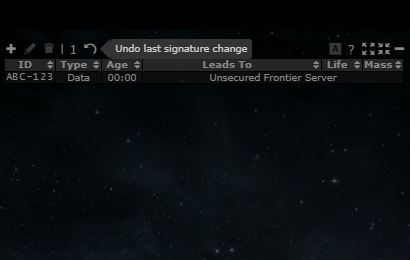
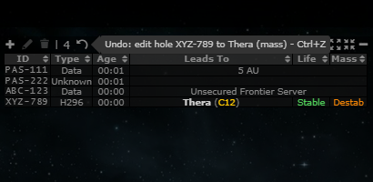
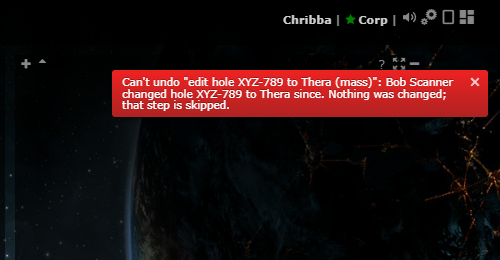

# Undo and redo any signature or map edit

**Date:** 2026-11-15

## Description

Undo was per system: Ctrl+Z only undid changes made in the system you were viewing, an automapped hole landed on
another system's stack, and the arrow just said "Undo last signature change". Now there is one undo / redo history for
the session covering every signature and map edit, Ctrl+Z / Ctrl+Shift+Z (or Ctrl+Y) work from anywhere outside a text
field, the arrows and the command palette name the step ("Undo: delete sig DEF-456"), and a step someone else has
changed since is refused instead of overwriting their change. Undo is the top reliability complaint in the Tripwire
forum thread; WormholeSystems added map-wide undo / redo in wsctl v0.7.

## Before / After

| Before | After |
| --- | --- |
|  |  |

Refused step (someone else changed the hole since): 

## Change

- New `app/js/fork/undo-history.js`. Upstream and the fork push undo entries onto `tripwire.signatures.undo[systemID]`
  (signature dialog, delete dialog, paste, automapper, inline life / mass cells, return-sig paste, jump-sig link).
  Those two objects are replaced by proxies whose every system key is the same stack, so all existing pushers (and
  upstream 2.0's `signaturePayload.recordUndo`, which pushes the same way) feed one history without being edited. The
  automapper's undo (`automapper-undo.js`) and the inline cells' Ctrl+Z are now part of it: one Ctrl+Z, not three.
- Covered: sig add / edit / delete (dialog, paste, inline), hole life, mass, type and leads-to, hole deletes and adds
  (which take a system off / put it on the map), automapped holes.
- Entries pushed by one action (a paste's adds and updates, an automap's add and update) are one step and are undone in
  one request. A new edit clears the redo stack. 100 steps kept, in `sessionStorage` (`tripwire_history`).
- `tripwire.undo` / `tripwire.redo` are replaced. Undo and redo go through the normal save (`refresh.php` ->
  `signatures.php`), so other clients see them and the audit log records them. Before sending, the step is checked: an
  item it changes must still be there and be last changed by you (the server always stamps the editor from the session),
  and an item it adds back must not be on the list again (same ID, same system). Otherwise it is refused with a red
  notice naming who changed what, and skipped. A server refusal also skips the step (it no longer blocks undo for the
  session). Re-added items get new ids; the rest of the history is remapped to them.
- A step made in another system: the view goes to that system first (its signatures are only loaded there), then the
  step runs.
- Ctrl+Z / Ctrl+Shift+Z / Ctrl+Y are caught before upstream's handler (which now never runs for them); in inputs,
  text areas, selects and editors they are left to the field. The Undo / Redo arrows' tooltips and the palette's Undo /
  Redo commands show the next step; Redo's shortcut shows Ctrl+Shift+Z.
- New hints event `history.recorded` (`hints.js`).
- PHP: the two server bugs named for this work were already fixed on main (`lastInsertId()` read before the statistics
  upsert, 7fc139b4; automapper undo on the viewed system, `automapper-undo.js`), both adapted from mogglemoss/tripwire
  09bcb40 (MIT) and tested in `tests/automap_dedupe_test.php` / `automapper-undo.test.js`. New
  `tests/undo_history_test.php` pins the server behaviour the history relies on: re-added copies get new ids in request
  order with their fields, timer, hole life / mass kept and the author from the session; an update stamps the session's
  character as editor whatever the copy says; the audit log records it.
- Tests: `app/js-test/fork/undo-history.test.js` (steps, payloads, conflicts, snapshots, id remapping, labels, keys,
  storage).
- No upstream files touched (upstream `undo.js`, `redo.js` and `global-hooks.js` stay as they are; their functions are
  replaced from the fork file).

## Settings

No toggle: it is a fix of an existing feature (undo / redo already existed, per system and partly broken). Nothing new
is drawn or pops up on its own; the shortcuts only act when pressed.

## Tip

Yes, one callout on the Undo arrow (`undoHistory.keys`), after you delete or edit a signature or hole: the shortcuts are
easy to miss and the history now covers every system. It retires once you have undone something.
