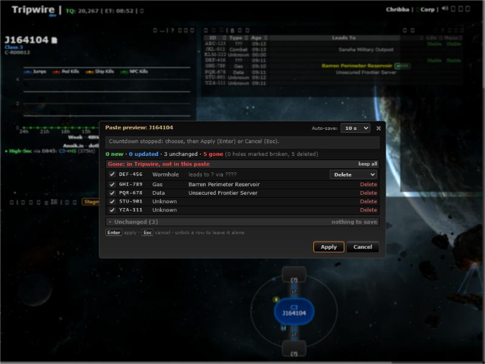
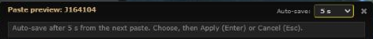

# Paste preview: auto-save drop-down opens on click

**Date:** 2026-11-18

## Description

The auto-save drop-down in the paste preview's title bar (PR #180) did nothing when clicked: the title bar is the
dialog's drag handle, and jQuery UI took the mousedown (to drag and to focus the dialog) before the select could open.

## Before / After

| Before | After |
| --- | --- |
|  (click: the select doesn't open or take focus) |  (clicked, 5 s chosen) |

## Settings

No toggle: bug fix.

## Change

- `app/js/fork/paste-preview.js`: the drop-down's label stops `mousedown` / `touchstart` from reaching the title bar,
  and stops the countdown itself (the document-level "any input" handler no longer sees that mousedown). Checked with
  a real click and arrow keys in the dev stack: the select takes focus, the choice is saved, Enter on it doesn't Apply.
