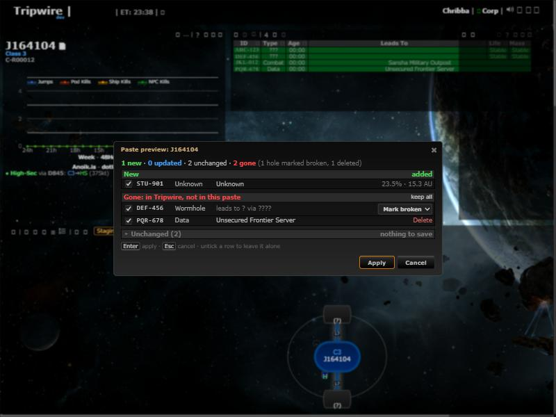
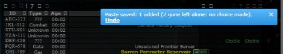

# Paste preview: Delete by default, 10 second auto-save

**Date:** 2026-11-18

## Description

The paste preview waited for an answer and pre-selected "Mark broken" for gone wormholes. Now every gone signature
defaults to Delete, and the dialog counts down 10 seconds: with no input by then the paste saves only its new and
updated signatures and leaves everything gone as it is (nothing deleted, nothing marked broken).

## Before / After

| Before | After |
| --- | --- |
|  |  |

No input for 10 seconds: 

## Settings

No new toggle: this changes how the existing preview behaves (Settings > Signatures > Preview pastes still turns the
preview off). Tip: none, the countdown explains itself in the dialog.

## Change

- `app/js/fork/paste-preview.js`: a gone wormhole's choice defaults to Delete (Delete listed first, Mark broken still
  offered). New `AUTO_SECONDS: 10` and `keepGone(groups)` (all Gone rows unticked). The dialog shows a countdown line
  with a shrinking bar; any mousedown, key, wheel or touch on the page stops it and the user chooses as before (Apply /
  Enter, Esc / Cancel). At zero the preview applies `keepGone`: adds, updates and broken-hole restores only. The notice
  says "(2 gone left alone: no choice made)". An auto-save is tracked as the event `auto_saved` (not the use `applied`; added to `public/fork/feature-catalog.json`).
  Stopped by input, the line stays in place ("Countdown stopped") so the buttons don't move under the mouse.
- Settings > Signatures > Preview pastes text updated.
- `app/css/fork/paste-preview.css`: the countdown line.
- Tests: Delete default, `keepGone` plan, choice counts (`app/js-test/fork/paste-preview.test.js`).
