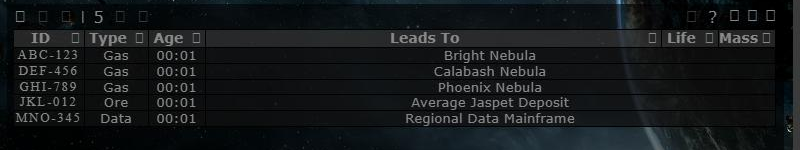
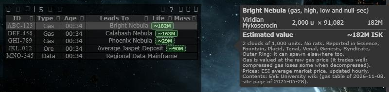

# Site value for k-space gas and ore

**Date:** 2026-11-21

## Description

The site value chip (wormhole gas and ore, PR #165) now also covers k-space gas sites (every Mykoserocin and
Cytoserocin nebula, such as "Bright Nebula" and "Calabash Nebula") and k-space ore sites (anomalies, including pasted
ones, and ore signatures). Asked for after a low-sec system (Old Man Star, Essence) showed two nebulae without a value.

## Before / After

| Before | After |
| --- | --- |
|  |  |

## Settings

No new toggle: the existing Settings > Signatures row "Site value" (`options.siteValues.enabled`, on by default) covers
these sites. Its text ("gas, ore, relic and data sites") already names them, so it is unchanged.

Tip: none. The chip is visible on the row and its tooltip explains it.

## Change

- **K-space gas (63 sites).** Contents from EVE University's [Gas cloud harvesting](https://wiki.eveuniversity.org/Gas_cloud_harvesting)
  table (revision of 2026-11-08) and each nebula's own page; gas type IDs and volumes (10 m3) from the SDE (ESI
  `/universe/types`).
  - 16 Mykoserocin nebulae (small: 2 x 1,000 units; large: 3 x 2,000 units): `verified`. The table and every site
    page agree, and every page was edited after CCP doubled the gas in December 2021 (2022-2026). Tooltip: clouds, "No rats" and "Not in deadspace" only where
    the site page says so (several pages say "?" for deadspace), and the regions of the gas table and the site page
    merged (Calabash: Domain, Genesis, Placid, Solitude, Fountain, Essence, Syndicate, Outer Ring, Venal).
  - 47 Cytoserocin nebulae: `approximate` (dashed chip). Tooltip: clouds, rats, deadspace and the location (one
    region/constellation per gas). Cloud damage is given as a figure only where the gas table and the site page agree;
    where they differ (Leopard 1400 explosive / 700 thermal, Hazy, Hidden, Whirling, Massive, Glistening, Red Dragonfly)
    the tooltip gives both, and where the page only says "thermal" or "Yes" (Goose, Icy, Pale, Polar Bear, Murky) it
    says the cloud is unstable without a figure. CCP doubled all cytoserocin and mykoserocin in Version 19.11
    (2021-12-07, [patch notes](https://www.eveonline.com/news/view/patch-notes-version-19-11)), and many cytoserocin
    pages still carry the wiki's "review quantities due to 19.11" banner. Where the table and the page disagree (Emerald,
    Bandit, Rocky, Dewy, Foggy, Shimmering, Swarm, Lion, Shiny, Gaseous, Wispy), the data keeps both,
    `[typeID, [low, high]]`, and the chip shows a range ("~120-240M") with the reason; each page's walkthrough text was
    checked against its summary box. Red Dragonfly Nebula: 9,000-18,000 (the table says 18,000; the page's walkthrough
    one cloud of 9,000, from before the 19.11 doubling; its summary box 1,000 + 2,000, which contradicts the
    walkthrough). Pale Nebula: page only (the table has an unknown cloud). Moth Nebula: table only (no page; its source
    is the gas table). Glistening Nebula: 6,000 (the table's total of 3,000 contradicts its own 3,000 + 3,000 clouds and
    the page).
  - Priced as **raw** gas: it trades well (Jita 2026-11-21: Viridian Mykoserocin ~41k units a day raw vs ~30k
    compressed), and compressed gas (1 unit per unit, 1/10 of the volume) loses some on decompression (EVE University,
    Compression). The tooltip says so.
  - Not covered: the career-agent "Gas Training Sites" (unlimited Azure Mykoserocin, no clear scanner name), and
    Gamboge/Chartreuse Cytoserocin (in no listed site, no market price). No Pochven gas sites are documented.
- **K-space ore (54 sites, 33 with a value, counting the wormhole W-Space Blue A0 anomaly that belongs with them).** Contents from each site's EVE University page, read by a script that
  keeps a page only when every ore row adds up (units x the SDE volume = the m3 the page lists, within 2%).
  - With a value (`approximate`, dashed; tooltip: "from one EVE University page (usually one player's scan of the site)"):
    high-sec Hidden Omber, Empire Border Rare Asteroids; low-sec Average Jaspet,
    Small/Average/Large/Hidden Gneiss, Small/Average/Hidden Dark Ochre and Gneiss, Small Crokite and Dark Ochre,
    Large/Hidden Crokite, Dark Ochre and Gneiss, Small/Average/Large Hedbergite, Hemorphite and Jaspet, Mordunium
    Deposit, Veiled Asteroid Field; null-sec Griemeer, Kylixium and Large Kylixium, Ueganite and Large Ueganite,
    Nocxite, Large Veldspar, Hezorime and Large Hezorime, Small/Average/Large Mercoxit, Interstitial Ore Deposit,
    Nullsec Blue A0 Rare Asteroids; wormhole W-Space Blue A0 Rare Asteroids. Each names its page date (2024-04 to 2026-06).
    Where a page marks single amounts with `{{verify}}` (Average Dark Ochre and Gneiss, Large Crokite, Dark Ochre and
    Gneiss, Large Gneiss), the tooltip says which ones. Where a page's summary counts the II/III-Grade ores in the
    base-ore rows (Large Hezorime, Large Kylixium, Large Ueganite, Large Veldspar), the tooltip says they are valued as
    the base ore; where a page also has a per-grade breakdown, the breakdown is used. Every ore page was checked for a page-wide "update" banner.
  - "?" with the reason (sites miners look for, but no usable figures): Small Kernite and Omber and Average Omber (their
    pages, edited after Catalyst brought the sites back in November 2025, carry the banner "Numbers need to be
    verified"), Small/Large Omber and Average/Large Kernite and Omber (figures from before Catalyst), Small Mordunium, Enormous Mercoxit and the
    pages EVE University doesn't have (amounts TBD or no page), Large Dark Ochre and Gneiss (rock counts only), and
    pages whose figures don't add up (Average Crokite and Dark Ochre, Small Crokite, Dark Ochre and Gneiss, Average
    Omber, Dark Ochre and Gneiss, Large Griemeer, Large Mordunium, Veldspar Deposit, Small Hezorime), Small Ueganite
    (page says outdated), Nullsec Border Rare Asteroids (one amount unknown).
  - No chip: the null-sec Arkonor/Bistot deposits and Asteroid Clusters (EVE University: pre-Equinox sites), Pochven
    "Border/Internal/Home <ore> Field" sites (no figures), removed high-sec sites (Hemorphite, Jaspet and Kernite;
    Spodumain, Crokite and Dark Ochre). Ice is out of scope (not asked for, and ice belts are not signatures).
  - Ore variants are their own types (II/III/IV-Grade), each priced as its own compressed grade. Pages written before
    the Catalyst rename (November 2025) use the old names; they map by EVE University's "Pre Catalyst ore variant
    names" table (+5% = II-Grade, +10% = III, +15% = IV), which the SDE descriptions confirm (17426 "Arkonor III-Grade":
    "Prime arkonor is ...").
- **Wormhole ore gaps.** Shattered Debris Field now has a value (`approximate`): its "pre-2024 names" are the
  pre-Catalyst variant names above (Prime Arkonor = Arkonor III-Grade, Monoclinic Bistot = Bistot III-Grade, ...).
  Infrequent Core Deposit stays `unverified`: its page still says its quantities predate the 19.11 changes.
- **Prices.** The stored fallback prices are one new ESI `/markets/prices/` `average_price` snapshot of 2026-11-21 for
  every type (the relic test's expected Sansha Monument value moves from 26M to 27M with it). The server's hourly copy
  already reads every type in `sites.json` (now 251 wanted, 238 with an ESI average), so `market_prices.inc.php` is
  unchanged; `tests/market_prices_test.php` checks the new gas and compressed ore types.
- **Code.** `app/js/fork/site-values.js`: a contents row may give `[low, high]` units (estimate `low`/`range`, chip and
  tooltip show the range); the tooltip shows a site's `where` and `note` and its source date, keeps the wormhole gas
  Sleeper note for wormhole sites only, and has a k-space ore approximate note and a raw-gas price note.
  `public/site-values/sites.json`: `kspaceAbout`, 3 sources, 104 types, 117 new sites and the Shattered Debris Field
  entry replaced. Tests in
  `app/js-test/fork/site-values.test.js`.
- Upstream files touched: none. No new hosts: the research read EVE University, CCP's patch notes and ESI by hand; the app
  still only calls ESI through the existing server copy.
