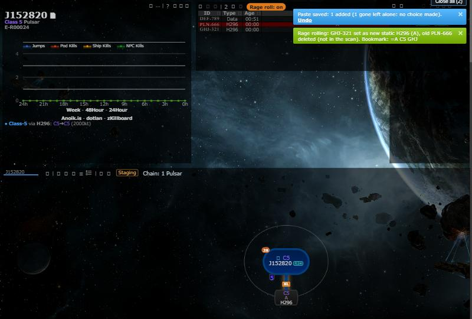

# Rage rolling mode

**Date:** 2026-11-22

## Description

While a group rolls its home static over and over, each roll leaves a new wormhole to scan and fill in. With the new
Rage roll switch on, Tripwire takes the new unknown wormhole you paste for the new static: when the paste leaves the
static's slot empty (the paste preview's Apply deletes the old static and adds the new hole in one go) it sets the
hole's type (H296, far side C5) and its static letter (A), and shows the bookmark text.

## Before / After

Home J152820 (C5, static H296): the old static A was rolled; a probe scanner paste with the paste preview's Apply
deletes it and adds the new hole.

| Before | After |
| --- | --- |
|  |  |

Before, the new hole stays `???` with no name. After, with Rage roll on (orange chip in the Signatures panel's
header), it is the new H296 named A, with a toast "Rage rolling: KLM-222 set as new static H296 (A). Bookmark: =A C5 KLM".

## Settings

- The mode is per user and **off by default** (it guesses): the "Rage roll" chip in the Signatures panel's header (only
  in a home system with a static) or the command palette (Rage rolling on / Rage rolling off). It switches itself off
  after 3 hours. Stored in `options.rageRollingMode` = `{on, since}`.
- Toggle: Settings > Wormhole Jumps & Mass > Rage rolling button (`options.rageRolling.enabled`, on by default) hides
  the chip (and turns the mode off). Added to the mask-default allow-list (`maskDefaults.ALLOWED`,
  `MASKADMIN_DEFAULTS_ALLOW`); the mode itself is a separate key so a mask default never switches anyone's mode on.
  Settings > Reset removes both keys.

Tip: yes (easy to miss). One toast when you mark a home static as rolling (Mark rolling, rolling.js) while the mode is
off, with "Turn it on". New hint event `rolling.marked` {wormholeID}, emitted from `holeRolling.set`.

## Change

- New `app/js/fork/rage-rolling.js` / `app/css/fork/rage-rolling.css`. Pure `rageRolling.plan()` decides which new hole
  becomes which static (mocha-tested in `app/js-test/fork/rage-rolling.test.js`).
- Home = the root of any of the user's chain tabs, with at least one static. A static slot is empty when no wormhole
  sig there has the static's type on its own side and no sig of unknown type holds its reserved name (A for static #1,
  from Statics get the first letters; with that setting off only the type counts). A K162 or other known type named A
  (old data) doesn't hold the slot. Nothing happens while the old static is listed.
- Candidates: the wormhole sigs one save of ours added (or turned into wormholes), in the order they were sent (= paste
  order); only unnamed, no type on this side (not K162), far side in the list and unknown. They count only at the check
  right after that save: the slot was already empty, or the same save emptied it. A hole pasted while the old static was
  still listed is dropped, so it is never filled when the old static is deleted later (it could be any K162 that came
  in meanwhile). With more eligible new holes than empty slots the first ones in paste order are picked and the toast
  says so in yellow ("2 new holes: picked the first, check it"). Two empty statics take the next new holes in order.
  Only the client that saved acts, so two clients never fight.
- The fill (`rageRolling.fillPayload`, tested against the Sig dialog's update shape) is one update request ~1.2 s after the save (the signature list only redraws an edit made in a later second),
  sets the wormhole type and parent like the Sig dialog does, the far side's class (Class-5 for H296), and the name only
  while Suggest hole names is on. It is an Undo step; an undone fill is not redone in that session.
- The bookmark string (mask template) is copied when the browser allows it outside a click; otherwise it is in the toast.
- Usage: `rageRolling.turned_on`, `rageRolling.filled` (new catalog entry `rageRolling`, commands `rageRolling.on/off`).
