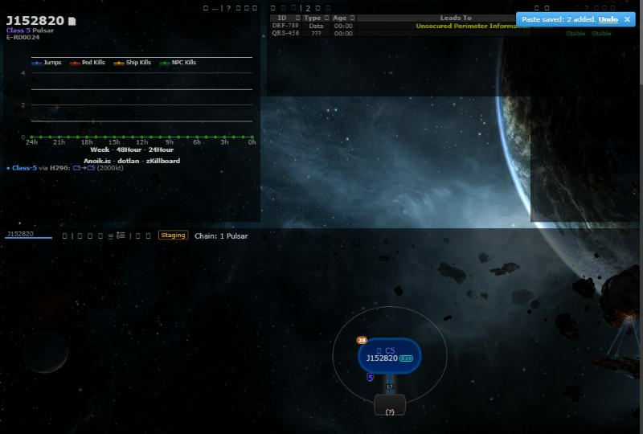

# Rage rolling mode

**Date:** 2026-11-22

## Description

While a group rolls its home static over and over, each roll leaves a new wormhole to scan and fill in. With the new
Rage roll switch on, Tripwire takes the new unknown wormhole you paste for the new static: when the pasted scan no
longer has the old static's signature, it deletes the old static, sets the new hole's type (H296, far side C5) and its
static letter (A), and shows the bookmark text.

## Before / After

Home J152820 (C5, static H296): the old static A was rolled; a fresh probe scanner paste (the paste preview's
10 s auto-save, which leaves gone sigs alone) has the new hole and not the old static.

| Before | After |
| --- | --- |
|  |  |

Before, the new hole stays `???` with no name and the old static stays listed. After, with Rage roll on (orange chip in
the Signatures panel's header), the new hole is the new H296 named A, the old one is deleted (red row), with a toast
"Rage rolling: GHJ-321 set as new static H296 (A), old PLN-666 deleted (not in the scan). Bookmark: =A C5 GHJ".

## Settings

- The mode is per user and **off by default** (it guesses): the "Rage roll" chip in the Signatures panel's header (only
  in a home system with a static) or the command palette (Rage rolling on / Rage rolling off). It switches itself off
  after 3 hours. Stored in `options.rageRollingMode` = `{on, since}`.
- Toggle: Settings > Wormhole Jumps & Mass > Rage rolling button (`options.rageRolling.enabled`, on by default) hides
  the chip (and turns the mode off). Added to the mask-default allow-list (`maskDefaults.ALLOWED`,
  `MASKADMIN_DEFAULTS_ALLOW`); the mode itself is a separate key so a mask default never switches anyone's mode on.
  Settings > Reset removes both keys.

Tip: yes (easy to miss). One toast when you mark a home static as rolling (Mark rolling, rolling.js) while the mode is
off, with "Turn it on". New hint event `rolling.marked` {wormholeID}, emitted from `holeRolling.set`.

## Change

- New `app/js/fork/rage-rolling.js` / `app/css/fork/rage-rolling.css`. Pure `rageRolling.plan()` decides which new hole
  becomes which static and which old static it replaces (mocha-tested in `app/js-test/fork/rage-rolling.test.js`).
- Home = the root of any of the user's chain tabs, with at least one static. A slot's holder is a wormhole sig there with
  the static's type on its own side, or a sig of unknown type holding the static's reserved name (A for static #1, from
  Statics get the first letters; with that setting off only the type counts). A K162 or other known type named A (old
  data) doesn't hold the slot.
- The static rolled: `tripwire.pasteSignatures.parsePaste` (plain paste and paste preview both pass through it with the
  whole pasted text) records the scan's signature IDs; the save that carries the paste's new sigs (at once, or at the
  preview's Apply / auto-save) takes that scan along. A holder whose signature ID is missing from a full scan (it has a
  sig that was listed before, or the holders are the only sigs with an ID; holders without an ID never count) empties
  its slot: the fill request also deletes it (as "Click to delete missing sigs" would). The fill and the delete are
  one Undo step.
  A holder marked broken (`brokenHoles.ids`, e.g. Mark broken in the paste preview) is kept: the user chose to keep it.
  Recent pastes are kept per paste (`rageRolling.matchScan`: a save takes the newest scan that has all its new sigs),
  so a paste the preview refuses while one is open never takes the open preview's scan.
- Candidates: the wormhole sigs one save of ours added (or turned into wormholes), in the order they were sent (= paste
  order); only unnamed, no type on this side (not K162), far side in the list and unknown. They count only at the check
  right after that save, so a hole pasted while the old static was still in the scan is never filled later (it could be
  any K162 that came in meanwhile). The first ones in paste order are picked; when that is a guess (more new holes than
  empty slots, or other unknown holes listed in the system) the toast is yellow and says so ("picked the newest hole,
  2 unknown holes in this system, check it"). Only the client that saved acts, so two clients never fight.
- The fill (`rageRolling.fillPayload`, tested against the Sig dialog's update shape) is one request ~1.2 s after the
  save (the signature list only redraws an edit made in a later second): wormhole type and parent like the Sig dialog,
  the far side's class (Class-5 for H296), the name only while Suggest hole names is on, and the old static's removal.
  An undone fill is not redone in that session.
- The bookmark string (mask template) is copied when the browser allows it outside a click; otherwise it is in the toast.
- Usage: `rageRolling.turned_on`, `rageRolling.filled` (new catalog entry `rageRolling`, commands `rageRolling.on/off`).
