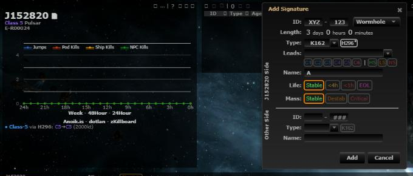
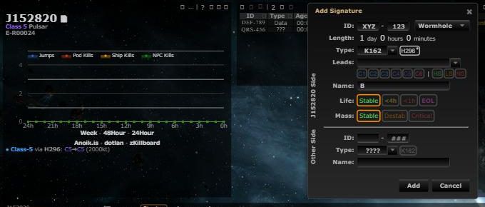

# Statics get the first letters

**Date:** 2026-11-22

## Description

Suggested hole names keep the first letters for a system's statics: in a C5 with an H296 static the H296 is always A,
and K162s, other types and holes without a type start at B. Before, holes were lettered in the order they were
bookmarked, so the static's letter changed from roll to roll.

## Before / After

Add Signature in a home C5 (J152820, static H296), a K162 picked as this side's type:

| Before | After |
| --- | --- |
|  |  |

## Settings

Toggle: Settings > Signatures > Statics get the first letters (`options.holeNaming.staticFirst`, on by default; off =
the old lowest-free-letter naming). The "Suggest hole names" row now keeps the sibling key when it saves
(it used to overwrite `options.holeNaming` whole). `holeNaming` is already a mask-default key, so both travel together.

Tip: none. The change shows in the Name field the user is already looking at when adding or editing a hole.

## Change

- `holeNaming.staticSlots` / `holeNaming.reservation`: each static (data order) reserves the first character of its own
  size pool after the path rule (letters for large statics, 6 for a medium one, 1 for a small one), not already
  reserved by an earlier static. Applies below any prefix: AA for the static of the C3 behind hole A.
- A static that is the hole we came in through (the incoming hole's type on this system's side is that static,
  `holeNaming.incomingType`) reserves nothing: a system reached through its own U210 static via hole B names its
  other holes from BA, not BB.
- `holeNaming.nextName(prefix, used, size, reservation)`: a static gets its reserved character while free; everything
  else skips the reserved characters and only falls back to them when nothing else is free. Without a reservation it
  works exactly as before.
- A second hole of a static type, or a static whose letter is already used by an old hole, is named like any other
  hole (we can't tell which one is the real static: the first one named keeps the letter).
- The Sig dialog uses only this side's type (not the far side's), so changing the type to or from H296 switches the
  suggestion while nothing was typed; the name-clash renames on save and after a race (`resolveConflict`,
  `raceRenames`) skip the reserved characters too.
