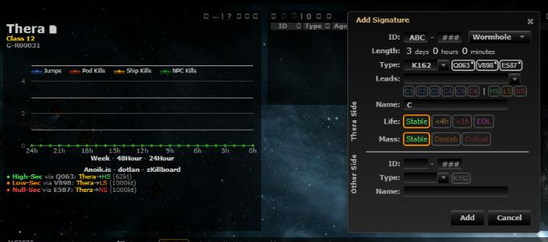

# Statics first: skip Thera and Drifter systems, at most three statics

**Date:** 2026-11-22

## Description

"Statics get the first letters" (#186) held a letter for every static the game data lists. Thera (3 statics)
and the Drifter systems (C14-C18, 6 statics each) would push every other hole down to D or G. They now hold no
letters, and any other system holds letters for at most its first three statics (shattered systems list up to three).

## Before / After

Add Signature in Thera, K162 (setting on):

| Before | After |
| --- | --- |
|  |  |

## Settings

No new toggle: this refines "Statics get the first letters" (Settings > Signatures), which still turns the whole
rule off.

## Change

- New pure `holeNaming.namingStatics(statics, systemClass)`: `[]` for class 12 (Thera) and 14-18 (Drifter systems),
  otherwise the first `holeNaming.MAX_RESERVED_STATICS` (3) statics.
- Hole naming and rage rolling both read their statics through it, so rage rolling never treats a Thera or Drifter
  system as a home with a static.
- Mocha: Thera, C14-C18, a shattered C2 with three statics (A, B, C; other holes from D), the cap, and no statics.
