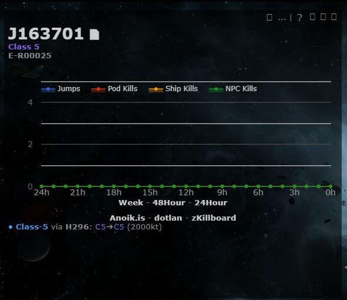
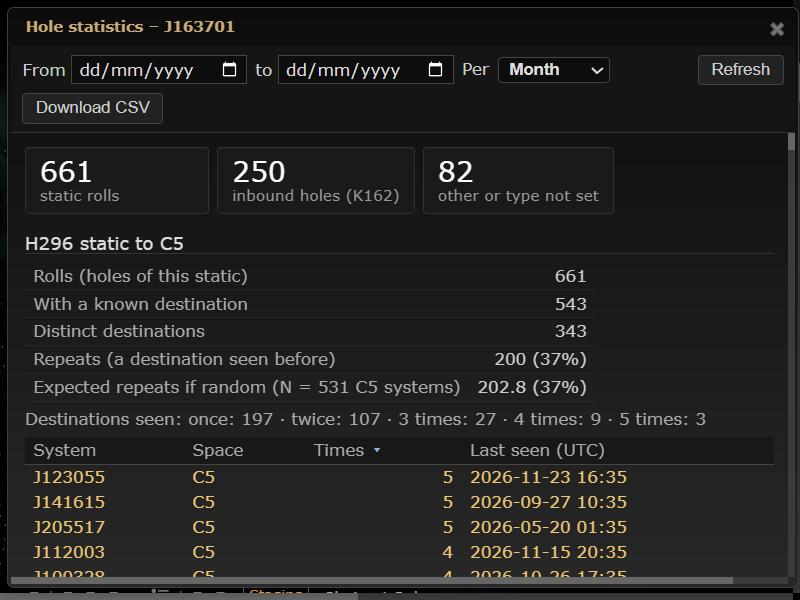
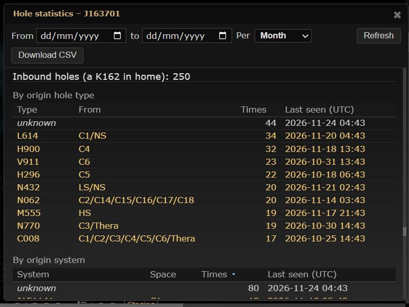
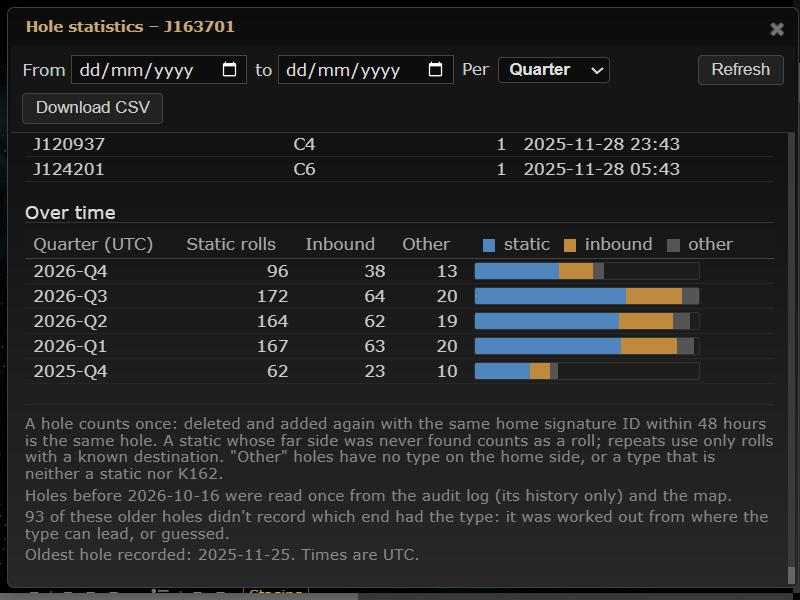

# Hole statistics

**Date:** 2026-11-25

## Description

A research window on how wormholes roll, for the mask's home system: how many times the home static rolled, how often
it landed in a system seen before (against what pure chance would give), and which holes open into home (inbound K162s
by origin type and system), per week, month, quarter, half-year or year. Every hole of home is now recorded server-side
for the whole mask, and the history is backfilled once from the audit log.

## Before / After

| Before | After |
| --- | --- |
|  |  |

| Inbound holes | Time breakdown (per quarter) |
| --- | --- |
|  |  |

## Settings

Toggle: Settings > Wormhole Jumps & Mass > Hole statistics button (on by default; `options.holeRollStats.enabled`). It
hides the System info link and the Ctrl+K command; recording is mask-wide and goes on either way.

Tip: none. The feature has a visible link in the System info panel of home and a Ctrl+K command.

## Change

- **Recording** (`holestats/holestats.inc.php`, 3 hook lines in `signatures.php`): every wormhole a request adds or
  changes with one end in the mask's home is saved to the new table `fork_hole_log` (`docker/sql/hole-log.sql`) when the
  request ends: home-side signature id and type, far system and type, first seen / last updated (UTC). Pastes, the Sig
  dialog, the automapper and undo all count. The same home-side signature id within 48 h = the same hole (re-pastes are
  merged). Rows are kept for ever. Classification (static roll / inbound / other) happens when the statistics are read.
- **Home** is the mask's home system of Mask Admin > Discord > Home system (no second setting); its help text there now
  says it is also Hole statistics' home.
- **Backfill** once per mask and home, the first time the window opens (stamp in `fork_hole_log_backfill`, marked done
  only at the end, a dead run taken over after 10 minutes; a re-run never duplicates): from the audit log's wormhole rows
  (adds, type/parent changes, far side found and its id set, signature id corrections, deletes, holes moved away; only
  rows that can concern home, newest 50,000) and the holes on the map now. Old audit rows don't record which end had the
  type: worked out from where the type can spawn and lead, else guessed (and flagged). Not reconstructable: anything
  older than the audit log's retention (60 days by default), holes added elsewhere and moved to home later, and on old
  rows a far end given its first id or system with no wormhole change while another hole of home also had no far id.
  From now on the audit log's wormhole rows also keep `parent` and the wormhole id (`wh`), so later backfills follow
  each hole exactly and need no guess.
- A hole's type is read as entered: a real type or `????` on one end makes the other end the K162, a typed `K162` is that
  end only, and a hole with no type (pastes, the automapper) is unknown on both ends, whichever end is home. A hole's
  first sighting is its home signature's creation, and only ever moves earlier.
- **Read endpoint** `public/hole_stats.php` (GET, session mask only, every member): the home and its rows (at most 20,000).
- **Window** (`app/js/fork/hole-roll-stats.js`, `app/css/fork/hole-roll-stats.css`): per static: rolls, known
  destinations, distinct, repeats and expected repeats if random (N = systems of the static's destination class: exact
  class for J-space, so Thera, C13 and Drifter systems are separate pools and shattered C1-C6 count with their class;
  k-space without the Jove regions and Zarzakh), a times-seen histogram and a sortable destination table; inbound holes by
  origin type and system (2+ highlighted); a timeline per week (ISO) / month / quarter / half-year / year; date range;
  Download CSV (in the browser, no third-party host).
- Usage: `holeRollStats.opened`, `holeRollStats.csv` and the `holeRollStats.open` command (catalog entry). Success signal:
  opened by >=25% of active users of masks with a home system by day 28; >=30% of openers open it again within 30 days;
  turned off by <10%.
- Tests: `app/js-test/fork/hole-roll-stats.test.js` (mocha), `tests/hole_stats_test.php`. Dev data:
  `docker/dev/seed-hole-stats.php`.
