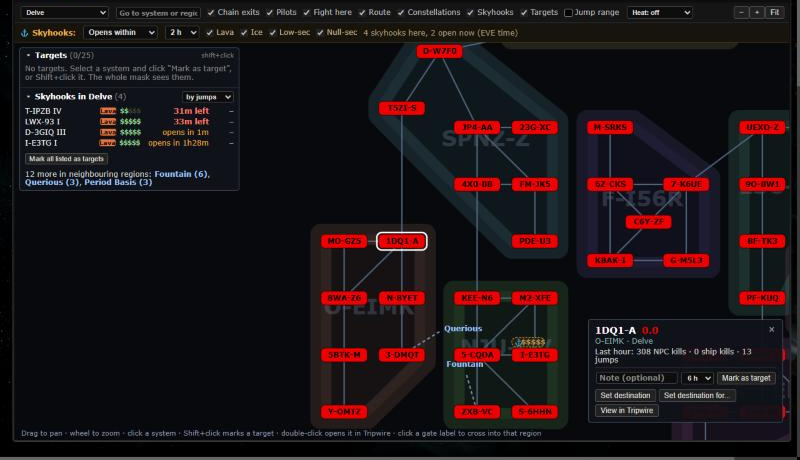
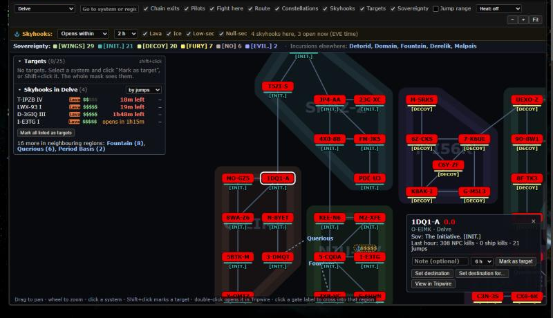
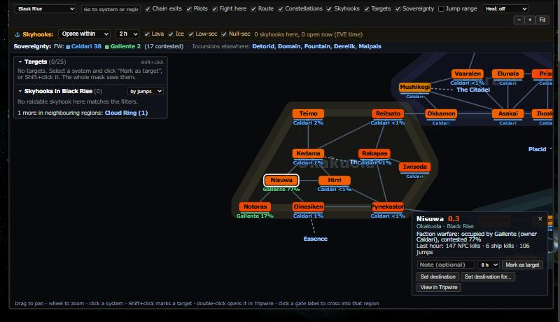
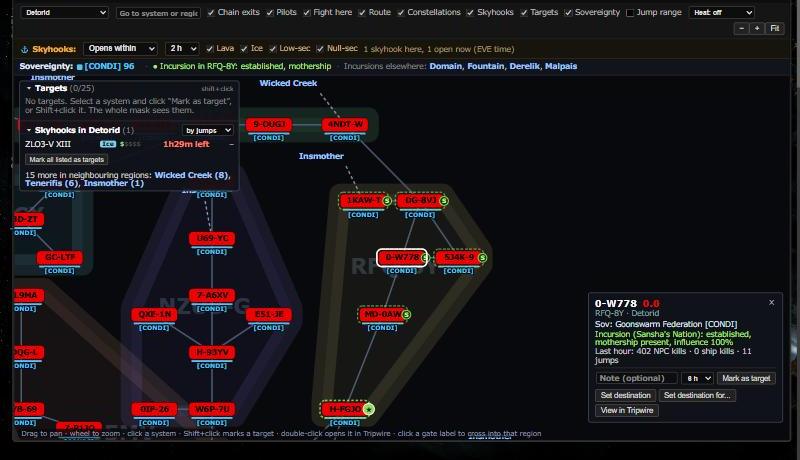

# Region map: sovereignty, faction warfare and incursions

**Date:** 2026-11-26

## Description

The region map has a new "Sovereignty" overlay that shows who holds each system: the sov-holding alliance's ticker in a
stable colour per alliance (so blocs show at a glance), NPC faction space, faction warfare occupiers with the contest
percentage, and Sansha incursions (infested systems ringed, the staging system starred). The original region map left
sovereignty out because Tripwire had no cached sov feed; this adds one, kept on the server for everyone.

## Before / After

| Before | After |
| --- | --- |
|  |  |

| Faction warfare (Black Rise) | Incursion (Detorid, RFQ-8Y) |
| --- | --- |
|  |  |

Before: Delve with no sign of who holds it. After: each box has the holder's colour bar and ticker underneath, the bar
above the map lists the region's main holders ([WINGS] 29, [INIT.] 21, ...) and links the regions with incursions, and
the card says "Sov: The Initiative. [INIT.]". Black Rise: FW occupier and contest per system ("Gallente 77%"), the bar
counts systems per occupier. Detorid: the infested constellation ringed in green with "S" badges, the staging system
with a star, and the card line "Incursion (Sansha's Nation): established, staging system, mothership present".

## Settings

Toggle: the map's own header checkbox "Sovereignty" (on by default), saved per user in `options.regionMap.overlays.sov`
like the other header toggles (a missing key means on; `regionMap` is already on the mask-defaults allow-list). No new
row in Settings: the existing region map rows (on/off, heat, jump ship) don't list the header overlays either.

Tip: none. The feature is a visible header toggle and bar on the region map, on by default.

## Change

- New `sovereignty.inc.php` + `public/region_sov.php?region=<id>` (session-gated, GET only): the server keeps one copy of
  ESI's public `GET /sovereignty/map` (1 h, ESI's own cache time; ETag through `esi/esi.inc.php`) and `GET /incursions`
  (10 min) in `cache/sov-map.json` / `cache/sov-incursions.json` for all users, refreshed under a lock (no stampede),
  with the old copy served and a 2-minute back-off when ESI fails or asks us to wait. The answer is the region's systems
  only (the system list is read from `public/region-map/<id>.json`), plus all current incursions (a handful).
- Alliance names and tickers are resolved server-side for the region's holders: one `POST /universe/names`, then
  `GET /alliances/{id}` (at most 40 per request, 6 s budget), kept a week in `cache/sov-alliances.json`. While some are
  still unnamed the answer says `pending` and the browser asks again after 20 s (at most 3 times). Browsers never call
  ESI for any of this. All calls go to ESI (CCP), no new third-party host.
- Faction warfare comes from the list Tripwire already loads (`cached_third_party.php?key=fw`, `app/js/fw.js`); FW
  systems show the occupier's colour and "Minmatar 37%" / "Amarr VULN" / "Caldari CAPT"; empire space outside FW gets
  only a thin faction-coloured bar, NPC null-sec its faction's name.
- The data is only fetched while the overlay is on or a system is selected (the card's line), at most every 10 minutes
  per region. If ESI or the endpoint is down the map works as before and the bar says what is unavailable.
- Not included: Angel / Guristas pirate insurgencies. ESI has no data for them (checked the OpenAPI spec and
  `/universe/systems/{id}`), so only Sansha incursions are shown.
- Files: new `app/js/fork/region-map-sov.js` (pure logic), `sovereignty.inc.php`, `public/region_sov.php`, tests
  `app/js-test/fork/region-map-sov.test.js` and `tests/sovereignty_test.php`; edited `app/js/fork/region-map-view.js`
  (overlay layer, bar, card and tooltip lines), `app/js/fork/region-map.js` (`sov` in `OVERLAYS`),
  `app/css/fork/region-map.css`, `public/fork/feature-catalog.json` (entry `regionMapSov`, PR number added with the PR).
